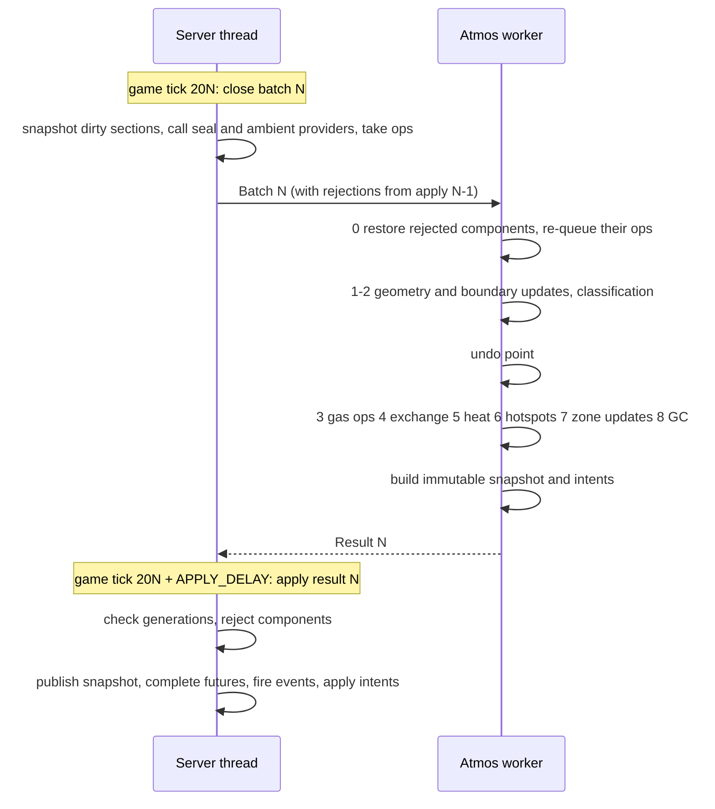

# ZAS³ architecture

**Status:** Draft, 2026-10-31 (Phase B). For review against the
`req-r1-baseline` requirements. The Phase B exit asks for this doc to be
accepted, the NFR numbers set, and the mixin list known.

**Inputs:**

- [requirements](requirements/README.md) (baseline `req-r1-baseline`)
- [plan](plan.md)
- [spike results](research/spikes.md) (S0–S5)
- [NeoForge 1.21.1 research](research/neoforge-1.21.1.md)
- [ZAS core notes](research/zas-core.md)

Each section ends with the requirements it serves. *Spike* marks a choice that
a measurement in [spikes.md](research/spikes.md) backs.

## 1. Overview

The world lives on the server thread; the simulation lives on a worker thread.
They exchange immutable messages once per atmos tick, and nothing else crosses
between them.

```
 server thread                                         atmos worker (per dimension)
 ─────────────                                         ────────────────────────────
 block-change hook ──► per-section dirty bitsets
 API / devices / breathing ──► op queue (seq-numbered)
 chunk load/unload ──► lifecycle events + saved shares
                                │
   every period (20 ticks):     ▼
   close batch: snapshot dirty sections,      ──Batch──►  restore rejected components
   seal providers, ambients, ops, events                  geometry phase (fills, splits, merges)
                                                          undo point
                                                          gas ops, exchange, heat, fire, reactions
   APPLY_DELAY ticks later (default 10):                  build immutable snapshot + intents
   validate generations, reject components,  ◄─Result──
   publish snapshot, complete futures,
   fire events, apply world intents
 ─────────────
 every tick, budgeted: hazards, airflow forces, client sync, (zas_atmos) devices
```

Requirements: D-30, CORE-045, CORE-049, CORE-069.

## 2. Modules and packaging

### 2.1 Gradle projects

| Project | Kind | Package root | Ships as | Depends on |
|---|---|---|---|---|
| `engine` | plain `java-library`, no Minecraft | `io.github.west3436.zas.engine` | classes copied into the `zas` jar | nothing |
| `zas-api` | ModDevGradle, `FMLModType: GAMELIBRARY` | `io.github.west3436.zas.api` | its own jar on Maven Central; nested (jar-in-jar) in `zas` and in consumers | Minecraft, NeoForge |
| `zas` | ModDevGradle mod `zas` | `io.github.west3436.zas` (excluding `.api`, `.engine`, `.atmos`) | `zas-<ver>.jar` | engine, zas-api |
| `compat-adastra` | ModDevGradle source set or project | `io.github.west3436.zas.compat.adastra` | classes inside the `zas` jar, loaded only when Ad Astra is present | zas-api, Ad Astra (compile-only) |
| `zas-atmos` | ModDevGradle mod `zas_atmos` | `io.github.west3436.zas.atmos` | `zas_atmos-<ver>.jar` | zas-api, `zas` (required at runtime) |
| `example-addon` | ModDevGradle mod | `io.github.west3436.zas.example` | not published; CI only (API-048) | zas-api only |

**Rules from S0** (*spike*):

1. **The API's Gradle project is named `zas-api`,** the same as the published
   artifactId. ModDevGradle writes a project dependency's jar-in-jar identity
   as `group:<project name>`. If that identity differs from consumers'
   `io.github.west3436:zas-api`, FML's `JarSelector` treats the two as one
   library (they have the same module name) and keeps whichever mod file it
   saw first. That silently downgrades consumers.
2. **The jar-in-jar range is declared by coordinates.** Use
   `jarJar('io.github.west3436:zas-api') { version { strictly '[<this>,<next major>)'; prefer '<this>' } }`
   plus a `dependencySubstitution` to `project(':zas-api')` in the `jarJar`
   configuration. ModDevGradle reads ranges only from module selectors.
   Consumers get the same snippet in the developer docs.
3. **`mods {}` lists the engine source set, never the API's.** The API loads
   as its own `GAMELIBRARY` module in dev and in production. Listing it in the
   mod splits its package across two modules and crashes the loader.
4. **The manifest of `zas-api`** sets `Automatic-Module-Name:
   io.github.west3436.zas.api`, `FMLModType: GAMELIBRARY` and
   `Implementation-Version`.
5. **No package exists in two jars** (D-15, D-38). The engine, the Ad Astra
   compat and the framework share the `zas` jar but keep separate package
   roots, so they can split into their own jars later.

**Why the engine is copied in, not nested.** It has no consumers outside
`zas`. Copying it keeps it out of jar-in-jar version selection and gives it
the `zas` module's access to Minecraft classes, which it must not use; that is
enforced by its own compile classpath (CORE-043). It stays a separate Gradle
project so its unit tests and benchmarks need no Minecraft.

### 2.2 Dependency directions

```
engine  ◄── zas ──► zas-api ◄── zas-atmos
                       ▲   ◄── compat-adastra (inside zas)
                       └────── example-addon, third-party mods
```

- `zas-api` never references `zas`, `engine` or any optional mod (API-003,
  API-044).
- `zas-atmos` uses only `zas-api` at compile time (D-50). It declares `zas` as
  a required runtime dependency, which proves the API is enough for tech mods.
- `engine` never imports `net.minecraft`, `net.neoforged` or
  `com.mojang`. An ArchUnit-style check in CI enforces this (CORE-043).

### 2.3 The engine/platform boundary

The engine sees the world only through these types, all in
`io.github.west3436.zas.engine` and all plain data:

| Type | Content |
|---|---|
| `GeometryPalette` | Dense table: geometry id → face masks (6 × 16×16 bits), volume, sub-cells with per-face footprints, flags (zone boundary, fluid, heat source). Built by `zas` from block states (§4.1). |
| `SectionSnapshot` | Section key, chunk lifecycle and block generations, `short[4096]` geometry ids or a compact palette-indexed form, plus per-position overrides (position-dependent shapes, seal providers) |
| `Ambient` | A dimension's ambient: partial pressures by gas id and a temperature; no gas is a vacuum (ENV-001, ENV-003). Built by `zas` from datapacks (`Ambients.ambient(dimension)`) |
| `Batch` | Atmos tick number; section snapshots; chunk lifecycle events with their saved shares; ambient definitions per dimension; queued operations with sequence numbers; rejections from the previous apply; config snapshot |
| `Result` | Atmos tick number; immutable zone snapshot table; per-component membership; per-operation outcomes; edge flow records (FLOW-001); world-write intents with the block generations they assumed; events; conservation ledger entries |

The platform (`zas`) converts Minecraft state into these types on the server
thread and turns `Result` back into world effects on the server thread.

*Implemented (#23):* `Batch` and `Result` are records in
`io.github.west3436.zas.engine.scheduler`. A `Batch` carries the atmos tick,
`SectionSource`s (captures decoded on the worker), chunk loads and unloads,
sections that couldn't be captured, the ambient, sequence-numbered `GasOp`s,
the previous apply's `Rejection` and `EngineSettings` (exchange settings and
the checker switch). A `Result` carries the `AtmosSnapshot` to publish, the
exchange `Component`s, per-operation `OpOutcome`s, `OpenAirEvent`s, the
conservation report, the sections the worker mirrors and the sections it
asks for. Saved shares, seal providers, edge flows and world-write intents
are added by the requirements that need them.

Requirements: API-001, API-003, API-007, API-044, CORE-043, D-15–D-17, D-38,
NFR-022.

## 3. The off-thread engine

### 3.1 Threads and ownership

- **One engine per dimension** (CORE-042). Engines run on a small dedicated
  daemon executor, `zas-atmos-N`, never `Util.backgroundExecutor()`. Its size
  is a COMMON config option, default 1 thread (NFR-005 is set against one).
  Dimensions are independent, so with more threads they run in parallel.
- *Implemented (#23):* `AtmosWorkers.create(n)` makes the pool;
  `worker_threads` in `zas-common.toml` sets n.
- **Ownership is exclusive:**

| State | Owner | Others get |
|---|---|---|
| Level, chunks, block entities, capabilities, attachments | server thread | nothing (CORE-049) |
| Persisted zone shares (chunk data tag `zas:atmos`) | server thread | copies inside `Batch` at chunk load |
| Op queue, dirty-section bitsets, chunk generations | server thread | the closed `Batch` |
| Published `ZoneSnapshot` table | server thread publishes; immutable | any thread may read it through a `volatile` reference (API-046) |
| Zone graph, mixtures, edges, membership, section mirror, pending shares | worker | the immutable `Result` |

*Spike (S5):* sharing the persistence store between the two threads was a
data race. The store is owned by the server thread, and the worker only ever
sees copies.

### 3.2 The atmos tick pipeline

The period T is 20 game ticks by default (CORE-041). Batch N closes at game
tick 20·N, at the end of `ServerTickEvent.Post`.



**Fixed-latency apply.** Result N is applied at game tick 20·N + D, with
`APPLY_DELAY` D = 10 ticks by default and required to be less than T, not
whenever the worker happens to finish. Inputs are fixed per batch and the
apply point is fixed in game ticks, so thread scheduling cannot change any
outcome.

- *Spike (S5):* threaded and inline runs of a 10-minute S-10-shaped scenario
  ended with bit-identical state (CORE-044, CORE-071).
- If the worker hasn't finished by the apply tick, the server thread waits.
  At NFR-005's 250 ms against D = 500 ms that should never happen. If it
  happens anyway, the wait is logged and counted by the profiler (OPS-004).
- A **single-threaded mode** runs the worker's tick inline when the batch
  closes and holds the result until the apply tick. Tests and the CORE-071
  equivalence harness use it. It is also a debug config option.

*Implemented (#23):* `AtmosService` (package `io.github.west3436.zas.simulation`)
runs the timing at the end of each server tick, level by level in the
server's order; `DimensionAtmos` holds one level's state; the protocol itself
is `DimensionPipeline` in the engine, so the whole close/apply cycle,
rejection included, runs in unit tests without Minecraft. `DimensionScheduler`
runs a `DimensionEngine` on the pool or inline (`single_threaded` in
`zas-server.toml`). `period_ticks` and `apply_delay_ticks` are server config;
a delay not shorter than the period falls back to the defaults (O-7).
Atmos tick numbers are a per-dimension counter. `AtmosService.tickNow(level)`
runs a whole atmos tick at once (apply anything in flight, close, apply), for
GameTests and commands. One deviation from the diagram: zones that
classification creates for zone triggers are created in phase 3 *before* the
undo point, like other geometry effects, so a restore never has to destroy a
zone; the triggering operation is re-queued and finds the zone.

**Latency.** A mutation's future completes at the apply tick: from 0.5 s
(the call lands just before a batch closes) to 1.5 s (just after) with the
defaults. That satisfies D-46's "at most one atmos tick" counted from the batch
that carries it.

Requirements: D-20, D-30, D-46, CORE-040, CORE-041, CORE-044, CORE-045,
CORE-046, CORE-047, CORE-071, NFR-005.

### 3.3 Staleness: two generations per chunk

Each loaded chunk carries two counters, kept in a server-side map (not an
attachment):

- **Lifecycle generation:** bumped when a chunk unloads.
- **Block generation:** bumped by the change hook on every write.

Both are opaque stamps from one per-dimension counter that never goes back
(`ChunkGenerations`), compared only for equality. An unloaded chunk drops
out of the map and reads as 0, so when it loads again it gets stamps it has
never had.

They are checked differently:

| Result part | Validated against | When stale |
|---|---|---|
| Zone mixtures (an *exchange component*) | lifecycle generation of every chunk the component spans | Reject the component: publish its previous snapshot, and tell the worker in the next batch to restore it from undo and re-queue its operations (CORE-070, CORE-074) |
| World-write intents (place or remove `zas:gas_fire`, light or extinguish, shatter glass, block damage) | block generation of the target's chunk | Drop the intent. The next tick re-derives it from fresh geometry. |
| Operation outcomes and futures | follow their component | Re-queued with the component |
| Events | follow their component | Not fired; they reappear when the work is redone |

- **Why block edits don't reject mixtures.** Block edits arrive in the next
  batch in order, so the worker's graph is always consistent with the world as
  of batch close. Rejecting on block edits would livelock a station that
  players are building in.
- **An exchange component** is the set of zones linked by edges that
  exchanged gas this tick. The worker computes it with union-find during phase
  4. Ambient edges don't link zones, because the ambient never changes
  (CORE-038). Restoring a whole component keeps conservation exact.
  *Spike (S5):* conservation stayed at 3e-14; without rejection it drifted by
  1.7e-3.
- **Undo point.** Each zone's mixture is copied after the geometry phase,
  before gas operations. Geometry effects reflect the world at batch close and
  stay; only gas operations, exchange, heat and reactions are undone.
- **Re-queued operations** go in front of the next batch's operations, sorted
  by their original sequence numbers.
- **Only unloads reject.** A paused zone doesn't change, so a chunk load
  during an in-flight tick needs no rejection. *Spike (S5):* counting loads
  as well doubled the rejections.

*Implemented (#23):*

- At batch close the pipeline records the lifecycle generation of every chunk
  holding a mirrored or captured section; the worker builds zones only there.
  At apply a component is stale if any of its chunks now has a different
  generation, or none was recorded.
- A component is the set of zones whose mixture differs bit for bit from the
  undo point, or that were destroyed since (merged or dissolved, CORE-076),
  linked when they shared a zone edge at the undo point. A zone that absorbs
  another inherits its edges, so every chain of exchange stays inside one
  component. Unchanged zones are in no component and need no check.
- The worker keeps the last tick's undo point: the membership table published
  at that point (an immutable `Membership`, §4.4, which later changes never
  touch) and a copy of each mixture. Restoring a component recreates its
  destroyed zones under their old ids from that table's cells
  (`ZoneGraph.restoreZone`, which moves cells back out of the zone that
  absorbed them) and copies the mixtures back (`ZoneGraph.restoreMixture`),
  before the ledger period begins, so the ledger needs no entry for it.
- The server thread publishes `AtmosSnapshot.withRejected(previous, zones)`:
  the new table, with the rejected zones and their positions answered from
  the previous one.

Requirements: CORE-036, CORE-048, CORE-070, CORE-074, D-43.

### 3.4 Server-thread work and budget

**Per batch (every T):**

- Snapshot dirty sections with `PalettedContainer#copy()` (*spike (S5):*
  0.3 µs per section). `SectionCapture` takes the copy; the worker decodes
  it into a `SectionSnapshot`.
- Evaluate position-dependent shapes and seal providers for dirty positions
  (API-028).
- Read ambient providers (ENV-015).
- Hand off the op queue (a list swap).

**Per apply:**

- Validate generations: O(chunks of components).
- Publish the snapshot: one reference swap.
- Complete futures and fire events: O(operations + events).
- Apply world-write intents.

*Spike (S5):* snapshot plus apply came to about 6 µs per atmos tick for S-10,
not counting devices, hazards or sync.

**Every game tick, under a budget:**

- hazard evaluation, staggered per entity (LIFE-033, LIFE-038)
- airflow forces from the last result's edge flows (FLOW-006, FLOW-013)
- client sync (DATA-014, DATA-015)
- `zas_atmos` steps devices once per atmos tick, spread across game ticks (D-31,
  D-50)

**The budget** (CORE-047, NFR-002) is one per-tick time limit, default 10 ms,
shared by all of `zas`'s server-thread work through a cooperative
`TickBudget`. Work that would exceed it carries over to the next game tick,
with one exception: the apply step itself is never split, so a result is
always applied atomically.

*Implemented (#23):* `server_budget_ms` (default 10) bounds atmos work per
game tick. Draining and capturing dirty sections is never deferred (it keeps
the worker's graph consistent with the world at batch close); the prefetch for
new zone triggers stops once the budget is spent, and those operations fetch
their sections a tick later. Applying is never split. Close and apply times
and waits for the worker are kept per dimension (`DimensionAtmos`) for the
profiler (OPS-004). The bench (NFR-002) is still to do.

Requirements: CORE-047, NFR-001, NFR-002, NFR-003.

### 3.5 Determinism rules (CORE-044, CORE-072)

- **Ordered iteration only.** No iteration over `HashMap`, `HashSet` or
  identity-keyed collections where order affects results. Use insertion-ordered
  primitive maps (as in the spikes), sorted arrays, or `LinkedHashMap`.
- **Ordered work items.** Every op carries a dimension-wide sequence number.
  Zones and edges are processed in id order. New zone ids come from a
  per-dimension counter.
- **Seeded randomness.** Random draws (hotspot spread, airflow jitter) come
  from a generator seeded by (dimension, atmos tick, zone id), never from a
  shared `Random`.
- **No wall-clock reads** in the engine.
- **Floating point:** `double` everywhere, the same order of operations in
  both modes, no parallel streams inside a tick. Java 17+ is strict IEEE by
  default.
- **Fault isolation:** an exception inside a dimension's engine pauses that
  dimension (D-55, NFR-014). The last published snapshot stays readable.

### 3.6 Fault isolation for third-party code

Seal providers, ambient providers, code reactions, hazard handlers and event
listeners run on the server thread inside a guard. The guard catches
exceptions, logs at most once per source per minute, and skips that source's
contribution for the tick (D-55, NFR-013). Code-defined reactions run on the
worker: API-020 implementations must be pure functions of their inputs, they
are guarded the same way, and the API documents them as worker-thread
callbacks.

## 4. Geometry, storage and persistence

### 4.1 Per-state geometry (GEO-001 to GEO-006, GEO-040 to GEO-043)

The geometry table is derived from collision shapes in an empty collision
context (GEO-041).

1. **Derivation.** For every block state, take its shape with
   `getCollisionShape(EmptyBlockGetter.INSTANCE, ZERO, CollisionContext.empty())`,
   then derive the geometry **once per distinct `VoxelShape` instance**
   (*spike (S2):* vanilla has 4,811 instances, taking 120 ms). Derivation runs
   at server start and again on `TagsUpdatedEvent`, on a background thread,
   and finishes before the first atmos tick. *Implemented (#24):* the
   shape-derived table is computed once per game session; distinct shape
   instances that rasterize to the same voxels share one derivation, which
   takes vanilla to about 60 ms and 303 geometries. Each reload only reapplies
   overrides. The lookup is `GeometryTable#geometryId(BlockState)` from
   `Geometries.table()` in `io.github.west3436.zas.geometry`, about 20 ns.
2. **Rasterization.** The shape is rasterized to 16³ voxels. Each face's
   coverage is its 16×16 boundary layer (GEO-003). Free space reaching a face
   is split into 6-connected components, the sub-cells (GEO-004), each with its
   volume (GEO-002) and per-face footprint. A volume in a fully enclosed pocket
   is ignored (GEO-001).
3. **Deduplication.** The results are deduplicated into a `GeometryPalette`
   (*spike (S2):* 287 unique geometries in vanilla), with a dense
   `int[] byStateId` indexed by `Block.getId(state)`. That is about 180 KiB for
   vanilla.
4. **Overrides and flags.** Datapack overrides (GEO-005, GEO-009), fluids
   (GEO-006) and zone-boundary tags (GEO-007) are applied over the derived
   geometry. Each produces a new palette entry, a single cell. Overrides are
   JSON files at `data/<namespace>/zas/geometry_overrides/<path>.json`:
   `blocks` (block ids, or tags prefixed with `#`; unknown ones are skipped),
   `sealed_faces` (any of `down`, `up`, `north`, `south`, `west`, `east`;
   default none) and `volume` (litres, 0 to 1,000). A block named directly
   beats a tag match; between equals, the file whose id sorts last wins.
5. **Position-dependent states** (*spike (S2):* 32 in vanilla, found by
   comparing shapes at two positions) and seal-provider blocks (API-023) are
   flagged. Their geometry is computed per position on the server thread when
   a snapshot is taken, and travels in `SectionSnapshot` overrides (GEO-043,
   API-028).
6. **`dynamicShape` blocks** (179 vanilla states, including moving pistons and
   shulker boxes) use the geometry of their settled state (GEO-042), from a
   data table of state → settled state.

**The seal test** between two cells in adjacent positions: the shared face is
gas-tight wherever `coverage(a, d) | coverage(b, d.opposite())` is full.
Sub-cell to sub-cell connection requires their footprints to overlap on an
uncovered part of the face (GEO-003, GEO-004).

### 4.2 Change detection (GEO-010 to GEO-014)

- **One mixin:** inside `LevelChunk#setBlockState(BlockPos, BlockState,
  boolean)`, wrapping its call to `LevelChunkSection#setBlockState`, on server
  levels only, when the stored state changed. *Spike (S1):* the method sees
  every source tested, including direct chunk writes that
  `onBlockStateChange` misses. Its cost doesn't show above noise. Wrapping the
  section write rather than injecting at RETURN also catches writes where the
  method returns `null` because `onRemove` replaced the block again.
- **The hook only enqueues** (`ChangeTracker`). It bumps the chunk's block
  generation on every write and, if the geometry id changed, sets a bit in a
  per-section dirty bitset (64 longs, allocated lazily, `DirtySections`),
  which coalesces for free (GEO-012). *Spike (S1):* sorting a queue cost 20 ms
  per 100,000 changes, which is too slow for explosion bursts. Off-thread
  writes go to a concurrent queue that is folded in on the server thread
  before any query and at the end of each server tick. A chunk's dirty bits
  are dropped when it unloads.
- **Locality filter (GEO-011).** In the hook, a write that keeps the geometry
  id (stone to cobblestone, air to a torch) sets no dirty bit. At batch close
  the scheduler drains with the set of sections that hold zoned cells, border
  a zone, or contain a pending classification, and only those are
  snapshotted (`ChangeTracker.drain(level, interest)`). All other dirty bits
  are cleared without work. Drains come out sorted by section x, z, then y.
  *Implemented (#23):* the interest set is the sections the worker mirrors,
  from the last applied `Result`; as §4.3 says, those are exactly the sections
  holding or bordering zoned cells or a pending classification.
- **Hardcore zone triggers (CORE-056).** *Implemented (#64):* the hook also
  reads a flag per block state (`TriggerStates`, rebuilt from
  `#zas:combustion` and `#zas:plants` whenever the server binds tags). A write
  whose new state has a flag the old one lacked starts a trigger: a fire
  starting, a fuel block being lit, a plant being placed. If the trigger's
  preset option is on, the position goes into that trigger's per-section bitset,
  which coalesces like the dirty bits and is dropped when its chunk unloads.
  Any other write costs two more array reads, and the preset is read only for a
  write that starts a trigger. At batch close `DimensionAtmos` drains the
  triggers. It queues one operation per trigger that moves no gas and may form
  a zone, at the cell a mutation at the block's centre resolves to (§6.5), and
  skips cells the published table already zones. From there it is like any
  zone-forming operation (§4.3).
- **Revalidation on load (GEO-013).** When a chunk with saved zone data loads,
  all its non-empty sections are snapshotted and the worker compares them with
  saved membership. `markDirty(level, pos)` (GEO-014) sets the dirty bit and
  forces re-evaluation of position-dependent overrides.

### 4.3 The worker's section mirror and classification (GEO-020 to GEO-028)

**Section mirror.** The worker keeps decoded `short[4096]` geometry-id arrays
for the sections it needs:

- sections holding zoned cells or bordering them
- sections of pending classifications

A mirror entry is replaced when a newer snapshot of that section arrives, and
dropped when its chunk unloads or nothing needs it any more. At 8 KiB per
section, S-10's station needs about 1–2 MiB.

**Classification is triggered,** never a scan (CORE-051, CORE-054):

1. **Prefetch.** An operation that can create a zone (CORE-055, CORE-056)
   makes the server thread snapshot the non-empty, loaded sections within
   3 sections of the target at the next batch close. Most enclosures under the
   65,536-cell cap fit inside that 7³-section cube (about 100 µs of copying in
   the worst case).
2. **The fill** runs on the mirror (GEO-022). It first does the GEO-021 column
   check (*spike (S3):* 0.7 µs), then the bounded fill (*spike (S3):* 5.5 ms at
   the cap). Possible outcomes:
   - **Enclosed:** the zone is created in phase 3 and the buffered operations
     apply (GEO-028).
   - **Open:** the gas goes to the ambient and is reported (CORE-053).
   - **Unresolved:** the fill reached an unloaded chunk (GEO-024).
   - **Needs more sections:** the fill reached a loaded section the mirror
     doesn't have. The worker asks for those sections in its result, the next
     batch carries them, and the fill reruns. Operations stay buffered, so a
     large or thin enclosure takes one or more extra atmos ticks.
3. **Cache.** Cells classified open are cached per section until a dirty bit
   in that section clears the entry (GEO-027).

*Implemented (#23):* the mirror is `SectionMirror`; `EnclosureClassifier`
wires `engine.classify` (#26) into the scheduler through the `Classifier`
seam, and `SectionTopology` over the mirror is also the zone graph's topology.

- **Geometry phase.** A new snapshot of a mirrored section is compared with
  the old one; the cells of every changed position are refreshed first, then
  those of its six neighbours, so a filled cell's gas stays in its zone before
  a split is found. A newly mirrored section refreshes the cells on its faces
  that border zoned sections.
- **Prefetch** happens only when the target's section isn't mirrored; a target
  in an unloaded chunk is unresolved straight away.
- **Missing sections.** A fill that reaches sections the mirror lacks splits
  them: those of unloaded chunks (known from unload events and from requests
  that couldn't be captured) make the region unresolved; the rest are asked
  for in the `Result`, and the operation waits. Held breaches are classified
  again every tick.
- **Retention.** After each tick the mirror keeps sections holding zoned cells
  and their six neighbours, and drops the rest; while any classification waits
  for sections it drops nothing, so repeated rounds always make progress.
- **Unresolved operations** act as at a paused zone (GEO-036, GEO-038): an
  addition is voided and a removal is supplied from the ambient; the API
  reports `PAUSED`, and the ledger keeps both (§4.6).

**Engine implementation (R0).** The pure logic is in
`io.github.west3436.zas.engine.classify`; the scheduler owns the mirror and
drives it.

- `SectionTopology` is the `CellTopology` over the mirror: a read-only adapter
  around a section lookup (null means not in the mirror) and the geometry
  palette. Cell ids (`CellIds`) pack 26 bits of x, 26 of z, 10 of y and a
  2-bit sub-cell index into a `long`: x and z cover Minecraft's whole world
  (−30,000,000 to 29,999,999, past the world border at ±29,999,984), y runs
  from −512 to 511, and a block has at most 4 cells, the most any vanilla
  shape has (crossed panes, fences and walls; the `geo_004` GameTest checks
  every vanilla state). Faces leading outside the build height, or beyond the
  ids' range, count as open (GEO-031's default). Through
  `ResolvableTopology` it also reports the faces that reach sections not in the
  mirror.
- `EnclosureFill` is the bounded fill: `Enclosed` (sorted cells and volume),
  `Open` (bound exceeded, or outside the world) or `Unresolved` with every
  missing section key. The fill can't tell an unloaded section from one the
  mirror hasn't been sent; the scheduler splits the keys into *unresolved*
  and *needs more sections*. *Measured:* 8.5 ms for a 65,536-cell fill with
  a `HashMap` lookup.
- `EnclosureZones` turns an enclosed region into zones, one per set of cells
  joined by direct openings, so a room behind an open door becomes its own
  zone rather than an ambient edge.
- `BreachResolver` finds the unzoned cells a refreshed change opened onto a
  zone and classifies each region, with zoned cells as walls: `Pocket` joins
  the zones (GEO-023), `Vent` needs nothing because the graph already counts
  the opening as an ambient connection (GEO-025), and `Hold` names the zones
  to pause and the sections to wait for (GEO-026).
- `PendingClassifications` holds operations by seed cell, in arrival order,
  until their region classifies, including across rounds that wait for
  sections (GEO-028).

**Cell-id layout** (*2026-10-31,
[#105](https://github.com/west3436/zas-cubed/issues/105), closing O-8*). The
ids used to pack 24 bits of x and z, 12 of y and 4 of sub-cell index, so
nothing more than ±8,388,607 blocks out could be zoned. The world border, a
datapack dimension's full height (−2,032 to 2,031) and even 2 sub-cells per
block don't fit one `long` together: 60,000,000² columns × 4,064 heights × 2
is about 2.9 × 10¹⁹, more than 2⁶⁴. Of the ways out:

- *Two `long`s per cell, or a block key plus a separate sub-cell index,*
  would change every set, map and neighbour list of cells in the fill, the
  zone graph and the snapshots, and add at least 8 bytes per stored cell to
  memory that is already over NFR-004's per-cell budget (#78).
- *A y offset per dimension* needs a layout per engine, threaded through every
  decode, and still can't hold a 4,064-high dimension; for a tall dimension
  centred on sea level it would keep the deep underground rather than the
  ground and sky.
- *Fewer y bits and sub-cell bits,* the layout chosen, keeps ids plain bit
  fields read with constant shifts, as before, so the fill and zone
  benchmarks are unchanged (S3 and S4 cases, [benchmarks](research/benchmarks.md)).
  Every vanilla dimension (−64 to 319, 0 to 255) fits, and so does every
  vanilla block's cells.

The order is the same as before: sorting ids as signed `long`s orders cells
by x, then z, then y, then sub-cell index (z's and y's negative values after
their positive ones). Since x and z stop short of what 26 bits hold,
`CellIds.NONE` (`Long.MIN_VALUE`) is never a cell, and is what `CellSpace`
returns for "no cell" (−1 is now a real cell). Chunk records moved to format 3;
formats 1 and 2 are still read, their cells converted, and any the new layout
can't name are left out with their gas kept in the share (§4.5). What the
layout gives up is O-11.

### 4.4 Zone membership and the zone graph (CORE-020 to CORE-039)

**Membership.** Each mirrored section with zoned cells has a `short[4096]` of
*local* indices plus a small palette from local index to zone id (0 means
unzoned). Positions with more than one sub-cell (panes, walls) keep a side
table keyed by packed position.

- **Merge** rewrites palette entries in the smaller zone's sections:
  O(sections). *Spike (S4):* the cell-list version took 0.15 ms for 24.5k
  cells, and the palette version is cheaper still.
- **Split** uses the interleaved searches from S4 (*spike (S4):* 2 µs for
  ordinary edits, 4.9 ms for the worst-case detour, 6.7 ms for a real 50k
  split). The cells of the split-off remnant get a new local index in their
  sections.
- **Zone records** hold: id (CORE-026), mixture, volume, the list of sections
  with per-section volume (needed for persistence shares), pins (API-017),
  flags (paused, breached), and edge references.
- **Edges** are keyed by (zone, zone) or (zone, ambient key) (CORE-030,
  ENV-016). They hold connection counts, the direct count (CORE-037) and the
  sleeping state (CORE-033). The connections themselves (cell faces) live in a
  per-edge list of packed face ids, so geometry changes can update counts
  without rescanning.

**Engine implementation (R0).** The zone graph is
`io.github.west3436.zas.engine.zone.ZoneGraph`. It runs on an abstract
`CellTopology` (cell volumes and open neighbours, each flagged direct or zone
boundary), so its tests need no geometry. Cells are `long` ids (in the world, `CellIds`;
see §4.3 for the layout and its range), the graph's own membership is
a primitive map from cell to zone, and every open pair of cells with at least
one zoned cell is stored on both cells, so edge counts follow joins, leaves,
merges and geometry changes without rescanning. A merge moves the absorbed
zone's edges onto the surviving zone as wholes, rather than recounting its
cells' pairs one by one. Every change to zoned gas is recorded in
`io.github.west3436.zas.engine.conservation.ConservationLedger` by category
(CORE-036, CORE-073).

*Implemented (#106, 2026-11-01):* the section palettes above are the
scheduler's membership, which the published snapshot reads.

- **Following the graph.** The graph reports every change of a cell's zone to
  a `MembershipListener`: a cell added, removed or resized, and a merge as a
  whole. `MembershipTracker` keeps one `SectionMembers` per section holding
  zoned cells: a `short[4096]` of local values, a palette of (zone id, cell
  count, volume) entries, and a side table, sorted by position, for positions
  whose zoned cells aren't just their first cell. A local value is 0
  (unzoned), a palette entry (only sub-cell 0 is zoned), or −1 (see the side
  table). A join, leave, fill or split changes one position and one entry; a
  merge renames the absorbed zone's entries in its sections, so it costs
  O(its sections), not O(its cells). Two entries may name one zone after a
  merge; an entry is freed when its last cell leaves.
- **Publishing.** `MembershipTracker.publish` returns an immutable
  `Membership`: the sections, ascending, and per zone its sections and the
  chunks they're in. Sections are copy-on-write: a published section is never
  changed again, and the tracker copies it (sharing the 8 KiB position array
  until a position changes) before its next change. So a table shares every
  unchanged section and zone record with the one before; publishing costs the
  changed sections plus copying two arrays of references, and a tick with no
  zone change publishes the same table again. The undo point and the snapshot
  each take a table (§3.3); `AtmosSnapshot` keeps it for lookups by position
  (`zoneAt`, the position's largest zoned cell, API-015), by cell
  (`zoneOfCell`, through the side table for sub-cells) and by chunk (saved
  shares, DATA-002).
- **Why this design.** The published table must be safe to read from the
  server thread while the worker moves on (API-046). Copy-on-write sections
  give that without locks and without copying what didn't change. The
  alternative of rebuilding a sorted table of every zoned cell at each change,
  as R0 first did, made a one-block edit in a 50,000-cell zone cost 3.6 ms on
  the worker and kept CORE-025's Bench from passing
  ([benchmarks](research/benchmarks.md#membership-palette-check-2026-11-01)).
- **Determinism.** Tables list sections and zones in ascending order, side
  tables are sorted, and hash maps are used for lookups only (§3.5). What the
  simulation reads back (the undo point's cells, each zone's chunks for
  pausing and storage, and which sections hold zoned cells for the mirror's
  retention) comes out in a fixed order.

**Memory** (NFR-004). Estimated before R0:

- 8 KiB per section that holds any zoned cell, about 2 B per position
- about 1–4 KiB per zone with its edges
- for S-10: about 100–300 sections × 8 KiB plus 100 zones × 4 KiB, which is
  about 1–3 MiB

*Measured 2026-11-01 ([#78](https://github.com/west3436/zas-cubed/issues/78),
closing O-4),* by retained size in the headless S-10 station
([benchmarks](research/benchmarks.md#membership-palette-check-2026-11-01)):
10.85 MiB in all. The palettes take 0.41 MiB (11 B per zoned cell; 37 B in
sparse 27-cell rooms), the section mirror 0.84 MiB (22 B; 69 B sparse), and
zones about 1 KiB each, as estimated. The estimate left out the zone graph's
cells: each cell's object, its stored connections and the cell map come to
189 B per zoned cell, 7.25 MiB, two thirds of the total. That is over NFR-004's
original 64 B per cell, which NFR-004 now revises to 256 B (accepted
2026-11-01); the total is well under its 64 MiB. Storing fewer pairs per cell
(for example, none for a cell whose six faces all open into its own zone) is
the lever if the per-cell cost ever matters.

### 4.5 Persistence (DATA-001 to DATA-016, D-54)

- **Chunk data tag `zas:atmos`**, a byte array in the chunk's own saved data,
  written at `ChunkDataEvent.Save` and read at `ChunkDataEvent.Load`. The
  bytes are a versioned, checksummed `ChunkRecord` (DATA-003). It holds:
  - per zone with cells in the chunk: the zone's persistent id, its cells
    there (sub-cells included, D-44; `CellIds` ids, whose layout changed in
    format 3, so older records are converted, §4.3), this chunk's share of its mixture
    (moles per gas, temperature) by volume, and every chunk the zone spans
  - block positions whose changes are held for a paused zone (DATA-010)
  - at shutdown only, queued additions that target the chunk (DATA-011)
  - zone pins (API-018) once they exist (R1)
- **Shares are written at chunk save.** They are computed on the server
  thread from the **published** snapshot (moles × this chunk's volume ÷ zone
  volume). Nothing is written per tick; chunks whose share changed are marked
  for saving at each apply, so autosaves pick them up. Only the published
  snapshot is ever saved, which is why an in-flight tick must be rejectable
  (§3.3).
- **Saved shares are authoritative only while their zone is not in memory.**
  When a chunk loads, the server thread copies its record into the next batch,
  with the sections its cells are in and their neighbours. If the zone is in
  memory with cells in that chunk (it was paused, so it hasn't changed), the
  worker ignores the share. Otherwise the share's cells and gas join the zone
  with that id, which is created if needed (`ZoneGraph.loadShare`). A zone
  built this way stays paused while any chunk its shares list is unloaded, so
  it is rebuilt a chunk at a time and holds the sum of its shares once complete
  (DATA-008, GEO-033). *Spike (S5):* conservation was exact across repeated
  unload and reload cycles.
- **Leaving memory.** Once every chunk a zone spans has unloaded, and no zone
  with a loaded chunk shares an edge with it, the worker drops it
  (`ZoneGraph.evict`); its state is in the chunks. Moving gas between memory
  and storage is the ledger's `STORAGE` category (CORE-036).
- **Rebuilt zones are checked against the blocks.** When a zone rebuilt from
  shares resumes, what its cells open onto is classified again (GEO-023,
  GEO-025, GEO-026), together with its saved held positions, so changes made
  while it was stored apply. Saved cells that are no longer cells are left
  out, and their gas stays in the zone (CORE-022). The zone stays paused until
  that classification finishes.
- **Records not yet taken in are kept.** A record the worker hasn't confirmed
  (its batch isn't applied yet), or that no engine has taken (the dimension is
  excluded, or its engine doesn't exist yet), is written back as it is.
- **Unloading.** At `ChunkEvent.Unload`, before the change tracker drops the
  chunk's dirty bits, the record is built and the chunk marked for saving;
  changed positions the worker hasn't seen, in sections it mirrors, are saved
  as held positions.
- **Shutdown** never waits for the worker: the tick in flight is abandoned and
  the last published snapshot is saved. Queued additions (including those
  re-queued under CORE-074, and those of the abandoned tick) are saved with
  their target chunk, or with the dimension if that chunk isn't loaded; they
  are queued again after load. Queued removals complete with nothing moved
  (outcome `PAUSED`); waiting additions are cancelled, their gas saved.
- **Level-wide state is tiny.** It is kept in a `SavedData`, `zas_atmos`, per
  dimension:
  - the zone-id counter, so saved ids are never issued again (CORE-026)
  - queued additions that couldn't be assigned to a loaded chunk
  - dimension pause flags (OPS-005) once they exist (R1)
- **Corruption** of a chunk's record (bad checksum, unknown version, another
  chunk's data, a bad value) resets that chunk's cells to unzoned, with one
  warning naming the dimension and chunk (DATA-004, DATA-013). The rest of the
  zone is rebuilt from its other chunks. Nothing is decoded while a chunk
  loads, so a bad tag can never stop it loading.
- **Removed gases.** A record lists the gas ids it was saved with and is
  remapped to the running gas set when decoded. Moles of a gas the set no
  longer defines (its datapack or mod was removed) are dropped from every
  share and queued addition; the rest of the record loads as it was
  (CORE-013). One warning per gas names the dimension, the gas, the amount,
  the chunk and each zone or queued addition that held it (CORE-016), and
  the chunk is marked for saving, so the next save writes it without the gas.
  The ledger never sees the dropped moles: they leave before the record
  reaches the engine.
- **Derived state is rebuilt on load:** edges, the geometry palette,
  sub-cells and hotspots (DATA-009).
- **A geometry palette change rebuilds from the loaded chunks' records**, as a
  restart would. When `/reload` (or a mod change) changes the palette's
  contents, the dimension waits until no batch is in flight, builds each
  loaded chunk's record from the published snapshot (what a save would write),
  abandons the old engine without waiting for its worker, and hands the
  records to a new engine with the new palette through the path of a chunk
  load. The rebuilt zones classify their surfaces again, so blocks whose
  geometry changed are picked up. Unloaded chunks keep what they saved; zones
  across them stay paused until they load. Outstanding operations are queued
  again on the new engine with their futures kept, so no gas is lost. Zone
  ids and pins come back with the shares (O-10).

*Implemented (#27, #29):* `ChunkRecord`, `ZoneShare` and
`DimensionPipeline.recordFor` in `engine.scheduler`; the byte format is
`engine.persist.ChunkRecordCodec`, unit-tested without Minecraft; the platform
side is `io.github.west3436.zas.persistence` (`AtmosPersistence`,
`DimensionData`) and `DimensionAtmos`. GameTests can't unload chunks or
restart the server, so they use `DimensionAtmos.simulateUnload`,
`simulateLoad` and `simulateSave` and `AtmosService.stopForTest` and
`startForTest`, which run the same save code and byte format; the real chunk
events run whenever the test server saves or unloads, and at its shutdown. The GameTest server starts from a
fresh world each run, since saved zones would otherwise come back.

*Implemented (#104):* the palette-change rebuild is `DimensionAtmos.rebuild`,
using `DimensionPipeline.recordChunks` and `resubmit`. The records go through
the byte format, so a gas registry changed by the same reload is remapped as
after a restart. A faulted engine's outstanding operations aren't run again,
since their futures already failed. The `data_009_palette_change_rebuilds_zones`
GameTest changes the palette with `Geometries.overrideForTest`.

### 4.6 Paused zones (GEO-030 to GEO-038)

- **When a zone pauses.** The worker pauses a zone when any chunk its cells are
  in is unloaded, while it waits for chunks its saved shares list (§4.5), and
  when it opens onto a region whose classification is held at unloaded chunks
  (GEO-026): once only unloaded chunks stand in the way, and then through any
  rounds of fetching after they load. `ZoneView.paused` publishes it; the API
  reports `PAUSED`.
- **What a paused zone does.** It keeps its cells and mixture and publishes
  its last-known state (GEO-035). It doesn't exchange, merge or dissolve.
  Operations into it are voided, and draws from it are supplied at its
  last-known state, up to what it holds, without depleting it (GEO-036,
  GEO-038); the outcome is `UNRESOLVED` with the zone's id. An active zone
  across an edge exchanges with a copy of the paused zone's mixture, so it
  sees the last-known state too; that gas is the ledger's `PAUSED` category.
  Voided and supplied operation gas never touches zoned gas, so the ledger
  keeps it apart (`ConservationReport.voided` and `supplied`).
- **Held changes.** A changed position touching a paused zone (its cells or
  their neighbours) is held: the worker's mirror keeps the old geometry there
  and the latest capture of the section is kept, so the change applies, in
  order with everything else, once the zone resumes (GEO-037). Held positions
  are published in `Result.heldBlocks` and saved with their chunk (DATA-010).
- **Unloaded chunks in the mirror.** Sections of an unloaded chunk are kept
  while they hold cells of zones in memory, and dropped once they don't, with
  the zoned cells across their faces refreshed, so faces into unloaded chunks
  lead nowhere and fills reaching them are unresolved (GEO-024). A chunk that
  loads again has its mirrored sections captured afresh, so changes made while
  it was unloaded are found.
- **Never force-load.** The engine never adds chunk tickets (GEO-034): the
  platform only ever reads chunks with `getChunkNow`.

## 5. Services around the engine (server thread)

| Service | Input | Cadence | Requirements |
|---|---|---|---|
| Hazards and breathing | published snapshot, point lookup by entity eye position (API-015), life-support capabilities | staggered per entity (LIFE-007, LIFE-033), capped per tick (LIFE-038) | LIFE, D-27, D-47 |
| Respiration and photosynthesis | queue ops with source attribution | per breather or crop on its own cadence, aggregated per zone per atmos tick | LIFE-005, CONT-053 |
| Airflow | `Result` edge flow records | each game tick, entities within range of active edges only | FLOW-001 to FLOW-017 |
| Fire and fuel blocks | mixins (§7) query the published snapshot; worker intents place or remove `zas:gas_fire` | on vanilla ticks; intents at apply | FIRE-018 to FIRE-027 |
| Client sync | own-player state; nearby edge flows | ≤ 4 Hz on thresholds; ≤ once per atmos tick | DATA-005, DATA-014, DATA-015, D-53 |
| Devices (`zas_atmos`) | API queries and asynchronous mutations, one outstanding per port | once per atmos tick, spread across game ticks | D-31, D-50, CONT-006 |
| Commands, profiler, audit | published snapshot; audit requests a fresh snapshot of a region and diffs it on the worker | on demand | OPS-003, OPS-004, OPS-010, GEO-032 |

*Implemented (#30):* the `/zas` commands ([commands.md](commands.md)) read
the published snapshot and edit gas through the API. Anything that needs the
engine itself goes through `DimensionScheduler.inspect`: a read-only query
queued on the worker behind the tick in flight, with the next tick queued
behind it, so it never races a tick and the server thread never waits for it;
the result comes back with `server.execute`. In single-threaded mode the query
runs at once on the server thread, which then owns the engine. The geometry
audit (`GeometryAudit`) is one such query: the server thread captures the
region's loaded sections, skipping those with changes still queued, and the
worker compares them with the mirror, the zones' cells and edges, and a fresh
`EnclosureFill` per zone; its repair marks stale sections dirty, so the next
batch's geometry phase resynchronises them. The profiler (`AtmosProfiler`)
times each phase through the engine's phase listener on the worker, publishes
a finished tick's row with one volatile write, and keeps a 100-tick window on
the server thread; `AtmosService` keeps the server thread's per-game-tick time
for 1,200 game ticks (average and p99, NFR-001).

*Implemented (#31):* the operator debug overlay (CLIENT-005, CLIENT-011 to
CLIENT-013). `/zas debug <zones|edges|cells|hotspots|all|off>` needs the
`/zas` permission level (`ZasCommands::permitted`, OPS-011). Each server tick `DebugOverlay` (package
`io.github.west3436.zas.debug`) hands the boxes within 32 blocks of operators
with the overlay on to their dimension's `DimensionScheduler`
(`setDebugRegions`). Right after the next tick, on the worker,
`DimensionEngine.debugView` exports the zoned cells, the faces out of zones and
the cells of unresolved regions inside those boxes, capped, as an immutable
`DebugView`, so the server thread never reads the zone graph. A paused zone
(GEO-030: part of it in an unloaded chunk, or held at a breach into an
unresolved region) keeps its cells in memory, so they are exported like any
other. The unresolved cells are flooded from the seeds of breaches the
classifier holds (`Classifier.unresolvedSeeds`, GEO-026) and from gas
operations that landed in an unresolved region that tick. When a dimension
publishes a new atmos tick, each of its operators gets one
`DebugOverlayPayload`. It carries that export with zone pressures and the
paused flag from the published table (`ZoneView.paused`), and the block
geometry within 6 blocks of their eyes for the crosshair. The client draws
paused zones grey and unresolved cells magenta. Nothing is sent to anyone else (DATA-005). The
renderer is in `io.github.west3436.zas.client`, loaded through a
`@Mod(dist = Dist.CLIENT)` entry point, and draws on `RenderLevelStageEvent`.
Hotspots are a FIRE concept (R1), so their list stays empty for now.

*Implemented (#37):* the atmosphere preset (OPS-007, OPS-014, OPS-015). Every
service above reads its preset-controlled settings from one registry,
`PresetOptions` in `io.github.west3436.zas.config`: each `PresetOption` has a
Normal and a Hardcore default and an entry under `[preset_options]` in the
server config that is `"preset"` or an override. `PresetOption.get()` gives the
effective value on any thread and `source()` says whether it is the preset's or
an override; services read it when they need it rather than keeping it, so a
preset change or a reloaded config applies from the next read. A value the
worker needs should travel in the batch, as the ambient does, so one atmos
tick sees one value. Zone triggers are viewed through `ZoneTrigger`: Normal's
(CORE-055) are on under both presets, and the platform passes
`ZoneTrigger.<kind>.active()` as an operation's `triggersZone`. Hardcore's
combustion and planting are read by the change hook when a trigger starts
(§4.2, #64). Options whose feature hasn't landed are declared with the
requirement they wait for.
`/zas preset` shows and changes them (commands.md).

**The conservation checker** (CORE-073) runs inside the worker. Every mole
change is recorded under a ledger category, and the checker compares the
dimension's totals before and after each tick. It is on in tests and fuzzing
(NFR-010) and optional in game.

## 6. API module

### 6.1 Package layout (`zas-api`)

| Package | Contents |
|---|---|
| `io.github.west3436.zas.api` | `ZasApi` (entry point, `isPresent()`, `install`), `ZasApiProvider` (the service interface `zas` installs), the package-private fallback, threading annotations `@AnyThread`, `@ServerThread` and `@LevelThread`, and the `ServerThreads` check |
| `.api.gas` | `GasMixture` (immutable record: moles per gas id, T, V, with derived P, partial pressures and composition), `GasParcel` (moles and T without a volume: what a mutation moves), `StandardAir` (ENV-011), `GasTag` (a gas tag's id) and `GasTags` (the shipped tags `OXIDIZER`, `FLAMMABLE` and `TOXIC`, and `gases(tag)` and `contains(tag, gas)`, any thread; CORE-012); later `GasType` (registry key, properties) |
| `.api.atmosphere` | `Atmospheres` (queries: `at(level, Vec3)`, `at(level, BlockPos)`, `of(entity)`, `zone(level, id)`, `zoneAt`), `AtmosphereSample` (state: ZONED, AMBIENT, PAUSED, UNRESOLVED; zone id; mixture, with composition, pressures and T), `ZoneId`, `ZoneInfo`, `EdgeSummary` |
| `.api.mutation` | `GasMutations` (`add`, `remove` with a `SourceId`; later `addHeat`, `removeHeat`), `MutationResult` (gas moved, outcome: ZONE, AMBIENT, PAUSED, ABSENT), `CompletableFuture`-based returns |
| `.api.capability` | `IGasHandler` (block, sided, simulate/execute), `ILifeSupport` (item and entity), `ISealProvider` (block), and their `BlockCapability`/`ItemCapability` constants |
| `.api.environment` | `AmbientDefinition`, `AmbientProvider` |
| `.api.reaction` | `ReactionType` (code-defined, worker-thread, pure), `Reactions.applyStandalone` (API-019) |
| `.api.life` | `Breathing` (API-014: `of(entity)`, and `vanilla(entity)`, vanilla's verdict alone), `Breathability` (the verdict: `BreathReason`, which decides whether it can breathe, `BreathSource` and the breath gas, the `Hazard`s its protection doesn't cover, and what protects it, a `Protection`); later `HazardHandler` (LIFE-032) |
| `.api.event` | Zone lifecycle, fire and hazard-tick events (API-030, API-031, API-033) |

### 6.2 Installation and fallback (API-006, API-009, API-040)

- **The holder.** `ZasApi` holds a `volatile ZasApiProvider`, initially the
  built-in fallback. `zas` installs its provider in its mod constructor; a
  second `install` throws. *Spike (S0):* this works with both mods present and
  with only the consumer.
- **The fallback** gives a vanilla, breathable world:
  - queries return standard air
  - mutations complete immediately with outcome `ABSENT`
  - `Breathing.of` gives vanilla's verdict, `Breathing.vanilla`: breathable
    in air, and underwater still counts
    (see [Breathability](#breathability-api-014) below)
  - capabilities still exist, because capability objects are created by name
    in the API jar
  - no events fire
- **Consumers** should call the API from common setup or later. If they need
  it during construction, they declare `ordering = "AFTER"` on an optional
  `zas` dependency. *Spike (S0):* `isPresent()` was then already true at
  consumer construction.
- **Versioning.** The API's semver is independent of the mod's (API-002), and
  R0 builds are `0.x` (API-041). Consumers nest it with the range
  `[their version, next major)`; FML keeps the newest copy that satisfies
  everyone. `zas` nests the API version it was built with. A consumer may
  nest a newer minor version, which then wins; the fallback never needs `zas`.
- **CI:** an API binary-compatibility check (japicmp) against the last
  release (API-043), and the example addon run without `zas` (API-048, S-12).
  The policy and the consumer snippet are in
  [api-consumers.md](api-consumers.md).
- **Provider methods added later get a default.** FML may load a newer API
  than the one `zas` was built with, and `zas`'s provider must still
  implement it. `ZasApiProvider.breathability` defaults to vanilla's verdict.

#### Breathability (API-014)

*Implemented in part ([#59](https://github.com/west3436/zas-cubed/issues/59)):
the API and the fallback.* `Breathing.of(entity)` returns an immutable
`Breathability`. It is a final class with a builder rather than a record, so
LIFE and API-022 can add parts without a binary-incompatible change:

| Part | Meaning |
|---|---|
| `reason()`, `canBreathe()` | Why it can or can't breathe: `BREATHABLE`, `FLUID_BREATHING`, `EXEMPT`, `DOES_NOT_BREATHE`, `DROWNING`, `LOW_OXYGEN`. The reason decides `canBreathe()`. |
| `source()`, `breath()` | What it breathes from (`ATMOSPHERE`, `INTERNALS`, `FLUID`, `NONE`), and the gas, when the verdict looked at one |
| `hazards()`, `isProtected()` | The hazards its protection doesn't cover (`TOXIC_GAS`, `LOW_PRESSURE`, `HIGH_PRESSURE`, `COLD`, `HEAT`); protected means none |
| `protection()` | What protects it: `PRESSURE`, `THERMAL`, `SEALED_BREATHING`, `GAS_FILTERING`, `IMMUNE`, `EXEMPT` |

`Breathing.vanilla(entity)` is the verdict NeoForge's breathing hook starts
`LivingBreatheEvent` with. Eyes in air or a bubble column give `BREATHABLE`.
Eyes in a fluid the entity can't drown in give `FLUID_BREATHING`: that covers
Water Breathing, Conduit Power, `#minecraft:can_breathe_under_water`, and
fluids nothing drowns in. An invulnerable player gets `EXEMPT`. Anything else
in a fluid gives `DROWNING`. The verdict has no breath gas, hazards or
protection. The fallback answers with it.

**Interim:** until LIFE ([#34](https://github.com/west3436/zas-cubed/issues/34)
to [#36](https://github.com/west3436/zas-cubed/issues/36)) and API-022 are
built, `zas` answers with vanilla's verdict too, so it ignores the atmosphere.
LIFE replaces `ZasApiProviderImpl.breathability` with the full verdict. That
verdict covers who breathes, the breath source, the O₂ minimum, gas hazards
and protection, and keeps vanilla's rule while the eyes are in water
(LIFE-022).

### 6.3 Threading contract (API-004, API-045, API-046)

| Call | Threads |
|---|---|
| Queries (`Atmospheres`, `ZoneInfo`) | Any thread. They read the published immutable snapshot of the last applied atmos tick. |
| Mutations, pins, `markDirty` | Server thread only. They throw `IllegalStateException` otherwise. |
| Breathability (`Breathing`) | The main thread of the entity's logical side (`@LevelThread`), because it reads live entity state. On the server side, it throws `IllegalStateException` from any other thread. On the client, it gives a display-only answer. The verdict itself may be used anywhere. |
| Futures | Complete on the server thread at the apply tick |
| Events | Fired on the server thread when results are applied (API-032), on `NeoForge.EVENT_BUS` |
| Providers (seal, ambient), hazard handlers | Called on the server thread |
| `ReactionType`, `Reactions.applyStandalone` | Any thread; pure |

### 6.4 Event model

- Events are NeoForge `Event` subclasses defined in the API. Cancellable ones
  implement `ICancellableEvent`.
- Lifecycle events (created, merged, split, breached, sealed, dissolved,
  paused, resumed) are emitted by the worker as records in `Result`. The
  server thread turns them into events at apply, so they never fire for
  rejected work.
- Hazard-tick events (API-033) fire from the hazard service and may modify the
  hazard before it applies.
- Events carry snapshot data (`ZoneInfo`, `GasMixture`), never live engine
  objects.

### 6.5 Point resolution (API-015, D-44)

*Implemented ([#108](https://github.com/west3436/zas-cubed/issues/108),
[#109](https://github.com/west3436/zas-cubed/issues/109)).* A query or a
mutation first resolves its point to one cell (`PointResolver` in
`io.github.west3436.zas.provider`), then reads or acts on that cell.

- **Voxel to cell.** `GeometryDeriver.cellOfVoxels` labels each voxel of a
  block's 16³ rasterization (§4.1) with its cell, and each voxel inside the
  shape with the nearest cell by a breadth-first search from every cell at
  once. `SubCells` builds this 4 KiB map the first time a block state with
  more than one cell is asked about, and keeps it.
- **Resolving.** An exact point uses its block's cell at the point's voxel. A
  point inside a block with no cells uses the nearest adjacent block with a
  cell, by the distance to their shared face, and that block's cell nearest
  the point; with none, it stays at its block, which reads as the ambient. A
  block position uses its largest cell. Only loaded chunks are read, from any
  thread; an unreadable block resolves to its largest cell.
- **The published table.** `AtmosSnapshot.zoneAt(block, sub)` names the
  cell and looks it up in the section palettes and their sub-cell side table
  (§4.4), the same lookup as `zoneOfCell`, with no pass over the cells. The
  table holds no geometry, so a sub-cell index the position doesn't have reads
  as unzoned; the resolver always asks a one-cell block for sub-cell 0. The
  snapshot also carries the unzoned cells of regions whose breach is held at
  unloaded chunks (GEO-026, a `CellTable`), flooded from the classifier's held
  seeds, which read as unresolved (API-010). Building it costs the held
  regions only, and it is rebuilt only when the seeds, the zones or the
  geometry change.
- **Mutations.** A `GasOp` carries the sub-cell index (−1 for the largest
  cell), and the engine acts on that cell, or on the largest if the block no
  longer has that many cells. Saved operations don't keep the index.

## 7. Mixin inventory

All mixins are injection-only, with no `@Overwrite` (NFR-021). Each class's
javadoc names its purpose and requirement (NFR-024). They are declared in
`zas.mixins.json` through `[[mixins]]` in `neoforge.mods.toml`. Behaviour
toggles are checked at runtime inside the injection, not by skipping mixins,
because STARTUP config is too late for block classes.

| # | Target | Injection | Purpose | Requirements | Verified |
|---|---|---|---|---|---|
| M1 | `LevelChunk#setBlockState(BlockPos, BlockState, boolean)`, its call to `LevelChunkSection#setBlockState(int, int, int, BlockState)` | `@WrapOperation` (`LevelChunkMixin`) | Change hook: bump the block generation, mark the position dirty if its geometry changed, and record a Hardcore zone trigger the write starts | GEO-010, GEO-011, GEO-012, CORE-056 | **S1**, GameTests |
| M2 | `FireBlock#tick(BlockState, ServerLevel, BlockPos, RandomSource)` | `@Inject` HEAD, cancellable | Fire inside a zone without enough O₂ goes out; burning consumes O₂ | FIRE-020, FIRE-022, FIRE-023, FIRE-030 | research only |
| M3 | `BaseFireBlock#canBePlacedAt(Level, BlockPos, Direction)` | `@ModifyReturnValue` | No ignition without enough O₂ | FIRE-020, FIRE-014 | research only |
| M4 | NeoForge's `FireBlock#checkBurnOut(Level, BlockPos, int, RandomSource, int, Direction)` and `FireBlock#canCatchFire(BlockGetter, BlockPos, Direction)` | `@WrapMethod` / `@ModifyReturnValue` | Fire spread depends on O₂ | FIRE-016, FIRE-020 | research only |
| M5 | `AbstractFurnaceBlockEntity#serverTick` (static) plus a `litTime` `@Accessor` | `@Inject` HEAD, cancellable | Lit furnaces consume O₂ and pause without it | FIRE-021, FIRE-027, HEAT-007 | research only |
| M6 | `CampfireBlock#canLight` and `CampfireBlockEntity#cookTick` | `@ModifyReturnValue`, `@Inject` | Campfires need O₂, and go out (`dowse`) without it | FIRE-021, FIRE-027 | research only |
| M7 | `PalettedContainer` internals (palette, storage) | `@Accessor` | Optional fast section decode, about 10× faster than `get()` | CORE-047 (worker side) | proposed (S5) |

Not mixins:

- **Breathing** uses `LivingBreatheEvent` and `LivingDrownEvent`.
- **Airflow** uses `push` and `hurtMarked` for impulses, and the synced flow
  field for continuous force.
- **Torches** use the ignition-source config.
- **The Ad Astra adapter** uses Ad Astra's own events and ticks (SPACE-016,
  to be proved in S6).
- **Client rendering** uses NeoForge render events.
- **Candles and soul fire** are found by scanning zones (no ticking hook).

M2–M6 are new compared with the S1 spike, but their targets were verified in
the official 1.21.1 mappings during research
([neoforge §10](research/neoforge-1.21.1.md#10-fire--furnaces)). Each needs a
GameTest in R1 (E3).

## 8. Testing strategy

| Layer | Tool | What runs there |
|---|---|---|
| Engine | JUnit 5 in `engine` (no Minecraft) | Gas math, zone graph, split and merge, exchange, ledger, fuzz (NFR-010), and the CORE-071 equivalence harness, which runs the same batches inline and threaded and compares hashes |
| Engine benchmarks | A scripted harness in `engine`'s `bench` source set (`./gradlew :engine:bench`) | The headless S-10 scenario and the R0 Bench checks ([results](research/benchmarks.md)); NFR-034's CI check against the recorded baseline, with a 10 % tolerance, comes in R1 |
| Platform | GameTest server (MDG `gameTestServer`) | Geometry derivation, the change hook, persistence, scenarios S-01 to S-13 (NFR-032), and the dedicated-server boot (NFR-023) |
| Packaging | GameTest harness loading built jars | The S0 harness, kept: `zas` plus example addon, and example addon alone (API-048) |

The test names include requirement IDs (README rule 5).

## 9. Open items

| # | Item | Plan |
|---|---|---|
| O-1 | **S6 (Ad Astra) not run.** The adapter design (events only, no mixins) is unproven. | [#9](https://github.com/west3436/zas-cubed/issues/9). Deferred to R2 with the Ad Astra adapter (D-66); nothing in R0 or R1 depends on it. |
| O-2 | ~~**S0 on a real dedicated server.**~~ **Done** 2026-10-31. | [#77](https://github.com/west3436/zas-cubed/issues/77). On an installer-built 21.1.265 server, one API copy loads and the newest wins (0.1.1 over 0.1.0), the addon starts without `zas`, and no client classes load ([spikes · S0](research/spikes.md#follow-up-real-dedicated-server-2026-10-31)). The fallback and provider are rechecked once the API has content (API-048). |
| O-3 | ~~**Piston coverage in S1** not exercised~~ **Done.** | [#25](https://github.com/west3436/zas-cubed/issues/25). The `geo_010_piston` GameTest sees both the pushed-into and the vacated position. |
| O-4 | ~~**Memory** (NFR-004) estimated, not measured~~ **Done** 2026-11-01. | [#78](https://github.com/west3436/zas-cubed/issues/78). The R0 bench counts retained heap part by part: 10.85 MiB for S-10, about 1 KiB per zone, 222 B per zoned cell in the parts that scale with cells, of which the palettes are 11 B, the section mirror 22 B and the zone graph's cells 189 B (§4.4). NFR-004's per-cell budget is revised from 64 to 256 B, which the owner accepted on 2026-11-01. |
| O-5 | **Large-pack geometry derivation** (state counts of 10⁵+) | [#79](https://github.com/west3436/zas-cubed/issues/79). Measure in a real pack before R1. The per-`VoxelShape` cache should keep it about 1 s. |
| O-6 | **Classification that needs more sections** adds an atmos tick per round | [#80](https://github.com/west3436/zas-cubed/issues/80). Measure how often enclosures escape the 3-section prefetch, and widen it if needed. |
| O-7 | ~~**Apply delay and period** must satisfy D < T~~ **Done.** | [#23](https://github.com/west3436/zas-cubed/issues/23). `SchedulerSettings` rejects D ≥ T, and the server config falls back to the defaults. |
| O-8 | ~~**Cell ids name x and z only within ±8,388,608**~~ **Done** 2026-10-31. | [#105](https://github.com/west3436/zas-cubed/issues/105). Ids now pack 26 bits of x and z, 10 of y and 2 of sub-cell index, reaching the whole world past the border (§4.3); chunk records are format 3 and older ones are converted. The `data_002_zone_near_the_*_world_border` GameTests form, save, reload and vent a zone at x = z = ±29,999,008. What the layout gives up is O-11. |
| O-9 | **Geometry in the tick a chunk unloads.** A block change applied by the tick in flight when a chunk of its zone unloads isn't in that chunk's share, which was saved from the previous snapshot. Mixtures are rejected and restored (§3.3), but geometry effects aren't, so the zone's shares can differ from the zone in memory by that change | Rare: it needs a change to the zone within about a second of the unload. A rebuilt zone re-classifies its surface (§4.5), which picks up openings; record the zone's volume with its shares if it matters in practice. |
| O-10 | ~~**A geometry palette change drops every zone**~~ **Done** 2026-10-31. | [#104](https://github.com/west3436/zas-cubed/issues/104). The zones are rebuilt from the loaded chunks' records, as after a restart, and classified again with the new geometry; unloaded chunks keep their saved records, and outstanding operations carry over (§4.5). |
| O-11 | **Cell ids name y only from −512 to 511, and 4 cells per block** (`CellIds`, §4.3). A datapack dimension taller than that can't be zoned above 511 or below −512 (those faces count as open), and a modded shape that splits a block into more than 4 cells loses the rest, which act as solid | Every vanilla dimension and block fits. If a pack needs more, give each engine its own y window (an offset from the dimension's lowest y) or move to wider ids; both cost more than the gain today (§4.3). |

## 10. Requirement coverage

| Area | Where |
|---|---|
| CORE | §3, §4.4; §3.5 (determinism); §5 (ledger) |
| GEO | §4.1–§4.3, §4.6 |
| ENV | §2.3 (ambients in `Batch`), §3.4 (providers on the server thread) |
| API | §6 |
| LIFE, FLOW, FIRE, HEAT | §5, §7; phases 4–7 in §3.2 |
| CONT | §5 (devices through the API, D-50) |
| DATA | §4.5 |
| SPACE | §2.1 (`compat-adastra`), §7; open item O-1 |
| OPS | §3.4 (profiler), §5 (commands, audit, preset) |
| NFR | §2 (packaging, licensing untouched), §3.4 (budgets), §3.6 (fault isolation), §7 (mixins), §8 (tests) |
