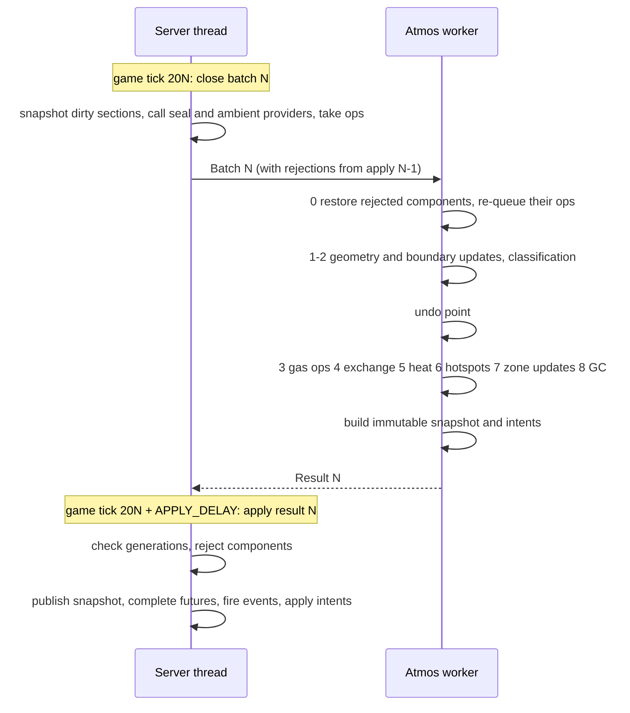

# ZAS³ architecture

**Status:** Draft, 2026-10-31 (Phase B). For review against the
`req-r1-baseline` requirements. The Phase B exit asks for this doc to be
accepted, the NFR numbers set, and the mixin list known.

**Inputs:**

- [requirements](requirements/README.md) (baseline `req-r1-baseline`)
- [plan](plan.md)
- [spike results](research/spikes.md) (S0–S5)
- [NeoForge 1.21.1 research](research/neoforge-1.21.1.md)
- [ZAS core notes](research/zas-core.md)

Each section ends with the requirements it serves. *Spike* marks a choice that
a measurement in [spikes.md](research/spikes.md) backs.

## 1. Overview

The world lives on the server thread; the simulation lives on a worker thread.
They exchange immutable messages once per atmos tick, and nothing else crosses
between them.

```
 server thread                                         atmos worker (per dimension)
 ─────────────                                         ────────────────────────────
 block-change hook ──► per-section dirty bitsets
 API / devices / breathing ──► op queue (seq-numbered)
 chunk load/unload ──► lifecycle events + saved shares
                                │
   every period (20 ticks):     ▼
   close batch: snapshot dirty sections,      ──Batch──►  restore rejected components
   seal providers, ambients, ops, events                  geometry phase (fills, splits, merges)
                                                          undo point
                                                          gas ops, exchange, heat, fire, reactions
   APPLY_DELAY ticks later (default 10):                  build immutable snapshot + intents
   validate generations, reject components,  ◄─Result──
   publish snapshot, complete futures,
   fire events, apply world intents
 ─────────────
 every tick, budgeted: hazards, airflow forces, client sync, (zas_atmos) devices
```

Requirements: D-30, CORE-045, CORE-049, CORE-069.

## 2. Modules and packaging

### 2.1 Gradle projects

| Project | Kind | Package root | Ships as | Depends on |
|---|---|---|---|---|
| `engine` | plain `java-library`, no Minecraft | `io.github.west3436.zas.engine` | classes copied into the `zas` jar | nothing |
| `zas-api` | ModDevGradle, `FMLModType: GAMELIBRARY` | `io.github.west3436.zas.api` | its own jar on Maven Central; nested (jar-in-jar) in `zas` and in consumers | Minecraft, NeoForge |
| `zas` | ModDevGradle mod `zas` | `io.github.west3436.zas` (excluding `.api`, `.engine`, `.atmos`) | `zas-<ver>.jar` | engine, zas-api |
| `compat-adastra` | ModDevGradle source set or project | `io.github.west3436.zas.compat.adastra` | classes inside the `zas` jar, loaded only when Ad Astra is present | zas-api, Ad Astra (compile-only) |
| `zas-atmos` | ModDevGradle mod `zas_atmos` | `io.github.west3436.zas.atmos` | `zas_atmos-<ver>.jar` | zas-api, `zas` (required at runtime) |
| `example-addon` | ModDevGradle mod | `io.github.west3436.zas.example` | not published; CI only (API-048) | zas-api only |

**Rules from S0** (*spike*):

1. **The API's Gradle project is named `zas-api`,** the same as the published
   artifactId. ModDevGradle writes a project dependency's jar-in-jar identity
   as `group:<project name>`. If that identity differs from consumers'
   `io.github.west3436:zas-api`, FML's `JarSelector` treats the two as one
   library (they have the same module name) and keeps whichever mod file it
   saw first. That silently downgrades consumers.
2. **The jar-in-jar range is declared by coordinates.** Use
   `jarJar('io.github.west3436:zas-api') { version { strictly '[<this>,<next major>)'; prefer '<this>' } }`
   plus a `dependencySubstitution` to `project(':zas-api')` in the `jarJar`
   configuration. ModDevGradle reads ranges only from module selectors.
   Consumers get the same snippet in the developer docs.
3. **`mods {}` lists the engine source set, never the API's.** The API loads
   as its own `GAMELIBRARY` module in dev and in production. Listing it in the
   mod splits its package across two modules and crashes the loader.
4. **The manifest of `zas-api`** sets `Automatic-Module-Name:
   io.github.west3436.zas.api`, `FMLModType: GAMELIBRARY` and
   `Implementation-Version`.
5. **No package exists in two jars** (D-15, D-38). The engine, the Ad Astra
   compat and the framework share the `zas` jar but keep separate package
   roots, so they can split into their own jars later.

**Why the engine is copied in, not nested.** It has no consumers outside
`zas`. Copying it keeps it out of jar-in-jar version selection and gives it
the `zas` module's access to Minecraft classes, which it must not use; that is
enforced by its own compile classpath (CORE-043). It stays a separate Gradle
project so its unit tests and benchmarks need no Minecraft.

### 2.2 Dependency directions

```
engine  ◄── zas ──► zas-api ◄── zas-atmos
                       ▲   ◄── compat-adastra (inside zas)
                       └────── example-addon, third-party mods
```

- `zas-api` never references `zas`, `engine` or any optional mod (API-003,
  API-044).
- `zas-atmos` uses only `zas-api` at compile time (D-50). It declares `zas` as
  a required runtime dependency, which proves the API is enough for tech mods.
- `engine` never imports `net.minecraft`, `net.neoforged` or
  `com.mojang`. An ArchUnit-style check in CI enforces this (CORE-043).

### 2.3 The engine/platform boundary

The engine sees the world only through these types, all in
`io.github.west3436.zas.engine` and all plain data:

| Type | Content |
|---|---|
| `GeometryPalette` | Dense table: geometry id → face masks (6 × 16×16 bits), volume, sub-cells with per-face footprints, flags (zone boundary, fluid, heat source). Built by `zas` from block states (§4.1). |
| `SectionSnapshot` | Section key, chunk lifecycle and block generations, `short[4096]` geometry ids or a compact palette-indexed form, plus per-position overrides (position-dependent shapes, seal providers) |
| `Batch` | Atmos tick number; section snapshots; chunk lifecycle events with their saved shares; ambient definitions per dimension; queued operations with sequence numbers; rejections from the previous apply; config snapshot |
| `Result` | Atmos tick number; immutable zone snapshot table; per-component membership; per-operation outcomes; edge flow records (FLOW-001); world-write intents with the block generations they assumed; events; conservation ledger entries |

The platform (`zas`) converts Minecraft state into these types on the server
thread and turns `Result` back into world effects on the server thread.

Requirements: API-001, API-003, API-007, API-044, CORE-043, D-15–D-17, D-38,
NFR-022.

## 3. The off-thread engine

### 3.1 Threads and ownership

- **One engine per dimension** (CORE-042). Engines run on a small dedicated
  daemon executor, `zas-atmos-N`, never `Util.backgroundExecutor()`. Its size
  is a COMMON config option, default 1 thread (NFR-005 is set against one).
  Dimensions are independent, so with more threads they run in parallel.
- **Ownership is exclusive:**

| State | Owner | Others get |
|---|---|---|
| Level, chunks, block entities, capabilities, attachments | server thread | nothing (CORE-049) |
| Persisted zone shares (chunk attachment `zas:atmos`) | server thread | copies inside `Batch` at chunk load |
| Op queue, dirty-section bitsets, chunk generations | server thread | the closed `Batch` |
| Published `ZoneSnapshot` table | server thread publishes; immutable | any thread may read it through a `volatile` reference (API-046) |
| Zone graph, mixtures, edges, membership, section mirror, pending shares | worker | the immutable `Result` |

*Spike (S5):* sharing the persistence store between the two threads was a
data race. The store is owned by the server thread, and the worker only ever
sees copies.

### 3.2 The atmos tick pipeline

The period T is 20 game ticks by default (CORE-041). Batch N closes at game
tick 20·N, at the end of `ServerTickEvent.Post`.



**Fixed-latency apply.** Result N is applied at game tick 20·N + D, with
`APPLY_DELAY` D = 10 ticks by default and required to be less than T, not
whenever the worker happens to finish. Inputs are fixed per batch and the
apply point is fixed in game ticks, so thread scheduling cannot change any
outcome.

- *Spike (S5):* threaded and inline runs of a 10-minute S-10-shaped scenario
  ended with bit-identical state (CORE-044, CORE-071).
- If the worker hasn't finished by the apply tick, the server thread waits.
  At NFR-005's 250 ms against D = 500 ms that should never happen. If it
  happens anyway, the wait is logged and counted by the profiler (OPS-004).
- A **single-threaded mode** runs the worker's tick inline when the batch
  closes and holds the result until the apply tick. Tests and the CORE-071
  equivalence harness use it. It is also a debug config option.

**Latency.** A mutation's future completes at the apply tick: from 0.5 s
(the call lands just before a batch closes) to 1.5 s (just after) with the
defaults. That satisfies D-46's "at most one atmos tick" counted from the batch
that carries it.

Requirements: D-20, D-30, D-46, CORE-040, CORE-041, CORE-044, CORE-045,
CORE-046, CORE-047, CORE-071, NFR-005.

### 3.3 Staleness: two generations per chunk

Each loaded chunk carries two counters, kept in a server-side map (not an
attachment):

- **Lifecycle generation:** bumped when a chunk unloads.
- **Block generation:** bumped by the change hook on every write.

They are checked differently:

| Result part | Validated against | When stale |
|---|---|---|
| Zone mixtures (an *exchange component*) | lifecycle generation of every chunk the component spans | Reject the component: publish its previous snapshot, and tell the worker in the next batch to restore it from undo and re-queue its operations (CORE-070, CORE-074) |
| World-write intents (place or remove `zas:gas_fire`, light or extinguish, shatter glass, block damage) | block generation of the target's chunk | Drop the intent. The next tick re-derives it from fresh geometry. |
| Operation outcomes and futures | follow their component | Re-queued with the component |
| Events | follow their component | Not fired; they reappear when the work is redone |

- **Why block edits don't reject mixtures.** Block edits arrive in the next
  batch in order, so the worker's graph is always consistent with the world as
  of batch close. Rejecting on block edits would livelock a station that
  players are building in.
- **An exchange component** is the set of zones linked by edges that
  exchanged gas this tick. The worker computes it with union-find during phase
  4. Ambient edges don't link zones, because the ambient never changes
  (CORE-038). Restoring a whole component keeps conservation exact.
  *Spike (S5):* conservation stayed at 3e-14; without rejection it drifted by
  1.7e-3.
- **Undo point.** Each zone's mixture is copied after the geometry phase,
  before gas operations. Geometry effects reflect the world at batch close and
  stay; only gas operations, exchange, heat and reactions are undone.
- **Re-queued operations** go in front of the next batch's operations, sorted
  by their original sequence numbers.
- **Only unloads reject.** A paused zone doesn't change, so a chunk load
  during an in-flight tick needs no rejection. *Spike (S5):* counting loads
  as well doubled the rejections.

Requirements: CORE-036, CORE-048, CORE-070, CORE-074, D-43.

### 3.4 Server-thread work and budget

**Per batch (every T):**

- Snapshot dirty sections with `PalettedContainer#copy()` (*spike (S5):*
  0.3 µs per section).
- Evaluate position-dependent shapes and seal providers for dirty positions
  (API-028).
- Read ambient providers (ENV-015).
- Hand off the op queue (a list swap).

**Per apply:**

- Validate generations: O(chunks of components).
- Publish the snapshot: one reference swap.
- Complete futures and fire events: O(operations + events).
- Apply world-write intents.

*Spike (S5):* snapshot plus apply came to about 6 µs per atmos tick for S-10,
not counting devices, hazards or sync.

**Every game tick, under a budget:**

- hazard evaluation, staggered per entity (LIFE-033, LIFE-038)
- airflow forces from the last result's edge flows (FLOW-006, FLOW-013)
- client sync (DATA-014, DATA-015)
- `zas_atmos` steps devices once per atmos tick, spread across game ticks (D-31,
  D-50)

**The budget** (CORE-047, NFR-002) is one per-tick time limit, default 10 ms,
shared by all of `zas`'s server-thread work through a cooperative
`TickBudget`. Work that would exceed it carries over to the next game tick,
with one exception: the apply step itself is never split, so a result is
always applied atomically.

Requirements: CORE-047, NFR-001, NFR-002, NFR-003.

### 3.5 Determinism rules (CORE-044, CORE-072)

- **Ordered iteration only.** No iteration over `HashMap`, `HashSet` or
  identity-keyed collections where order affects results. Use insertion-ordered
  primitive maps (as in the spikes), sorted arrays, or `LinkedHashMap`.
- **Ordered work items.** Every op carries a dimension-wide sequence number.
  Zones and edges are processed in id order. New zone ids come from a
  per-dimension counter.
- **Seeded randomness.** Random draws (hotspot spread, airflow jitter) come
  from a generator seeded by (dimension, atmos tick, zone id), never from a
  shared `Random`.
- **No wall-clock reads** in the engine.
- **Floating point:** `double` everywhere, the same order of operations in
  both modes, no parallel streams inside a tick. Java 17+ is strict IEEE by
  default.
- **Fault isolation:** an exception inside a dimension's engine pauses that
  dimension (D-55, NFR-014). The last published snapshot stays readable.

### 3.6 Fault isolation for third-party code

Seal providers, ambient providers, code reactions, hazard handlers and event
listeners run on the server thread inside a guard. The guard catches
exceptions, logs at most once per source per minute, and skips that source's
contribution for the tick (D-55, NFR-013). Code-defined reactions run on the
worker: API-020 implementations must be pure functions of their inputs, they
are guarded the same way, and the API documents them as worker-thread
callbacks.

## 4. Geometry, storage and persistence

### 4.1 Per-state geometry (GEO-001 to GEO-006, GEO-040 to GEO-043)

The geometry table is derived from collision shapes in an empty collision
context (GEO-041).

1. **Derivation.** For every block state, take its shape with
   `getCollisionShape(EmptyBlockGetter.INSTANCE, ZERO, CollisionContext.empty())`,
   then derive the geometry **once per distinct `VoxelShape` instance**
   (*spike (S2):* vanilla has 4,811 instances, taking 120 ms). Derivation runs
   at server start and again on `TagsUpdatedEvent`, on a background thread,
   and finishes before the first atmos tick.
2. **Rasterization.** The shape is rasterized to 16³ voxels. Each face's
   coverage is its 16×16 boundary layer (GEO-003). Free space reaching a face
   is split into 6-connected components, the sub-cells (GEO-004), each with its
   volume (GEO-002) and per-face footprint. A volume in a fully enclosed pocket
   is ignored (GEO-001).
3. **Deduplication.** The results are deduplicated into a `GeometryPalette`
   (*spike (S2):* 287 unique geometries in vanilla), with a dense
   `int[] byStateId` indexed by `Block.getId(state)`. That is about 180 KiB for
   vanilla.
4. **Overrides and flags.** Datapack overrides (GEO-005, GEO-009), fluids
   (GEO-006) and zone-boundary tags (GEO-007) are applied over the derived
   geometry. Each produces a new palette entry, a single cell.
5. **Position-dependent states** (*spike (S2):* 32 in vanilla, found by
   comparing shapes at two positions) and seal-provider blocks (API-023) are
   flagged. Their geometry is computed per position on the server thread when
   a snapshot is taken, and travels in `SectionSnapshot` overrides (GEO-043,
   API-028).
6. **`dynamicShape` blocks** (179 vanilla states, including moving pistons and
   shulker boxes) use the geometry of their settled state (GEO-042), from a
   data table of state → settled state.

**The seal test** between two cells in adjacent positions: the shared face is
gas-tight wherever `coverage(a, d) | coverage(b, d.opposite())` is full.
Sub-cell to sub-cell connection requires their footprints to overlap on an
uncovered part of the face (GEO-003, GEO-004).

### 4.2 Change detection (GEO-010 to GEO-014)

- **One mixin:** `LevelChunk#setBlockState(BlockPos, BlockState, boolean)` at
  RETURN, on server levels only, when the return value is non-null.
  *Spike (S1):* it sees every source tested, including direct chunk writes
  that `onBlockStateChange` misses. Its cost doesn't show above noise.
- **The hook only enqueues.** It sets a bit in a per-section dirty bitset
  (64 longs, allocated lazily) and bumps the chunk's block generation, which
  coalesces for free (GEO-012). *Spike (S1):* sorting a queue cost 20 ms per
  100,000 changes, which is too slow for explosion bursts. Off-thread writes
  go to a concurrent queue that is drained at batch close.
- **Locality filter (GEO-011).** At batch close only dirty sections that hold
  zoned cells, border a zone, or contain a pending classification are
  snapshotted. All other dirty bits are cleared without work.
- **Revalidation on load (GEO-013).** When a chunk with saved zone data loads,
  all its non-empty sections are snapshotted and the worker compares them with
  saved membership. `markDirty(level, pos)` (GEO-014) sets the dirty bit and
  forces re-evaluation of position-dependent overrides.

### 4.3 The worker's section mirror and classification (GEO-020 to GEO-028)

**Section mirror.** The worker keeps decoded `short[4096]` geometry-id arrays
for the sections it needs:

- sections holding zoned cells or bordering them
- sections of pending classifications

A mirror entry is replaced when a newer snapshot of that section arrives, and
dropped when its chunk unloads or nothing needs it any more. At 8 KiB per
section, S-10's station needs about 1–2 MiB.

**Classification is triggered,** never a scan (CORE-051, CORE-054):

1. **Prefetch.** An operation that can create a zone (CORE-055, CORE-056)
   makes the server thread snapshot the non-empty, loaded sections within
   3 sections of the target at the next batch close. Most enclosures under the
   65,536-cell cap fit inside that 7³-section cube (about 100 µs of copying in
   the worst case).
2. **The fill** runs on the mirror (GEO-022). It first does the GEO-021 column
   check (*spike (S3):* 0.7 µs), then the bounded fill (*spike (S3):* 5.5 ms at
   the cap). Possible outcomes:
   - **Enclosed:** the zone is created in phase 3 and the buffered operations
     apply (GEO-028).
   - **Open:** the gas goes to the ambient and is reported (CORE-053).
   - **Unresolved:** the fill reached an unloaded chunk (GEO-024).
   - **Needs more sections:** the fill reached a loaded section the mirror
     doesn't have. The worker asks for those sections in its result, the next
     batch carries them, and the fill reruns. Operations stay buffered, so a
     large or thin enclosure takes one or more extra atmos ticks.
3. **Cache.** Cells classified open are cached per section until a dirty bit
   in that section clears the entry (GEO-027).

### 4.4 Zone membership and the zone graph (CORE-020 to CORE-039)

**Membership.** Each mirrored section with zoned cells has a `short[4096]` of
*local* indices plus a small palette from local index to zone id (0 means
unzoned). Positions with more than one sub-cell (panes, walls) keep a side
table keyed by packed position.

- **Merge** rewrites palette entries in the smaller zone's sections:
  O(sections). *Spike (S4):* the cell-list version took 0.15 ms for 24.5k
  cells, and the palette version is cheaper still.
- **Split** uses the interleaved searches from S4 (*spike (S4):* 2 µs for
  ordinary edits, 4.9 ms for the worst-case detour, 6.7 ms for a real 50k
  split). The cells of the split-off remnant get a new local index in their
  sections.
- **Zone records** hold: id (CORE-026), mixture, volume, the list of sections
  with per-section volume (needed for persistence shares), pins (API-017),
  flags (paused, breached), and edge references.
- **Edges** are keyed by (zone, zone) or (zone, ambient key) (CORE-030,
  ENV-016). They hold connection counts, the direct count (CORE-037) and the
  sleeping state (CORE-033). The connections themselves (cell faces) live in a
  per-edge list of packed face ids, so geometry changes can update counts
  without rescanning.

**Memory** (NFR-004, to be measured in R0):

- 8 KiB per section that holds any zoned cell, about 2 B per position
- about 1–4 KiB per zone with its edges
- for S-10: about 100–300 sections × 8 KiB plus 100 zones × 4 KiB, which is
  about 1–3 MiB

That is well under the 64 MiB total budget.

### 4.5 Persistence (DATA-001 to DATA-016, D-54)

- **Chunk attachment `zas:atmos`**, serialized with a versioned codec
  (DATA-003). It holds:
  - membership per section: the palette of saved zone ids and the packed
    local indices
  - per zone in this chunk: the zone's persistent id and this chunk's share
    of its mixture (moles per gas, temperature) by volume, plus the zone's
    pins (API-018)
  - held block changes for paused zones (DATA-010) and queued additions that
    target this chunk (DATA-011)
- **Shares are written at chunk save.** They are computed on the server
  thread from the **published** snapshot (moles × this chunk's volume ÷ zone
  volume). Nothing is written per tick. Only the published snapshot is ever
  saved, which is why an in-flight tick must be rejectable (§3.3).
- **Saved shares are authoritative only while their zone is not in memory.**
  When a chunk loads, the server thread copies its attachment into the next
  batch. If the zone is in memory (it was paused, so it hasn't changed), the
  worker ignores the copy. Otherwise it holds it as a *pending share* until
  every chunk of the zone has loaded, then rebuilds the zone as the sum of its
  shares (DATA-008, GEO-033). *Spike (S5):* conservation was exact across
  repeated unload and reload cycles.
- **Level-wide state is tiny.** It is kept in a `SavedData`:
  - the per-dimension zone-id counter
  - dimension pause flags (OPS-005)
  - queued additions that couldn't be assigned to a loaded chunk
- **Corruption** of a chunk's attachment resets that chunk's cells to
  unzoned, with one warning per chunk (DATA-004, DATA-013).
- **Derived state is rebuilt on load:** edges, the geometry palette,
  sub-cells and hotspots (DATA-009).

### 4.6 Paused zones (GEO-030 to GEO-038)

- **When a zone pauses.** The worker pauses a zone when any of its sections'
  chunks is unloaded, or when a classification touching it is unresolved.
- **What a paused zone does.** It keeps its mixture and publishes its
  last-known state. Operations into it are voided, and draws from it are
  supplied without depletion; both are ledger categories (CORE-036).
- **Held changes.** Block changes touching a paused zone are held in the
  worker and in the chunk attachment (DATA-010), and replayed in order when
  the zone resumes.
- **Never force-load.** The engine never adds chunk tickets (GEO-034).

## 5. Services around the engine (server thread)

| Service | Input | Cadence | Requirements |
|---|---|---|---|
| Hazards and breathing | published snapshot, point lookup by entity eye position (API-015), life-support capabilities | staggered per entity (LIFE-007, LIFE-033), capped per tick (LIFE-038) | LIFE, D-27, D-47 |
| Respiration and photosynthesis | queue ops with source attribution | per breather or crop on its own cadence, aggregated per zone per atmos tick | LIFE-005, CONT-053 |
| Airflow | `Result` edge flow records | each game tick, entities within range of active edges only | FLOW-001 to FLOW-017 |
| Fire and fuel blocks | mixins (§7) query the published snapshot; worker intents place or remove `zas:gas_fire` | on vanilla ticks; intents at apply | FIRE-018 to FIRE-027 |
| Client sync | own-player state; nearby edge flows | ≤ 4 Hz on thresholds; ≤ once per atmos tick | DATA-005, DATA-014, DATA-015, D-53 |
| Devices (`zas_atmos`) | API queries and asynchronous mutations, one outstanding per port | once per atmos tick, spread across game ticks | D-31, D-50, CONT-006 |
| Commands, profiler, audit | published snapshot; audit requests a fresh snapshot of a region and diffs it on the worker | on demand | OPS-003, OPS-004, OPS-010, GEO-032 |

**The conservation checker** (CORE-073) runs inside the worker. Every mole
change is recorded under a ledger category, and the checker compares the
dimension's totals before and after each tick. It is on in tests and fuzzing
(NFR-010) and optional in game.

## 6. API module

### 6.1 Package layout (`zas-api`)

| Package | Contents |
|---|---|
| `io.github.west3436.zas.api` | `ZasApi` (entry point, `isPresent()`, version), `ZasApiProvider` (the service interface `zas` installs), threading annotations |
| `.api.gas` | `GasType` (registry key, properties), `GasMixture` (immutable record: moles per gas, T, V, with derived P and partial pressures), `GasTags` |
| `.api.atmosphere` | `Atmospheres` (queries: `at(level, Vec3)`, `at(level, BlockPos)`, `of(entity)`, `zone(id)`), `AtmosphereSample` (composition, pressures, T, state: ZONED, AMBIENT, PAUSED, UNRESOLVED; zone id), `ZoneInfo` |
| `.api.mutation` | `GasMutations` (`add`, `remove`, `addHeat`, `removeHeat` with a `SourceId`), `MutationResult` (amount moved, outcome), `CompletableFuture`-based returns |
| `.api.capability` | `IGasHandler` (block, sided, simulate/execute), `ILifeSupport` (item and entity), `ISealProvider` (block), and their `BlockCapability`/`ItemCapability` constants |
| `.api.environment` | `AmbientDefinition`, `AmbientProvider` |
| `.api.reaction` | `ReactionType` (code-defined, worker-thread, pure), `Reactions.applyStandalone` (API-019) |
| `.api.life` | `Breathability` (API-014): breathable, protected, reasons; `HazardHandler` (LIFE-032) |
| `.api.event` | Zone lifecycle, fire and hazard-tick events (API-030, API-031, API-033) |

### 6.2 Installation and fallback (API-006, API-009, API-040)

- **The holder.** `ZasApi` holds a `volatile ZasApiProvider`, initially the
  built-in fallback. `zas` installs its provider in its mod constructor; a
  second `install` throws. *Spike (S0):* this works with both mods present and
  with only the consumer.
- **The fallback** gives a vanilla, breathable world:
  - queries return standard air
  - mutations complete immediately with outcome `ABSENT`
  - `Breathability` follows vanilla rules (underwater still counts)
  - capabilities still exist, because capability objects are created by name
    in the API jar
  - no events fire
- **Consumers** should call the API from common setup or later. If they need
  it during construction, they declare `ordering = "AFTER"` on an optional
  `zas` dependency. *Spike (S0):* `isPresent()` was then already true at
  consumer construction.
- **Versioning.** The API's semver is independent of the mod's (API-002), and
  R0 builds are `0.x` (API-041). Consumers nest it with the range
  `[their version, next major)`; FML keeps the newest copy that satisfies
  everyone. `zas` nests the API version it was built with. A consumer may
  nest a newer minor version, which then wins; the fallback never needs `zas`.
- **CI:** an API binary-compatibility check (japicmp) against the last
  release (API-043), and the example addon run without `zas` (API-048, S-12).
  The policy and the consumer snippet are in
  [api-consumers.md](api-consumers.md).

### 6.3 Threading contract (API-004, API-045, API-046)

| Call | Threads |
|---|---|
| Queries (`Atmospheres`, `ZoneInfo`) | Any thread. They read the published immutable snapshot of the last applied atmos tick. |
| Mutations, pins, `markDirty` | Server thread only. They throw `IllegalStateException` otherwise. |
| Futures | Complete on the server thread at the apply tick |
| Events | Fired on the server thread when results are applied (API-032), on `NeoForge.EVENT_BUS` |
| Providers (seal, ambient), hazard handlers | Called on the server thread |
| `ReactionType`, `Reactions.applyStandalone` | Any thread; pure |

### 6.4 Event model

- Events are NeoForge `Event` subclasses defined in the API. Cancellable ones
  implement `ICancellableEvent`.
- Lifecycle events (created, merged, split, breached, sealed, dissolved,
  paused, resumed) are emitted by the worker as records in `Result`. The
  server thread turns them into events at apply, so they never fire for
  rejected work.
- Hazard-tick events (API-033) fire from the hazard service and may modify the
  hazard before it applies.
- Events carry snapshot data (`ZoneInfo`, `GasMixture`), never live engine
  objects.

## 7. Mixin inventory

All mixins are injection-only, with no `@Overwrite` (NFR-021). Each class's
javadoc names its purpose and requirement (NFR-024). They are declared in
`zas.mixins.json` through `[[mixins]]` in `neoforge.mods.toml`. Behaviour
toggles are checked at runtime inside the injection, not by skipping mixins,
because STARTUP config is too late for block classes.

| # | Target | Injection | Purpose | Requirements | Verified |
|---|---|---|---|---|---|
| M1 | `LevelChunk#setBlockState(BlockPos, BlockState, boolean)` | `@Inject` RETURN | Change hook: enqueue the dirty position and bump the block generation | GEO-010, GEO-011, GEO-012 | **S1** |
| M2 | `FireBlock#tick(BlockState, ServerLevel, BlockPos, RandomSource)` | `@Inject` HEAD, cancellable | Fire inside a zone without enough O₂ goes out; burning consumes O₂ | FIRE-020, FIRE-022, FIRE-023, FIRE-030 | research only |
| M3 | `BaseFireBlock#canBePlacedAt(Level, BlockPos, Direction)` | `@ModifyReturnValue` | No ignition without enough O₂ | FIRE-020, FIRE-014 | research only |
| M4 | NeoForge's `FireBlock#checkBurnOut(Level, BlockPos, int, RandomSource, int, Direction)` and `FireBlock#canCatchFire(BlockGetter, BlockPos, Direction)` | `@WrapMethod` / `@ModifyReturnValue` | Fire spread depends on O₂ | FIRE-016, FIRE-020 | research only |
| M5 | `AbstractFurnaceBlockEntity#serverTick` (static) plus a `litTime` `@Accessor` | `@Inject` HEAD, cancellable | Lit furnaces consume O₂ and pause without it | FIRE-021, FIRE-027, HEAT-007 | research only |
| M6 | `CampfireBlock#canLight` and `CampfireBlockEntity#cookTick` | `@ModifyReturnValue`, `@Inject` | Campfires need O₂, and go out (`dowse`) without it | FIRE-021, FIRE-027 | research only |
| M7 | `PalettedContainer` internals (palette, storage) | `@Accessor` | Optional fast section decode, about 10× faster than `get()` | CORE-047 (worker side) | proposed (S5) |

Not mixins:

- **Breathing** uses `LivingBreatheEvent` and `LivingDrownEvent`.
- **Airflow** uses `push` and `hurtMarked` for impulses, and the synced flow
  field for continuous force.
- **Torches** use the ignition-source config.
- **The Ad Astra adapter** uses Ad Astra's own events and ticks (SPACE-016,
  to be proved in S6).
- **Client rendering** uses NeoForge render events.
- **Candles and soul fire** are found by scanning zones (no ticking hook).

M2–M6 are new compared with the S1 spike, but their targets were verified in
the official 1.21.1 mappings during research
([neoforge §10](research/neoforge-1.21.1.md#10-fire--furnaces)). Each needs a
GameTest in R1 (E3).

## 8. Testing strategy

| Layer | Tool | What runs there |
|---|---|---|
| Engine | JUnit 5 in `engine` (no Minecraft) | Gas math, zone graph, split and merge, exchange, ledger, fuzz (NFR-010), and the CORE-071 equivalence harness, which runs the same batches inline and threaded and compares hashes |
| Engine benchmarks | JMH or a scripted harness in `engine` | The headless S-10 scenario (NFR-034), checked in CI against a recorded baseline with a 10 % tolerance |
| Platform | GameTest server (MDG `gameTestServer`) | Geometry derivation, the change hook, persistence, scenarios S-01 to S-13 (NFR-032), and the dedicated-server boot (NFR-023) |
| Packaging | GameTest harness loading built jars | The S0 harness, kept: `zas` plus example addon, and example addon alone (API-048) |

The test names include requirement IDs (README rule 5).

## 9. Open items

| # | Item | Plan |
|---|---|---|
| O-1 | **S6 (Ad Astra) not run.** The adapter design (events only, no mixins) is unproven. | [#9](https://github.com/west3436/zas-cubed/issues/9). Run S6 when downloading Ad Astra for a GameTest is allowed. It blocks E7, not R0. |
| O-2 | **S0 on a real dedicated server.** Proven only through the jar-in-jar harness. | [#77](https://github.com/west3436/zas-cubed/issues/77). Run once on a server built with the NeoForge installer during Phase C. |
| O-3 | **Piston coverage in S1** not exercised | In the GEO-010 GameTest, [#25](https://github.com/west3436/zas-cubed/issues/25) |
| O-4 | **Memory** (NFR-004) estimated, not measured | [#78](https://github.com/west3436/zas-cubed/issues/78). Measure the palette membership layout in the R0 benchmark. |
| O-5 | **Large-pack geometry derivation** (state counts of 10⁵+) | [#79](https://github.com/west3436/zas-cubed/issues/79). Measure in a real pack before R1. The per-`VoxelShape` cache should keep it about 1 s. |
| O-6 | **Classification that needs more sections** adds an atmos tick per round | [#80](https://github.com/west3436/zas-cubed/issues/80). Measure how often enclosures escape the 3-section prefetch, and widen it if needed. |
| O-7 | **Apply delay and period** must satisfy D < T | In the scheduler config, [#23](https://github.com/west3436/zas-cubed/issues/23). Reject combinations where D ≥ T. |

## 10. Requirement coverage

| Area | Where |
|---|---|
| CORE | §3, §4.4; §3.5 (determinism); §5 (ledger) |
| GEO | §4.1–§4.3, §4.6 |
| ENV | §2.3 (ambients in `Batch`), §3.4 (providers on the server thread) |
| API | §6 |
| LIFE, FLOW, FIRE, HEAT | §5, §7; phases 4–7 in §3.2 |
| CONT | §5 (devices through the API, D-50) |
| DATA | §4.5 |
| SPACE | §2.1 (`compat-adastra`), §7; open item O-1 |
| OPS | §3.4 (profiler), §5 (commands, audit) |
| NFR | §2 (packaging, licensing untouched), §3.4 (budgets), §3.6 (fault isolation), §7 (mixins), §8 (tests) |
