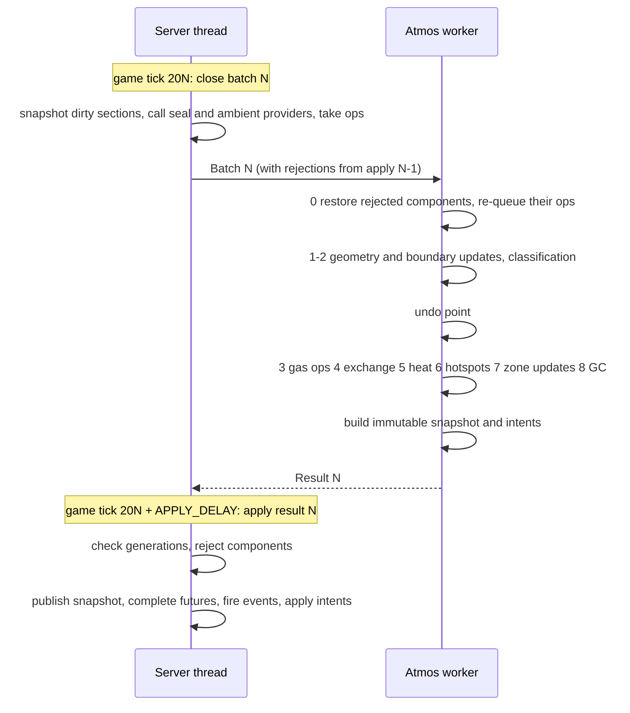

# ZAS³ architecture

**Status:** Accepted by the owner, 2026-11-05, which closes Phase B
([#2](https://github.com/west3436/zas-cubed/issues/2)). Written from 2026-10-31
against the `req-r1-baseline` requirements. The items still open are in
[§9](#9-open-items).

**Inputs:**

- [requirements](requirements/README.md) (baseline `req-r1-baseline`)
- [plan](plan.md)
- [spike results](research/spikes.md) (S0–S5)
- [NeoForge 1.21.1 research](research/neoforge-1.21.1.md)
- [ZAS core notes](research/zas-core.md)

Each section ends with the requirements it serves. *Spike* marks a choice that
a measurement in [spikes.md](research/spikes.md) backs.

## 1. Overview

The world lives on the server thread; the simulation lives on a worker thread.
They exchange immutable messages once per atmos tick, and nothing else crosses
between them.

```
 server thread                                         atmos worker (per dimension)
 ─────────────                                         ────────────────────────────
 block-change hook ──► per-section dirty bitsets
 API / devices / breathing ──► op queue (seq-numbered)
 chunk load/unload ──► lifecycle events + saved shares
                                │
   every period (20 ticks):     ▼
   close batch: snapshot dirty sections,      ──Batch──►  restore rejected components
   seal providers, ambients, ops, events                  geometry phase (fills, splits, merges)
                                                          undo point
                                                          gas ops, exchange, heat, fire, reactions
   APPLY_DELAY ticks later (default 10):                  build immutable snapshot + intents
   validate generations, reject components,  ◄─Result──
   publish snapshot, complete futures,
   fire events, apply world intents
 ─────────────
 every tick, budgeted: hazards, airflow forces, client sync, (zas_atmos) devices
```

Requirements: D-30, CORE-045, CORE-049, CORE-069.

## 2. Modules and packaging

### 2.1 Gradle projects

| Project | Kind | Package root | Ships as | Depends on |
|---|---|---|---|---|
| `engine` | plain `java-library`, no Minecraft | `io.github.west3436.zas.engine` | classes copied into the `zas` jar | nothing |
| `zas-api` | ModDevGradle, `FMLModType: GAMELIBRARY` | `io.github.west3436.zas.api` | its own jar on Maven Central; nested (jar-in-jar) in `zas` and in consumers | Minecraft, NeoForge |
| `zas` | ModDevGradle mod `zas` | `io.github.west3436.zas` (excluding `.api`, `.engine`, `.atmos`) | `zas-<ver>.jar` | engine, zas-api |
| `compat-adastra` | ModDevGradle source set or project | `io.github.west3436.zas.compat.adastra` | classes inside the `zas` jar, loaded only when Ad Astra is present | zas-api, Ad Astra (compile-only) |
| `zas-atmos` | ModDevGradle mod `zas_atmos` | `io.github.west3436.zas.atmos` | `zas_atmos-<ver>.jar` | zas-api, `zas` (required at runtime) |
| `example-addon` | ModDevGradle mod | `io.github.west3436.zas.example` | not published; CI only (API-048) | zas-api only |

**Rules from S0** (*spike*):

1. **The API's Gradle project is named `zas-api`,** the same as the published
   artifactId. ModDevGradle writes a project dependency's jar-in-jar identity
   as `group:<project name>`. If that identity differs from consumers'
   `io.github.west3436:zas-api`, FML's `JarSelector` treats the two as one
   library (they have the same module name) and keeps whichever mod file it
   saw first. That silently downgrades consumers.
2. **The jar-in-jar range is declared by coordinates.** Use
   `jarJar('io.github.west3436:zas-api') { version { strictly '[<this>,<next major>)'; prefer '<this>' } }`
   plus a `dependencySubstitution` to `project(':zas-api')` in the `jarJar`
   configuration. ModDevGradle reads ranges only from module selectors.
   Consumers get the same snippet in the developer docs.
3. **`mods {}` lists the engine source set, never the API's.** The API loads
   as its own `GAMELIBRARY` module in dev and in production. Listing it in the
   mod splits its package across two modules and crashes the loader.
4. **The manifest of `zas-api`** sets `Automatic-Module-Name:
   io.github.west3436.zas.api`, `FMLModType: GAMELIBRARY` and
   `Implementation-Version`.
5. **No package exists in two jars** (D-15, D-38). The engine, the Ad Astra
   compat and the framework share the `zas` jar but keep separate package
   roots, so they can split into their own jars later.

**Why the engine is copied in, not nested.** It has no consumers outside
`zas`. Copying it keeps it out of jar-in-jar version selection and gives it
the `zas` module's access to Minecraft classes, which it must not use; that is
enforced by its own compile classpath (CORE-043). It stays a separate Gradle
project so its unit tests and benchmarks need no Minecraft.

### 2.2 Dependency directions

```
engine  ◄── zas ──► zas-api ◄── zas-atmos
                       ▲   ◄── compat-adastra (inside zas)
                       └────── example-addon, third-party mods
```

- `zas-api` never references `zas`, `engine` or any optional mod (API-003,
  API-044).
- `zas-atmos` uses only `zas-api` at compile time (D-50). It declares `zas` as
  a required runtime dependency, which proves the API is enough for tech mods.
- `engine` never imports `net.minecraft`, `net.neoforged` or
  `com.mojang`. An ArchUnit-style check in CI enforces this (CORE-043).

### 2.3 The engine/platform boundary

The engine sees the world only through these types, all in
`io.github.west3436.zas.engine` and all plain data:

| Type | Content |
|---|---|
| `GeometryPalette` | Dense table: geometry id → face masks (6 × 16×16 bits), volume, sub-cells with per-face footprints, flags (zone boundary, fluid, heat source). Built by `zas` from block states (§4.1). |
| `SectionSnapshot` | Section key, chunk lifecycle and block generations, `short[4096]` geometry ids or a compact palette-indexed form, plus per-position overrides (position-dependent shapes, seal providers) |
| `Ambient` | A dimension's ambient: partial pressures by gas id and a temperature; no gas is a vacuum (ENV-001, ENV-003). Built by `zas` from datapacks and providers (`Ambients.ambient(dimension)`, ENV-014) |
| `Batch` | Atmos tick number; section snapshots; chunk lifecycle events with their saved shares; ambient definitions per dimension; queued operations with sequence numbers; rejections from the previous apply; config snapshot |
| `Result` | Atmos tick number; immutable zone snapshot table; per-component membership; per-operation outcomes; edge flow records (FLOW-001); world-write intents with the block generations they assumed; events; conservation ledger entries |

The platform (`zas`) converts Minecraft state into these types on the server
thread and turns `Result` back into world effects on the server thread.

*Implemented (#23):* `Batch` and `Result` are records in
`io.github.west3436.zas.engine.scheduler`. A `Batch` carries the atmos tick,
`SectionSource`s (captures decoded on the worker), chunk loads and unloads,
sections that couldn't be captured, the ambient, sequence-numbered `GasOp`s,
the previous apply's `Rejection` and `EngineSettings` (exchange settings and
the checker switch). A `Result` carries the `AtmosSnapshot` to publish, the
exchange `Component`s, per-operation `OpOutcome`s, `OpenAirEvent`s, the
conservation report, the sections the worker mirrors and the sections it
asks for. Saved shares, seal providers, edge flows and world-write intents
are added by the requirements that need them.

Requirements: API-001, API-003, API-007, API-044, CORE-043, D-15–D-17, D-38,
NFR-022.

## 3. The off-thread engine

### 3.1 Threads and ownership

- **One engine per dimension** (CORE-042). Engines run on a small dedicated
  daemon executor, `zas-atmos-N`, never `Util.backgroundExecutor()`. Its size
  is a COMMON config option, default 1 thread (NFR-005 is set against one).
  Dimensions are independent, so with more threads they run in parallel.
- *Implemented (#23):* `AtmosWorkers.create(n)` makes the pool;
  `worker_threads` in `zas-common.toml` sets n.
- **Ownership is exclusive:**

| State | Owner | Others get |
|---|---|---|
| Level, chunks, block entities, capabilities, attachments | server thread | nothing (CORE-049) |
| Persisted zone shares (chunk data tag `zas:atmos`) | server thread | copies inside `Batch` at chunk load |
| Op queue, dirty-section bitsets, chunk generations | server thread | the closed `Batch` |
| Published `ZoneSnapshot` table | server thread publishes; immutable | any thread may read it through a `volatile` reference (API-046) |
| Zone graph, mixtures, edges, membership, section mirror, pending shares | worker | the immutable `Result` |

*Spike (S5):* sharing the persistence store between the two threads was a
data race. The store is owned by the server thread, and the worker only ever
sees copies.

### 3.2 The atmos tick pipeline

The period T is 20 game ticks by default (CORE-041). Batch N closes at game
tick 20·N, at the end of `ServerTickEvent.Post`.



**Fixed-latency apply.** Result N is applied at game tick 20·N + D, with
`APPLY_DELAY` D = 10 ticks by default and required to be less than T, not
whenever the worker happens to finish. Inputs are fixed per batch and the
apply point is fixed in game ticks, so thread scheduling cannot change any
outcome.

- *Spike (S5):* threaded and inline runs of a 10-minute S-10-shaped scenario
  ended with bit-identical state (CORE-044, CORE-071).
- If the worker hasn't finished by the apply tick, the server thread waits.
  At NFR-005's 250 ms against D = 500 ms that should never happen. If it
  happens anyway, the wait is logged and counted by the profiler (OPS-004).
- A **single-threaded mode** runs the worker's tick inline when the batch
  closes and holds the result until the apply tick. Tests and the CORE-071
  equivalence harness use it. It is also a debug config option.

*Implemented (#23):* `AtmosService` (package `io.github.west3436.zas.simulation`)
runs the timing at the end of each server tick, level by level in the
server's order; `DimensionAtmos` holds one level's state; the protocol itself
is `DimensionPipeline` in the engine, so the whole close/apply cycle,
rejection included, runs in unit tests without Minecraft. `DimensionScheduler`
runs a `DimensionEngine` on the pool or inline (`single_threaded` in
`zas-server.toml`). `period_ticks` and `apply_delay_ticks` are server config;
a delay not shorter than the period falls back to the defaults (O-7).
Atmos tick numbers are a per-dimension counter. `AtmosService.tickNow(level)`
runs a whole atmos tick at once (apply anything in flight, close, apply), for
GameTests and commands. One deviation from the diagram: zones that
classification creates for zone triggers are created in phase 3 *before* the
undo point, like other geometry effects, so a restore never has to destroy a
zone; the triggering operation is re-queued and finds the zone.

**Latency.** A mutation's future completes at the apply tick: from 0.5 s
(the call lands just before a batch closes) to 1.5 s (just after) with the
defaults. That satisfies D-46's "at most one atmos tick" counted from the batch
that carries it.

Requirements: D-20, D-30, D-46, CORE-040, CORE-041, CORE-044, CORE-045,
CORE-046, CORE-047, CORE-071, NFR-005.

### 3.3 Staleness: two generations per chunk

Each loaded chunk carries two counters, kept in a server-side map (not an
attachment):

- **Lifecycle generation:** bumped when a chunk unloads.
- **Block generation:** bumped by the change hook on every write.

Both are opaque stamps from one per-dimension counter that never goes back
(`ChunkGenerations`), compared only for equality. An unloaded chunk drops
out of the map and reads as 0, so when it loads again it gets stamps it has
never had.

They are checked differently:

| Result part | Validated against | When stale |
|---|---|---|
| Zone mixtures (an *exchange component*) | lifecycle generation of every chunk the component spans | Reject the component: publish its previous snapshot, and tell the worker in the next batch to restore it from undo and re-queue its operations (CORE-070, CORE-074) |
| World-write intents (place or remove `zas:gas_fire`, light a vanilla fire, shatter glass, block damage) | block generation of the target's chunk | Drop the intent. The next tick re-derives it from fresh geometry. |
| Operation outcomes and futures | follow their component | Re-queued with the component |
| Events | follow their component | Not fired; they reappear when the work is redone |

- **Why block edits don't reject mixtures.** Block edits arrive in the next
  batch in order, so the worker's graph is always consistent with the world as
  of batch close. Rejecting on block edits would livelock a station that
  players are building in.
- **An exchange component** is the set of zones linked by edges that
  exchanged gas this tick, or that exchanged heat through a wall (§4.8). The
  worker computes it with union-find during phase 4. Ambient edges don't link
  zones, because the ambient never changes (CORE-038). Restoring a whole
  component keeps conservation exact.
  *Spike (S5):* conservation stayed at 3e-14; without rejection it drifted by
  1.7e-3.
- **Undo point.** Each zone's mixture is copied after the geometry phase,
  before gas operations. Geometry effects reflect the world at batch close and
  stay; only gas operations, exchange, heat and reactions are undone.
- **Re-queued operations** go in front of the next batch's operations, sorted
  by their original sequence numbers.
- **Only unloads reject.** A paused zone doesn't change, so a chunk load
  during an in-flight tick needs no rejection. *Spike (S5):* counting loads
  as well doubled the rejections.

*Implemented (#23):*

- At batch close the pipeline records the lifecycle generation of every chunk
  holding a mirrored or captured section; the worker builds zones only there.
  At apply a component is stale if any of its chunks now has a different
  generation, or none was recorded.
- A component is the set of zones whose mixture differs bit for bit from the
  undo point, or that were destroyed since (merged or dissolved, CORE-076),
  linked when they shared a zone edge at the undo point. A zone that absorbs
  another inherits its edges, so every chain of exchange stays inside one
  component. Unchanged zones are in no component and need no check.
- The worker keeps the last tick's undo point: the membership table published
  at that point (an immutable `Membership`, §4.4, which later changes never
  touch) and a copy of each mixture. Restoring a component recreates its
  destroyed zones under their old ids from that table's cells
  (`ZoneGraph.restoreZone`, which moves cells back out of the zone that
  absorbed them) and copies the mixtures back (`ZoneGraph.restoreMixture`),
  before the ledger period begins, so the ledger needs no entry for it.
- The server thread publishes `AtmosSnapshot.withRejected(previous, zones)`:
  the new table, with the rejected zones and their positions answered from
  the previous one.

Requirements: CORE-036, CORE-048, CORE-070, CORE-074, D-43.

### 3.4 Server-thread work and budget

**Per batch (every T):**

- Snapshot dirty sections with `PalettedContainer#copy()` (*spike (S5):*
  0.3 µs per section). `SectionCapture` takes the copy; the worker decodes
  it into a `SectionSnapshot`.
- Evaluate position-dependent shapes and seal providers in the sections being
  copied, for the positions with no answer kept (API-028). A section with no
  such block pays one look at its palette.
- Read ambient providers (ENV-015). *Implemented
  ([#66](https://github.com/west3436/zas-cubed/issues/66)):*
  `DimensionAtmos.close` calls `Ambients.takeProviderAnswer` first, in every
  dimension, an excluded one included. `ProvidedAmbients` keeps the answer, which
  the batch and every query read until the next close, and is the only place a
  provider is called, with NFR-013's guard around it.
- Hand off the op queue (a list swap).

**Per apply:**

- Validate generations: O(chunks of components).
- Publish the snapshot: one reference swap.
- Complete futures and fire events: O(operations + events).
- Apply world-write intents.

*Spike (S5):* snapshot plus apply came to about 6 µs per atmos tick for S-10,
not counting devices, hazards or sync.

**Every game tick, under a budget:**

- hazard evaluation, staggered per entity (LIFE-033, LIFE-038)
- airflow forces from the last result's edge flows (FLOW-006, FLOW-013)
- client sync (DATA-014, DATA-015)
- `zas_atmos` steps devices once per atmos tick, spread across game ticks (D-31,
  D-50)

**The budget** (CORE-047, NFR-002) is one per-tick time limit, default 10 ms,
shared by all of `zas`'s server-thread work through a cooperative
`TickBudget`. Work that would exceed it carries over to the next game tick,
with one exception: the apply step itself is never split, so a result is
always applied atomically.

*Implemented (#23):* `server_budget_ms` (default 10) bounds atmos work per
game tick. Draining and capturing dirty sections is never deferred (it keeps
the worker's graph consistent with the world at batch close); the prefetch for
new zone triggers stops once the budget is spent, and those operations fetch
their sections a tick later. Applying is never split. Close and apply times
and waits for the worker are kept per dimension (`DimensionAtmos`) for the
profiler (OPS-004). The bench (NFR-002) is still to do.

Requirements: CORE-047, NFR-001, NFR-002, NFR-003.

### 3.5 Determinism rules (CORE-044, CORE-072)

- **Ordered iteration only.** No iteration over `HashMap`, `HashSet` or
  identity-keyed collections where order affects results. Use insertion-ordered
  primitive maps (as in the spikes), sorted arrays, or `LinkedHashMap`.
- **Ordered work items.** Every op carries a dimension-wide sequence number.
  Zones and edges are processed in id order. New zone ids come from a
  per-dimension counter.
- **Seeded randomness.** Random draws (hotspot spread, airflow jitter) come
  from a generator seeded by (dimension, atmos tick, zone id), never from a
  shared `Random`.
- **No wall-clock reads** in the engine.
- **Floating point:** `double` everywhere, the same order of operations in
  both modes, no parallel streams inside a tick. Java 17+ is strict IEEE by
  default.
- **Fault isolation:** an exception inside a dimension's engine pauses that
  dimension through `DimensionAtmos.pauseSimulation` (D-55, NFR-014). The failed
  tick reaches the server thread as nothing but an exception, so none of it is
  published, and its engine is never read again. A new, paused engine is built at
  once from the last published table, as after a palette change (§4.5), and the
  outstanding operations move to it. An engine that throws while the dimension is
  already paused isn't replaced until the dimension resumes: its last published
  snapshot stays readable meanwhile.

### 3.6 Fault isolation for third-party code

Seal providers, ambient providers, code reactions, hazard handlers and event
listeners run on the server thread inside a guard. The guard catches
exceptions, logs at most once per source per minute, and skips that source's
contribution for the tick (D-55, NFR-013). Code-defined reactions run on the
worker: API-020 implementations must be pure functions of their inputs, they
are guarded the same way, and the API documents them as worker-thread
callbacks.

*Implemented for each kind but hazard handlers, which don't exist yet (LIFE-032):*
each kind has one call point, which catches `Exception` and `LinkageError` and asks
`ThirdPartyFaults` (API-062) whether to log. That's the one limit for both mods, per
source, with a bounded record. It reads a clock, so it stays out of the engine, and it
only decides what's logged.

| Kind | Call point | What "skipped" means |
|---|---|---|
| Ambient provider | `ProvidedAmbients.call` | Its last good answer for that dimension stands, so one that keeps throwing freezes it. The next source applies only if it has none yet (ENV-014), and a null it gave counts as its last answer. One answer is kept per dimension, in memory only |
| Seal provider | `SealProviders.ask` | The block's own shape for that atmos tick. Nothing is kept, and the position is marked dirty, so its section is copied and the provider asked again the next atmos tick |
| Code reaction | `ApiReactionType.compute` | No change for that call |
| Event listener | `ApiEvents.post` | That listener misses that event; the others hear it |
| Gas handler (`zas_atmos`) | `GasHandlers` | No more transfer on that face that atmos tick, and what a failed fill was offered goes back to the network. A lookup that throws keeps the pipe's arm, so a fault can't leave an open end |
| Life support, internal supply | `GuardedLifeSupport` | That call gives what the interface's default gives, so a part that throws protects from nothing and its other parts still count. A lookup that throws counts as no capability. A supply that throws delivers nothing, and a draw that throws gives no gas. Nothing is kept |

The bus's own `post` stops at a listener that throws, logs an error each time and
rethrows. So `ApiEvents` calls the listeners itself, reading the bus's private
`getListenerList` by reflection, which the bus's open module permits. If that method
ever goes, it falls back to `post` inside a guard, and
`nfr_013_an_event_listener_that_throws_is_skipped_and_logged_once_a_minute` fails.

## 4. Geometry, storage and persistence

### 4.1 Per-state geometry (GEO-001 to GEO-006, GEO-040 to GEO-043)

The geometry table is derived from collision shapes in an empty collision
context (GEO-041).

1. **Derivation.** For every block state, take its shape with
   `getCollisionShape(EmptyBlockGetter.INSTANCE, ZERO, CollisionContext.empty())`,
   then derive the geometry **once per distinct `VoxelShape` instance**
   (*spike (S2):* vanilla has 4,811 instances, taking 120 ms). Derivation runs
   at server start and again on `TagsUpdatedEvent`, on a background thread,
   and finishes before the first atmos tick. *Implemented (#24):* the
   shape-derived table is computed once per game session; distinct shape
   instances that rasterize to the same voxels share one derivation, which
   takes vanilla to about 60 ms and 303 geometries. Each reload only reapplies
   overrides. The lookup is `GeometryTable#geometryId(BlockState)` from
   `Geometries.table()` in `io.github.west3436.zas.geometry`, about 20 ns.
2. **Rasterization.** The shape is rasterized to 16³ voxels. Each face's
   coverage is its 16×16 boundary layer (GEO-003). Free space reaching a face
   is split into 6-connected components, the sub-cells (GEO-004), each with its
   volume (GEO-002) and per-face footprint. A volume in a fully enclosed pocket
   is ignored (GEO-001).
3. **Deduplication.** The results are deduplicated into a `GeometryPalette`
   (*spike (S2):* 287 unique geometries in vanilla), with a dense
   `int[] byStateId` indexed by `Block.getId(state)`. That is about 180 KiB for
   vanilla.
4. **Overrides and flags.** Datapack overrides (GEO-005, GEO-009), fluids
   (GEO-006) and zone-boundary tags (GEO-007) are applied over the derived
   geometry, then heat data (HEAT-002, HEAT-003; §4.8). Each produces a new
   palette entry: an override is a single cell, a zone boundary is the block's
   geometry with a flag per boundary face (§4.7), and heat data is the block's
   geometry with its U and source temperature. Overrides are
   JSON files at `data/<namespace>/zas/geometry_overrides/<path>.json`:
   `blocks` (block ids, or tags prefixed with `#`; unknown ones are skipped),
   `sealed_faces` (any of `down`, `up`, `north`, `south`, `west`, `east`;
   default none), `volume` (litres, 0 to 1,000) and `fluid_seals` (default false).
   A block named directly
   beats a tag match; between equals, the file whose id sorts last wins.
   *Implemented ([#65](https://github.com/west3436/zas-cubed/issues/65)):*
   GEO-009's four files ship in `data/zas/zas/geometry_overrides/`. A state
   holding a fluid gets `Geometry.SOLID` with `FLAG_FLUID` in the derived table.
   An override applied after it wins, unless it says `fluid_seals`, as the shipped
   permeable ones do, which leaves such states as they are: water wins in a
   waterlogged fence, and a pack's override keeps the last word (GEO-006). Boundary
   faces come from a waterlogged state's dry state, since a fluid seals alike open
   or closed.
5. **Position-dependent states** (*spike (S2):* 32 in vanilla, found by
   comparing shapes at two positions) and seal-provider blocks (API-023) are
   flagged. Their geometry is computed per position on the server thread when
   a snapshot is taken, and travels in `SectionSnapshot` overrides (GEO-043,
   API-028). `PositionGeometries` keeps the answer per position until the block
   state there is written or `markDirty` is called, so a section copied again
   asks nothing again. The worker gives each override's geometry an id in the
   engine's own extensible copy of the palette, so the table's palette never
   changes. A datapack override of a seal-provider block leaves it unflagged:
   the pack has the last word. *Implemented
   ([#65](https://github.com/west3436/zas-cubed/issues/65)):* a state is flagged
   if its block says `dynamicShape`, as one must whose shape depends on position
   or data, or if its shape at the origin differs from its shape at four other
   positions. Scaffolding and powder snow are left out, since only the entity
   changes their shapes. So is a state holding a fluid, and any block with an
   override. `PositionGeometries` reads the shape with an empty context in the
   level, and derives each distinct set of voxels once; a shape equal to the
   block state's needs no snapshot override. Of a shape with several cells it
   keeps the voxel to cell map too, so `PointResolver` finds the cell a point is
   in ([#123](https://github.com/west3436/zas-cubed/issues/123)). The fallback to
   the largest cell is left for a position not read yet, or a broken shape. A
   shape that throws leaves the block state's geometry, as at derivation.
6. **`dynamicShape` blocks** (179 vanilla states, including moving pistons and
   shulker boxes) use the geometry of their settled state (GEO-042), from a
   data table of state → settled state. *Implemented
   ([#65](https://github.com/west3436/zas-cubed/issues/65)):* no data table was
   needed. A moving piston takes the table geometry of
   `PistonMovingBlockEntity#getMovedState`, from the moment the motion starts, so
   its cells don't change again when it ends. A shulker box stays unflagged, so
   it has the geometry derived at the origin, where it has no block entity and is
   closed. A modded block that animates its shape is read once and kept until its
   state is written or `markDirty` is called, so it isn't tracked. Such a block
   should give a seal provider, or a pack an override, if the moment read isn't
   the settled one.

**The seal test** between two cells in adjacent positions: the shared face is
gas-tight wherever `coverage(a, d) | coverage(b, d.opposite())` is full.
Sub-cell to sub-cell connection requires their footprints to overlap on an
uncovered part of the face (GEO-003, GEO-004).

### 4.2 Change detection (GEO-010 to GEO-014)

- **One mixin:** inside `LevelChunk#setBlockState(BlockPos, BlockState,
  boolean)`, wrapping its call to `LevelChunkSection#setBlockState`, on server
  levels only, when the stored state changed. *Spike (S1):* the method sees
  every source tested, including direct chunk writes that
  `onBlockStateChange` misses. Its cost doesn't show above noise. Wrapping the
  section write rather than injecting at RETURN also catches writes where the
  method returns `null` because `onRemove` replaced the block again.
- **The hook only enqueues** (`ChangeTracker`). It bumps the chunk's block
  generation on every write and, if the geometry id changed, sets a bit in a
  per-section dirty bitset (64 longs, allocated lazily, `DirtySections`),
  which coalesces for free (GEO-012). *Spike (S1):* sorting a queue cost 20 ms
  per 100,000 changes, which is too slow for explosion bursts. Off-thread
  writes go to a concurrent queue that is folded in on the server thread
  before any query and at the end of each server tick. A chunk's dirty bits
  are dropped when it unloads.
- **Locality filter (GEO-011).** In the hook, a write that keeps the geometry
  id (stone to cobblestone, a poppy to a dandelion) sets no dirty bit. At
  batch close the scheduler drains with the set of sections that hold zoned
  cells, border a zone, or contain a pending classification, and only those are
  snapshotted (`ChangeTracker.drain(level, interest)`). All other dirty bits
  are cleared without work. Drains come out sorted by section x, z, then y.
  *Implemented (#23):* the interest set is the sections the worker mirrors,
  from the last applied `Result`; as §4.3 says, those are exactly the sections
  holding or bordering zoned cells or a pending classification.
- **Hardcore zone triggers (CORE-056).** *Implemented (#64):* the hook also
  reads a flag per block state (`TriggerStates`, rebuilt from
  `#zas:combustion` and `#zas:plants` whenever the server binds tags). A write
  whose new state has a flag the old one lacked starts a trigger: a fire
  starting, a fuel block being lit, a plant being placed. If the trigger's
  preset option is on, the position goes into that trigger's per-section bitset,
  which coalesces like the dirty bits and is dropped when its chunk unloads.
  Any other write costs two more array reads, and the preset is read only for a
  write that starts a trigger. At batch close `DimensionAtmos` drains the
  triggers. It queues one operation per trigger that moves no gas and may form
  a zone, at the cell a mutation at the block's centre resolves to (§6.5), and
  skips cells the published table already zones. From there it is like any
  zone-forming operation (§4.3).
- **Plant changes (CONT-053).** A write that makes a position a plant or stops
  it being one, whatever the preset, goes into a third per-section bitset, which
  photosynthesis drains once a period and filters by the sections it keeps
  plants for (§5, [Photosynthesis](#photosynthesis-cont-053-cont-057)). A crop
  growing isn't one. Any other write costs the same two array reads again.
- **Revalidation on load (GEO-013).** When a chunk loads, the pipeline captures
  the sections of it the worker mirrors, and those holding its saved zones'
  cells with their neighbours, whatever the dirty bits say, so the worker sees
  changes no hook could (offline or worldgen edits). A paused zone takes the
  fresh copy as it takes any block change when it resumes. A zone rebuilt from
  its shares keeps only the cells still open, splits if they no longer connect
  (one search over its cells), and has its surface classified before it
  resumes. `BlockGeometry.markDirty(level, pos)` (GEO-014) sets the dirty bit
  and forces re-evaluation of position-dependent overrides.

### 4.3 The worker's section mirror and classification (GEO-020 to GEO-028)

**Section mirror.** The worker keeps decoded `short[4096]` geometry-id arrays
for the sections it needs:

- sections holding zoned cells or bordering them
- sections of pending classifications

A mirror entry is replaced when a newer snapshot of that section arrives, and
dropped when its chunk unloads or nothing needs it any more. At 8 KiB per
section, S-10's station needs about 1–2 MiB.

**Classification is triggered,** never a scan (CORE-051, CORE-054):

1. **Prefetch.** An operation that can create a zone (CORE-055, CORE-056)
   makes the server thread snapshot the non-empty, loaded sections within
   3 sections of the target at the next batch close, and the sections above
   the target up to the top of the world. Most enclosures under the 65,536-cell
   cap fit inside that 7³-section cube (about 100 µs of copying in the worst
   case).
2. **Without a fill.** A cell found open before is open, from the cache (GEO-027,
   20 ns). So is a cell that nothing seals from the top of the world in its own
   column, whatever the sky light (GEO-021, 0.8 µs). If the column reaches
   a section the mirror lacks before anything seals it, a fill could only say
   open or unresolved, so the operation waits for the rest of the column.
3. **The fill** runs on the mirror (GEO-022): the bounded fill (*spike (S3):*
   5.5 ms at the cap). Possible outcomes:
   - **Enclosed:** the zone is created in phase 3 and the buffered operations
     apply (GEO-028).
   - **Open:** the gas goes to the ambient and is reported (CORE-053).
   - **Unresolved:** the fill reached an unloaded chunk (GEO-024).
   - **Needs more sections:** the fill reached a loaded section the mirror
     doesn't have. The worker asks for those sections in its result, the next
     batch carries them, and the fill reruns. Operations stay buffered, so a
     large or thin enclosure takes one or more extra atmos ticks.
4. **Cache.** A cell found open is kept with the sections its result rests on:
   those of the cells the fill visited, or its column's. A block change in one
   of them or its chunk unloading clears the entry (GEO-027). It doesn't matter
   whether the mirror holds the section: the batch lists the changes in sections
   it doesn't hold (`Batch.changedOutsideMirror`), which the worker couldn't
   otherwise see. An entry cleared this way is classified again if a zone opens
   onto it, because the way out may have closed somewhere far from any zone: if
   it's a pocket now, it joins the zone (GEO-023). Until that's known the zone
   goes on venting and doesn't pause. Each such check can take a fill up to the
   bound, so they run at most once every 2 atmos ticks: the first change is
   checked at once, and those after it wait their turn. A check that has to fetch
   sections fills again the next tick, so changes that keep coming can mean a fill
   every tick. A region that can't be classified is tried again once a section it
   lacks is in a loaded chunk, with no fills before that. At most 65,536 links between a cell and a section are
   kept; past that the cache starts again, which costs fills, and a way out that
   closes after that goes unseen until something changes beside the zone.

*Implemented (#23):* the mirror is `SectionMirror`; `EnclosureClassifier`
wires `engine.classify` (#26) into the scheduler through the `Classifier`
seam, and `SectionTopology` over the mirror is also the zone graph's topology.

- **Geometry phase.** A new snapshot of a mirrored section is compared with
  the old one; the cells of every changed position are refreshed first, then
  those of its six neighbours, so a filled cell's gas stays in its zone before
  a split is found. A newly mirrored section refreshes the cells on its faces
  that border zoned sections.
- **Prefetch** happens only when the target's section isn't mirrored; a target
  in an unloaded chunk is unresolved straight away.
- **Missing sections.** A fill that reaches sections the mirror lacks splits
  them: those of unloaded chunks (known from unload events and from requests
  that couldn't be captured) make the region unresolved; the rest are asked
  for in the `Result`, and the operation waits. Held breaches are classified
  again every tick.
- **Retention.** After each tick the mirror keeps sections holding zoned cells
  and their six neighbours, and drops the rest; while any classification waits
  for sections it drops nothing, so repeated rounds always make progress.
- **Unresolved operations** act as at a paused zone (GEO-036, GEO-038): an
  addition is voided and a removal is supplied from the ambient; the API
  reports `PAUSED`, and the ledger keeps both (§4.6).

**Engine implementation (R0).** The pure logic is in
`io.github.west3436.zas.engine.classify`; the scheduler owns the mirror and
drives it.

- `SectionTopology` is the `CellTopology` over the mirror: a read-only adapter
  around a section lookup (null means not in the mirror) and the geometry
  palette. Cell ids (`CellIds`) pack 26 bits of x, 26 of z, 10 of y and a
  2-bit sub-cell index into a `long`: x and z cover Minecraft's whole world
  (−30,000,000 to 29,999,999, past the world border at ±29,999,984), y runs
  from −512 to 511, and a block has at most 4 cells, the most any vanilla
  shape has (crossed panes and walls, and fences by shape, though the shipped
  override makes those one cell; the `geo_004` GameTest checks
  every vanilla state). Faces leading outside the build height, past the world
  border or beyond the ids' range count as open, unless the dimension seals
  them (GEO-031): `WorldLimits` comes with each batch. No cell lies past such a
  face, so a zone open there has its ambient edge to an entry in the graph for
  the position beyond it, which holds no gas. Through
  `ResolvableTopology` it also reports the faces that reach sections not in the
  mirror.
- `EnclosureFill` is the bounded fill: `Enclosed` (sorted cells and volume),
  `Open` (bound exceeded, or outside the world) or `Unresolved` with every
  missing section key. The fill can't tell an unloaded section from one the
  mirror hasn't been sent; the scheduler splits the keys into *unresolved*
  and *needs more sections*. *Measured:* 8.5 ms for a 65,536-cell fill with
  a `HashMap` lookup.
- `EnclosureZones` turns an enclosed region into zones, one per set of cells
  joined by direct openings, so a room behind an open door becomes its own
  zone rather than an ambient edge. The door's own cells go with the room on
  the side away from its panel (§4.7).
- `BreachResolver` finds the unzoned cells a refreshed change opened onto a
  zone and classifies each region, with zoned cells as walls: `Pocket` joins
  the zones (GEO-023), `Vent` needs nothing because the graph already counts
  the opening as an ambient connection (GEO-025), and `Hold` names the zones
  to pause and the sections to wait for (GEO-026).
- `PendingClassifications` holds operations by seed cell, in arrival order,
  until their region classifies, including across rounds that wait for
  sections (GEO-028).

**Cell-id layout** (*2026-10-31,
[#105](https://github.com/west3436/zas-cubed/issues/105), closing O-8*). The
ids used to pack 24 bits of x and z, 12 of y and 4 of sub-cell index, so
nothing more than ±8,388,607 blocks out could be zoned. The world border, a
datapack dimension's full height (−2,032 to 2,031) and even 2 sub-cells per
block don't fit one `long` together: 60,000,000² columns × 4,064 heights × 2
is about 2.9 × 10¹⁹, more than 2⁶⁴. Of the ways out:

- *Two `long`s per cell, or a block key plus a separate sub-cell index,*
  would change every set, map and neighbour list of cells in the fill, the
  zone graph and the snapshots, and add at least 8 bytes per stored cell to
  memory that is already over NFR-004's per-cell budget (#78).
- *A y offset per dimension* needs a layout per engine, threaded through every
  decode, and still can't hold a 4,064-high dimension; for a tall dimension
  centred on sea level it would keep the deep underground rather than the
  ground and sky.
- *Fewer y bits and sub-cell bits,* the layout chosen, keeps ids plain bit
  fields read with constant shifts, as before, so the fill and zone
  benchmarks are unchanged (S3 and S4 cases, [benchmarks](research/benchmarks.md)).
  Every vanilla dimension (−64 to 319, 0 to 255) fits, and so does every
  vanilla block's cells.

The order is the same as before: sorting ids as signed `long`s orders cells
by x, then z, then y, then sub-cell index (z's and y's negative values after
their positive ones). Since x and z stop short of what 26 bits hold,
`CellIds.NONE` (`Long.MIN_VALUE`) is never a cell, and is what `CellSpace`
returns for "no cell" (−1 is now a real cell). Chunk records moved to format 3;
formats 1 and 2 are still read, their cells converted, and any the new layout
can't name are left out with their gas kept in the share (§4.5). What the
layout gives up is O-11.

### 4.4 Zone membership and the zone graph (CORE-020 to CORE-039)

**Membership.** Each mirrored section with zoned cells has a `short[4096]` of
*local* indices plus a small palette from local index to zone id (0 means
unzoned). Positions with more than one sub-cell (panes, walls) keep a side
table keyed by packed position.

- **Merge** rewrites palette entries in the smaller zone's sections:
  O(sections). *Spike (S4):* the cell-list version took 0.15 ms for 24.5k
  cells, and the palette version is cheaper still.
- **Split** uses the interleaved searches from S4 (*spike (S4):* 2 µs for
  ordinary edits, 4.9 ms for the worst-case detour, 6.7 ms for a real 50k
  split). The cells of the split-off remnant get a new local index in their
  sections.
- **Zone records** hold: id (CORE-026), mixture, volume, the list of sections
  with per-section volume (needed for persistence shares), pins with their
  owners (API-017, §6.6),
  flags (paused, breached), and edge references.
- **Edges** are keyed by (zone, zone) or (zone, ambient key) (CORE-030,
  ENV-016). They hold connection counts, the direct count (CORE-037) and the
  sleeping state (CORE-033). The connections themselves (cell faces) live in a
  per-edge list of packed face ids, so geometry changes can update counts
  without rescanning.

**Engine implementation (R0).** The zone graph is
`io.github.west3436.zas.engine.zone.ZoneGraph`. It runs on an abstract
`CellTopology` (cell volumes and open neighbours, each flagged direct or zone
boundary), so its tests need no geometry. Cells are `long` ids (in the world, `CellIds`;
see §4.3 for the layout and its range), the graph's own membership is
a primitive map from cell to zone, and every open pair of cells with at least
one zoned cell is stored on both cells, so edge counts follow joins, leaves,
merges and geometry changes without rescanning. A merge moves the absorbed
zone's edges onto the surviving zone as wholes, rather than recounting its
cells' pairs one by one. Every change to zoned gas is recorded in
`io.github.west3436.zas.engine.conservation.ConservationLedger` by category
(CORE-036, CORE-073).

*Implemented (#106, 2026-11-01):* the section palettes above are the
scheduler's membership, which the published snapshot reads.

- **Following the graph.** The graph reports every change of a cell's zone to
  a `MembershipListener`: a cell added, removed or resized, and a merge as a
  whole. `MembershipTracker` keeps one `SectionMembers` per section holding
  zoned cells: a `short[4096]` of local values, a palette of (zone id, cell
  count, volume) entries, and a side table, sorted by position, for positions
  whose zoned cells aren't just their first cell. A local value is 0
  (unzoned), a palette entry (only sub-cell 0 is zoned), or −1 (see the side
  table). A join, leave, fill or split changes one position and one entry; a
  merge renames the absorbed zone's entries in its sections, so it costs
  O(its sections), not O(its cells). Two entries may name one zone after a
  merge; an entry is freed when its last cell leaves.
- **Publishing.** `MembershipTracker.publish` returns an immutable
  `Membership`: the sections, ascending, and per zone its sections and the
  chunks they're in. Sections are copy-on-write: a published section is never
  changed again, and the tracker copies it (sharing the 8 KiB position array
  until a position changes) before its next change. So a table shares every
  unchanged section and zone record with the one before; publishing costs the
  changed sections plus copying two arrays of references, and a tick with no
  zone change publishes the same table again. The undo point and the snapshot
  each take a table (§3.3); `AtmosSnapshot` keeps it for lookups by position
  (`zoneAt`, the position's largest zoned cell, API-015), by cell
  (`zoneOfCell`, through the side table for sub-cells) and by chunk (saved
  shares, DATA-002).
- **Why this design.** The published table must be safe to read from the
  server thread while the worker moves on (API-046). Copy-on-write sections
  give that without locks and without copying what didn't change. The
  alternative of rebuilding a sorted table of every zoned cell at each change,
  as R0 first did, made a one-block edit in a 50,000-cell zone cost 3.6 ms on
  the worker and kept CORE-025's Bench from passing
  ([benchmarks](research/benchmarks.md#membership-palette-check-2026-11-01)).
- **Determinism.** Tables list sections and zones in ascending order, side
  tables are sorted, and hash maps are used for lookups only (§3.5). What the
  simulation reads back (the undo point's cells, each zone's chunks for
  pausing and storage, and which sections hold zoned cells for the mirror's
  retention) comes out in a fixed order.

**Exchange** (CORE-031, CORE-032, CORE-035, CORE-068). Each atmos tick, every
awake edge closes a fraction of the difference between its two sides. The
fraction is the same for each gas and for thermal energy, and the exchange
keeps the sides' volume-weighted mean, so it conserves moles. A zone shares
with the ambient through a temporary mixture of ambient gas that is refilled
each time, so the ambient never changes. Per second, an edge with k
connections closes r_k·w of the difference: r_k comes from the sharing table,
and w ≤ 1 is a weight set by the venting model (`ExchangeSettings.Venting`,
the server config's `[atmos] venting`). A tick of T seconds closes
1 − (1 − r_k·w)^T (CORE-046).

- **Volume-aware** (the default, D-21). Exchange passes through a sharer of
  V_s = 4,000 L at the openings, so w = V_s/(V_s + μ), where μ is the zones'
  reduced volume V_A·V_B/(V_A + V_B), or the zone's volume for the ambient.
  The same openings drain a large zone proportionally slower than a small one,
  into the ambient or into a much larger zone. The ambient is the limit of an
  infinitely large zone, so a zone never drains into another zone faster than
  into the ambient.
- **Faithful** (ZAS, [zas-core §3.2](research/zas-core.md#32-edge-exchange-math)).
  Between zones w = 1, so both move toward their volume-weighted mean at the
  full ratio. With the ambient, w = (V + V_s)/(2V + V_s), ZAS's sharer of the
  zone's volume plus four cells.
- **Why zones too.** With only the ambient volume-aware, a room draining into
  a much larger zone lost the full ratio per tick, as fast as a closet.
  Removing that means slowing exchange between two large zones of similar
  size as well: otherwise a zone would drain slower into a larger neighbour
  than into a smaller one. Two 27-cell rooms joined by one opening take about
  18 s to halve their difference, against about 4 s under ZAS's model.

**Memory** (NFR-004). Estimated before R0:

- 8 KiB per section that holds any zoned cell, about 2 B per position
- about 1–4 KiB per zone with its edges
- for S-10: about 100–300 sections × 8 KiB plus 100 zones × 4 KiB, which is
  about 1–3 MiB

*Measured 2026-11-01 ([#78](https://github.com/west3436/zas-cubed/issues/78),
closing O-4),* by retained size in the headless S-10 station
([benchmarks](research/benchmarks.md#membership-palette-check-2026-11-01)):
10.85 MiB in all. The palettes take 0.41 MiB (11 B per zoned cell; 37 B in
sparse 27-cell rooms), the section mirror 0.84 MiB (22 B; 69 B sparse), and
zones about 1 KiB each, as estimated. The estimate left out the zone graph's
cells: each cell's object, its stored connections and the cell map come to
189 B per zoned cell, 7.25 MiB, two thirds of the total. That is over NFR-004's
original 64 B per cell, which NFR-004 now revises to 256 B (accepted
2026-11-01); the total is well under its 64 MiB. Storing fewer pairs per cell
(for example, none for a cell whose six faces all open into its own zone) is
the lever if the per-cell cost ever matters.

### 4.5 Persistence (DATA-001 to DATA-016, D-54)

- **Chunk data tag `zas:atmos`**, a byte array in the chunk's own saved data,
  written at `ChunkDataEvent.Save` and read at `ChunkDataEvent.Load`. The
  bytes are a versioned, checksummed `ChunkRecord` (DATA-003). It holds:
  - per zone with cells in the chunk: the zone's persistent id, its cells
    there (sub-cells included, D-44; `CellIds` ids, whose layout changed in
    format 3, so older records are converted, §4.3), this chunk's share of its mixture
    (moles per gas, temperature) by volume, and every chunk the zone spans
  - block positions whose changes are held for a paused zone (DATA-010)
  - at shutdown only, queued additions that target the chunk (DATA-011), each
    with its sub-cell (format 5, §6.5)
  - each zone's pins, by owner id (API-018; format 4, §6.6)
- **Shares are written at chunk save.** They are computed on the server
  thread from the **published** snapshot (moles × this chunk's volume ÷ zone
  volume). Nothing is written per tick; chunks whose share changed are marked
  for saving at each apply, so autosaves pick them up. Only the published
  snapshot is ever saved, which is why an in-flight tick must be rejectable
  (§3.3).
- **A share written at unload stays as written.** The zone can still change
  after it: the published table may be a tick behind the block changes, and a
  paused zone still takes in shares and pockets. So `DimensionPipeline` keeps
  what each unloaded chunk saved, until the chunk loads or the zone leaves
  memory, and a later share of that zone is what those left of its gas, by
  volume among the chunks that haven't saved. While the zone hasn't changed
  that is its plain share, and if it has, the shares still add up to what it
  holds. The exception is a zone that divides in the tick a chunk saves during
  (the limit on DATA-008). This is in memory only, and the saved format is
  unchanged.
- **Saved shares are authoritative only while their zone is not in memory.**
  When a chunk loads, the server thread copies its record into the next batch,
  with the sections its cells are in and their neighbours. If the zone is in
  memory with cells in that chunk (it was paused, so it hasn't changed), the
  worker ignores the share. Otherwise the share's cells and gas join the zone
  with that id, which is created if needed (`ZoneGraph.loadShare`). A zone
  built this way stays paused while any chunk its shares list is unloaded, so
  it is rebuilt a chunk at a time and holds the sum of its shares once complete
  (DATA-008, GEO-033). *Spike (S5):* conservation was exact across repeated
  unload and reload cycles. A record whose chunk is already gone again when
  the batch closes, before the server has reported its unload, stays with the
  server thread: its sections can't be captured, so the worker would find none
  of its cells and drop the share. The chunk's unload then saves the record
  as it loaded ([#159](https://github.com/west3436/zas-cubed/issues/159)).
- **Settling chunks read as unresolved** ([#153](https://github.com/west3436/zas-cubed/issues/153)).
  Between a chunk's load and the apply of the batch that carried its record,
  the published snapshot doesn't hold its zones, so its cells look unzoned.
  `DimensionPipeline` keeps those chunks, with the tick of the batch that
  carries each record, in a concurrent set that any thread may read
  (`isSettling`), and drops them once a result of that tick or later is
  published. Before the dimension has an engine, a loaded chunk whose saved
  bytes `AtmosPersistence` still holds counts as settling too. Queries answer
  `UNRESOLVED` for an unzoned cell of a settling chunk (API-010), never the
  ambient. A chunk that loads with nothing saved is never settling: its cells
  are unzoned.
- **Leaving memory.** Once every chunk a zone spans has unloaded, and no zone
  with a loaded chunk shares an edge with it, the worker drops it
  (`ZoneGraph.evict`); its state is in the chunks. Moving gas between memory
  and storage is the ledger's `STORAGE` category (CORE-036).
- **Rebuilt zones are checked against the blocks.** When a zone rebuilt from
  shares resumes, what its cells open onto is classified again (GEO-023,
  GEO-025, GEO-026), together with its saved held positions, so changes made
  while it was stored apply. Saved cells that are no longer cells are left
  out, and their gas stays in the zone (CORE-022). The zone stays paused until
  that classification finishes. A classification that another zone is waiting
  on doesn't hold it.
- **Records not yet taken in are kept.** A record the worker hasn't confirmed
  (its batch isn't applied yet), or that no engine has taken (the dimension is
  excluded, or its engine doesn't exist yet), is written back as it is.
- **Unloading.** At `ChunkEvent.Unload`, before the change tracker drops the
  chunk's dirty bits, the record is built and the chunk marked for saving;
  changed positions the worker hasn't seen, in sections it mirrors, are saved
  as held positions.
- **Shutdown** never waits for the worker: the tick in flight is abandoned and
  the last published snapshot is saved. Queued additions (including those
  re-queued under CORE-074, and those of the abandoned tick) are saved with
  their target chunk, or with the dimension if that chunk isn't loaded; they
  are queued again after load. Queued removals complete with nothing moved
  (outcome `PAUSED`); waiting additions are cancelled, their gas saved.
- **A stop that doesn't finish says why** (NFR-015). The game's final chunk loop
  logs nothing while it runs, so `StopWatchdog`, a daemon thread, logs each
  level's remaining chunk work and a dump of every thread once a stop has run
  for 2 minutes, then every 2 minutes, at most 3 times. It only reads and logs.
- **Level-wide state is tiny.** It is kept in a `SavedData`, `zas_atmos`, per
  dimension:
  - the zone-id counter, so saved ids are never issued again (CORE-026)
  - queued additions that couldn't be assigned to a loaded chunk
  - the owners whose pins were taken off and who haven't pinned since
    (API-017, §6.6)
  - the dimension's pause, who asked and why (OPS-005, §4.6)
- **Corruption** of a chunk's record (bad checksum, unknown version, another
  chunk's data, a bad value) resets that chunk's cells to unzoned, with one
  warning naming the dimension and chunk (DATA-004, DATA-013). The rest of the
  zone is rebuilt from its other chunks. Nothing is decoded while a chunk
  loads, so a bad tag can never stop it loading.
- **Removed gases.** A record lists the gas ids it was saved with and is
  remapped to the running gas set when decoded. Moles of a gas the set no
  longer defines (its datapack or mod was removed) are dropped from every
  share and queued addition; the rest of the record loads as it was
  (CORE-013). One warning per gas names the dimension, the gas, the amount,
  the chunk and each zone or queued addition that held it (CORE-016), and
  the chunk is marked for saving, so the next save writes it without the gas.
  The ledger never sees the dropped moles: they leave before the record
  reaches the engine.
- **Derived state is rebuilt on load:** edges, the geometry palette,
  sub-cells and hotspots (DATA-009).
- **A geometry palette change rebuilds from the loaded chunks' records**, as a
  restart would. When `/reload` (or a mod change) changes the palette's
  contents, or which block states have which of its geometries, the dimension waits until no batch is in flight, builds each
  loaded chunk's record from the published snapshot (what a save would write),
  abandons the old engine without waiting for its worker, and hands the
  records to a new engine with the new palette through the path of a chunk
  load. The rebuilt zones classify their surfaces again, so blocks whose
  geometry changed are picked up. Unloaded chunks keep what they saved; zones
  across them stay paused until they load. Outstanding operations are queued
  again on the new engine with their futures kept, so no gas is lost. Zone
  ids and pins come back with the shares (O-10).

*Implemented (API-018):* format 4 saves each zone's pin owners; a record that
loads has the pins of owners that unpinned since taken off (§6.6).

*Implemented (#27, #29):* `ChunkRecord`, `ZoneShare` and
`DimensionPipeline.recordFor` in `engine.scheduler`; the byte format is
`engine.persist.ChunkRecordCodec`, unit-tested without Minecraft; the platform
side is `io.github.west3436.zas.persistence` (`AtmosPersistence`,
`DimensionData`) and `DimensionAtmos`. GameTests can't unload chunks or
restart the server, so they use `DimensionAtmos.simulateUnload`,
`simulateLoad` and `simulateSave` and `AtmosService.stopForTest` and
`startForTest`, which run the same save code and byte format; the real chunk
events run whenever the test server saves or unloads, and at its shutdown. The GameTest server starts from a
fresh world each run, since saved zones would otherwise come back.

*Implemented (#104):* the palette-change rebuild is `DimensionAtmos.rebuild`,
using `DimensionPipeline.recordChunks` and `resubmit`. The records go through
the byte format, so a gas registry changed by the same reload is remapped as
after a restart. An operation whose future failed with a fault isn't run again,
unless it is an addition, whose gas has left its caller (§3.5, NFR-014). The
`data_009_palette_change_rebuilds_zones` GameTest changes the palette with
`Geometries.overrideForTest`.

### 4.6 Paused zones (GEO-030 to GEO-038)

- **When a zone pauses.** The worker pauses a zone when any chunk its cells are
  in is unloaded, while it waits for chunks its saved shares list (§4.5), and
  when it opens onto a region whose classification is held at unloaded chunks
  (GEO-026): once only unloaded chunks stand in the way, and then through any
  rounds of fetching after they load. `ZoneView.paused` publishes it; the API
  reports `PAUSED`.
- **What a paused zone does.** It keeps its cells and mixture and publishes
  its last-known state (GEO-035). It doesn't exchange, merge or dissolve.
  Operations into it are voided, and draws from it are supplied at its
  last-known state, up to what it holds, without depleting it (GEO-036,
  GEO-038); the outcome is `UNRESOLVED` with the zone's id. An active zone
  across an edge exchanges with a copy of the paused zone's mixture, so it
  sees the last-known state too; that gas is the ledger's `PAUSED` category.
  Voided and supplied operation gas never touches zoned gas, so the ledger
  keeps it apart (`ConservationReport.voided` and `supplied`).
- **Held changes.** A changed position touching a paused zone (its cells or
  their neighbours) is held: the worker's mirror keeps the old geometry there
  and the latest capture of the section is kept, so the change applies, in
  order with everything else, once the zone resumes (GEO-037). Held positions
  are published in `Result.heldBlocks` and saved with their chunk (DATA-010).
- **Unloaded chunks in the mirror.** Sections of an unloaded chunk are kept
  while they hold cells of zones in memory, and dropped once they don't, with
  the zoned cells across their faces refreshed, so faces into unloaded chunks
  lead nowhere and fills reaching them are unresolved (GEO-024). A fill doesn't
  see the sections kept for those zones either: a kept section says nothing about
  its other cells, which may belong to a zone still in storage. A breach there is
  held until the chunk loads, and pauses its zones only if it starts in a loaded
  chunk: an unzoned cell in the kept section just waits, as a face into an
  unloaded chunk does. A chunk that loads again has its mirrored sections captured
  afresh, so changes made while it was unloaded are found.
- **Never force-load.** The engine never adds chunk tickets (GEO-034): the
  platform only ever reads chunks with `getChunkNow`.
- **Pausing a whole dimension** (OPS-005). `DimensionAtmos.pauseSimulation`
  takes a `DimensionPause` naming who asks and why, and assumes nothing else:
  an operator's `/zas pause` and code that must stop the dimension (NFR-014)
  both come through it. It is saved in `DimensionData`, and each batch's
  `EngineSettings.dimensionPaused` tells the engine, so a restart or a palette
  rebuild has nothing to carry over. In the engine every zone then pauses and
  the rules above apply. Beyond them, nothing is classified, so nothing can
  change a zone's cells: an operation that would form a zone is treated as at an
  unresolved region, and breaches, rebuilt zones' surfaces and refreshed cells
  wait for the first batch that resumes the dimension. Loading and unloading
  carry on, since they move state and don't simulate it.

### 4.7 Zone-boundary blocks (GEO-007, GEO-044, CORE-034, CORE-067)

*Implemented 2026-11-01 ([#64](https://github.com/west3436/zas-cubed/issues/64),
[#65](https://github.com/west3436/zas-cubed/issues/65),
[#107](https://github.com/west3436/zas-cubed/issues/107)).* An open door
passes gas but keeps the rooms on either side separate zones, and opening or
closing it is a cheap edge update.

- **Which blocks.** Those tagged `zas:zone_boundary`. The mod's tag holds
  `#minecraft:doors` and `#minecraft:trapdoors`; a datapack can add blocks, or
  replace the tag to take some out ([datapacks](datapacks.md#zone-boundaries)).
- **Boundaries are per face.** A geometry has six boundary flags, one per face
  (`Geometry.boundaryFlag`). An opening between two positions is a zone
  boundary, not a direct opening (CORE-037), when either block flags its side
  of the shared face. Gas crosses it like any opening: the fill and the
  exchange treat it so. Zones never span it: `EnclosureZones` makes one zone
  per set of cells joined by direct openings, and an equivalent edge with no
  direct connection sleeps rather than merging (CORE-033, CORE-034). A direct
  opening elsewhere, such as a broken wall beside the door, still merges the
  rooms (CORE-023).
- **Which faces.** Once tags are bound, `Geometries` marks each tagged state,
  after overrides. For a block with an `open` property, its boundary faces are
  those it seals in one of the two states but not the other: for a door, the
  face its panel closes against and the face it swings to; for a trapdoor, its
  bottom or top face and the side it swings to. A tagged block that doesn't
  open, or seals the same faces either way, is a boundary on every face, so
  each of its cells is a zone of its own.
- **The door's own cell.** Its other faces are direct, so the cell joins the
  space on the side away from its panel (a door joins the room it faces; a
  bottom trapdoor in a floor joins the room above), and a door's two halves
  join each other. A toggle changes only the boundary faces: closing seals the
  panel's face, which removes the non-direct connection to the other room, and
  opening adds it back. The cell never gains or loses a direct opening, so the
  graph never runs a split check (CORE-024 checks only when a cell loses a
  direct opening to its own zone), no zone is created or rebuilt, and the
  edge's connection count is all that changes (GEO-044). Closing the last open
  door between two rooms removes their edge; opening it adds one.
- **Why per face.** Until #107 a boundary block was a boundary on every face,
  so each open door's cell was a one-cell zone with an edge to each room: the
  S-10 station had 278 zones and 356 edges for 100 rooms, and every toggle
  removed that zone's cell or made a new one. ZAS keeps a door cell's removal
  cheap ([zas-core §3.1](research/zas-core.md#31-cell-update-algorithm-turfdm59-206));
  here the cell never leaves its zone at all. Choosing the faces from the two
  states, rather than from a block's `facing`, keeps it right for any block
  that opens, whatever its shape, and for overridden geometry.
- **Equalization (CORE-067).** After the exchange's edges have run, the zones
  reachable through sleeping edges from each edge that fell asleep are
  combined: their gas is summed into one mixture, at the temperature that
  conserves their thermal energy, and shared back by volume. Zones are taken
  in id order, so the result doesn't depend on the order they were reached in
  (§3.5). Paused zones keep their last-known mixture (GEO-035) and aren't
  crossed. Only zones joined through boundaries alone have sleeping edges
  between them, since equivalent zones with a direct opening merge instead. It
  costs one pass over a group in a tick when any of its edges falls asleep,
  however many do (S-10's 99 small rooms are one group of 178 door edges), and
  records nothing in the ledger but pruning. The group's edges stay asleep,
  since equal mixtures are equivalent; a change to any member wakes its edges
  (CORE-066), and the group is equalized again once they sleep. It follows
  only edges that existed at the undo point, so the exchange components of
  §3.3 still hold every chain of exchange.
- **Known cost.** A door that opens onto unzoned air is a breach each time it
  opens (GEO-023, GEO-025). Under open sky that takes no fill (GEO-021). Under
  a roof `BreachResolver` runs a bounded fill from the newly opened cell each
  time: the door's own change clears the cache entry (GEO-027), since the entry
  rests on the door's section.

### 4.8 Heat (HEAT-001 to HEAT-016)

*Implemented 2026-11-02 ([#39](https://github.com/west3436/zas-cubed/issues/39);
sources and heat operations [#40](https://github.com/west3436/zas-cubed/issues/40)).*
Zones conduct heat through their walls to the far side: another zone, a heat
source, the ambient, or the ground. A face toward a vacuum radiates from the
wall's outer surface. Conduction is steady-state: walls store no heat
(HEAT-009). It runs in phase 5 of the worker's tick (§3.2), in
`io.github.west3436.zas.engine.scheduler.Conduction`, with the pure maths in
`engine.heat.HeatMath`.

- **Palette data.** Each `Geometry` carries what conduction needs, so the
  worker never asks the server about blocks:
  - `through`: per face, the lines of the 1/16 grid that cross the block
    without meeting a cell. That's a whole face for a full block, the post for
    a pane, and the solid half for a slab.
  - per cell, `shields`: the lines that, entering at a face, cross solid
    before they reach that cell. That's every line from below for a bottom
    slab's cell.
  - `partitions`: pairs of the block's own cells with solid between them, and
    how many lines cross from one to the other. That's 256 lines (1 m²) for a
    pane's two halves.
  - `transmittance`: U in W/(m²·K) per block-thick layer, or NaN for the
    configured fallback (HEAT-015).
  - `sourceTemperature`: the fixed temperature of a heat-source block, or NaN
    (HEAT-003). A source also has `FLAG_HEAT_SOURCE`.

  A geometry also carries fire data, `igniteOdds` and `ignitionTemperature` (§5,
  *Blocks catching fire*).

  `GeometryDeriver` derives the masks and partitions with the rest of the
  geometry, from the same 16³ voxels. A declared geometry (an override) has
  its single cell behind each sealed face. `Geometries` adds U and temperature
  from `data/<ns>/zas/thermal/*.json` ([datapacks](datapacks.md#heat-data)),
  after overrides and boundary flags. Each field is resolved on its own: a
  block named directly beats a tag, and the later file wins. Heat data is part
  of a geometry's identity, so a `/reload` that changes it changes the
  palette and rebuilds the zones as any palette change does (§4.5). In the
  GameTest server, heat data takes the palette from 329 geometries to 461.
- **Links.** For each zone, conduction finds every heat path once and caches
  it. From every face of every cell in the zone, two groups of lines leave:
  the lines the neighbour seals at the face, and the cell's shielded lines,
  which start with the cell's own block as a layer. Each group is followed
  block by block along the face's normal, through at most `wall_thickness`
  blocks (HEAT-011, default 3). At each block, a line:
  - ends at a heat source, which conducts with its own U as a last layer;
  - ends at a cell it reaches at the block's face, or through that block's
    solid (its shield);
  - carries on along the block's `through` lines;
  - ends at the ground, at the ambient's temperature, if it is still going
    past the last block.

  Every block a line crosses is a layer in series, 1/U = Σ 1/Uᵢ (HEAT-012).
  Lines with the same end and the same layers are summed, each line being
  1/256 m². A line that reaches the next cell at once has crossed no layer;
  then it was the neighbour that sealed the face, so that block is the layer.
  A partition links the block's two cells through the block itself
  (HEAT-013). A link to a cell names the cell, not its zone.
- **Resolution.** When membership changes, each link is resolved to what is
  there now:
  - a cell in the same zone is ignored;
  - a cell in another zone gives a zone pair;
  - an unzoned cell, with an ambient that has gas, is a reservoir at the
    ambient's temperature;
  - an unzoned cell in a vacuum ambient is a radiating face (HEAT-004);
  - sources and the ground are reservoirs.

  A zone's sources sum to one conductance and a weighted temperature, and its
  ground and open-air links to one conductance to the ambient. Each step reads
  the ambient's temperature from the tick's batch, and combines them into one G
  and a weighted mean temperature, so a provider changing the ambient every tick
  costs no resolution (ENV-017). A pair's conductance is the mean of what each side found, so
  it is symmetric even where the two sides see different areas, such as a
  pane's partition seen from one half.
- **The step.** First, each zone moves toward its reservoirs exactly: T' =
  T_eq + (T − T_eq)·e^(−G·dt/C). A radiating face adds U·(T − T_s) per m²,
  with the outer surface T_s where U·(T − T_s) = εσ(T_s⁴ − T_bg⁴), solved by
  bracketed Newton steps. That flux becomes a conductance to the background
  for the tick. Then each pair exchanges E = ΔT·(1 − e^(−G·(1/C₁ + 1/C₂)·dt))
  / (1/C₁ + 1/C₂), through the zone graph's thermal-energy methods, so the
  pair conserves energy. Neither step can overshoot whatever the period,
  capacities or U (HEAT-006). A zone within 10⁻⁴ K of its reservoirs isn't
  stepped, so a settled station stays bit-for-bit still.

  Some zones take no part: a paused zone keeps its state (GEO-035), and a
  zone below `near_vacuum_percent` of standard air's density neither conducts
  nor radiates (HEAT-008), so a near-empty room beside lava doesn't reach
  lava's temperature.
- **Invalidation.** A zone's links are dropped and rebuilt when a cell joins,
  leaves or resizes in it (`Conduction` is a `MembershipListener`, beside the
  membership tracker), and when a block changes within `wall_thickness` + 1
  of one of its cells along an axis. They are also rebuilt when a section
  arrives in its section or next to it, since a line may have stopped at a
  section the mirror lacked. Changing the fallback U or the wall thickness
  rebuilds every link. Resolution runs again whenever any of this happens or
  the ambient turns to or from a vacuum. Otherwise a tick costs one pass over
  the zones and pairs.
- **Components and rejection.** Two zones that exchanged heat are in one
  exchange component (§3.3). If a chunk under one unloads mid-tick, both are
  restored, so no energy is made or lost. A reservoir is outside the graph,
  like the ambient, and links nothing.
- **Determinism.** Zones are stepped in id order and pairs in (lower id,
  higher id) order. Links are summed in the order cells are visited and then
  sorted by kind, far end and resistance. Nothing depends on hash order
  (§3.5).
- **Config** (`[heat]` in `zas-server.toml`, [config](config.md#server-zas-servertoml)):
  `enabled`, `fallback_transmittance` (1.7), `wall_thickness` (3),
  `near_vacuum_percent` (1) and `emissivity` (0.9). Batches carry them, so a
  change applies from a batch boundary.
- **Shipped sources** (HEAT-016), in `data/zas/zas/thermal/sources/`: lava
  1,450 K, magma block 1,000 K, ice 273 K, packed ice 263 K, blue ice 253 K
  and snow block 268 K. Lava has no U of its own, so it conducts at the
  fallback; the ice keeps its 2.2. Fluids seal (GEO-006), so lava is a wall to
  the geometry: it warms a room it touches directly, through its own layer, as
  well as through any wall between.
- **Heat operations** (API-013, HEAT-010). Adding or removing heat at a
  point is a `GasOp` of kind `ADD_HEAT` or `REMOVE_HEAT` carrying joules and
  no moles. It is queued, classified and run in phase 3 like a gas mutation,
  and may form a zone in an enclosed, unzoned area (CORE-055). In a zone it
  goes through the mixture's `addThermalEnergy` and `removeThermalEnergy`,
  so removal stops at the temperature floor and reports what it delivered.
  At an open point the ambient takes or supplies all of it and nothing
  changes (HEAT-010). At a paused zone or an unresolved region, added heat is
  voided and removed heat supplied, up to what a paused zone holds above the
  floor. The zone it touched joins its exchange component, so a rejected
  component undoes it and it runs again. The outcome carries the energy
  moved and the zone's temperature after. Heat operations aren't saved at
  shutdown; their futures complete `PAUSED` with nothing moved. Energy has no
  ledger: the conservation checker counts moles (CORE-073).
- **Cost.** With the default 3-block thickness, building one cell's links
  reads at most 6 × 3 blocks from the mirror. The cached links take about
  19 B per zoned cell in S-10, and 59 B in small rooms, which are all wall. In
  a vacuum no zone with gas is ever settled, since its walls keep radiating,
  so every such zone changes every tick. Each one is then its own exchange
  component, which is why components gather their operations in one pass
  ([benchmarks](research/benchmarks.md#heat-check-2026-11-02)).

## 5. Services around the engine (server thread)

| Service | Input | Cadence | Requirements |
|---|---|---|---|
| Hazards and breathing | published snapshot, point lookup by entity eye position (API-015), life-support capabilities | staggered per entity (LIFE-007, LIFE-033), capped per tick (LIFE-038) | LIFE, D-27, D-47 |
| Respiration and photosynthesis | queue ops with source attribution | respiration per breather on its own cadence; photosynthesis a pass over the known plants, spread across game ticks; both aggregated per zone per atmos tick | LIFE-005, CONT-053 |
| Airflow | `Result` edge flow records | each game tick, entities within range of active edges only | FLOW-001 to FLOW-019 |
| Fire and fuel blocks | mixins (§7) query the published snapshot; worker intents place or remove `zas:gas_fire` and light vanilla fires | on vanilla ticks; intents at apply | FIRE-018 to FIRE-027, FIRE-033, FIRE-034 |
| Client sync | own-player state; nearby edge flows | ≤ 4 Hz on thresholds; ≤ once per atmos tick | DATA-005, DATA-014, DATA-015, DATA-019, D-53 |
| Devices (`zas_atmos`) | API queries and asynchronous mutations, one outstanding per port | once per atmos tick, spread across game ticks | D-31, D-50, CONT-006 |
| Device activity (`zas_atmos`) | what each device moved in its last step | what changed, within 32 blocks, ≤ once per 4 game ticks per player | DATA-017, DATA-018, D-53 |
| Commands, profiler, audit | published snapshot; audit requests a fresh snapshot of a region and diffs it on the worker | on demand | OPS-003, OPS-004, OPS-010, GEO-032 |

*Implemented (#30):* the `/zas` commands ([commands.md](commands.md)) read
the published snapshot and edit gas through the API. Anything that needs the
engine itself goes through `DimensionScheduler.inspect`: a read-only query
queued on the worker behind the tick in flight, with the next tick queued
behind it, so it never races a tick and the server thread never waits for it;
the result comes back with `server.execute`. In single-threaded mode the query
runs at once on the server thread, which then owns the engine. The geometry
audit (`GeometryAudit`) is one such query: the server thread captures the
region's loaded sections, skipping those with changes still queued, and the
worker compares them with the mirror, the zones' cells and edges, and a fresh
`EnclosureFill` per zone; its repair marks stale sections dirty, so the next
batch's geometry phase resynchronises them. The profiler (`AtmosProfiler`)
times each phase through the engine's phase listener on the worker, publishes
a finished tick's row with one volatile write, and keeps a 100-tick window on
the server thread; `AtmosService` keeps the server thread's per-game-tick time
for 1,200 game ticks (average and p99, NFR-001).

*Implemented (#31):* the operator debug overlay (CLIENT-005, CLIENT-011 to
CLIENT-013). `/zas debug <zones|edges|cells|hotspots|all|off>` needs the
`/zas` permission level (`ZasCommands::permitted`, OPS-011). Each server tick `DebugOverlay` (package
`io.github.west3436.zas.debug`) hands the boxes within 32 blocks of operators
with the overlay on to their dimension's `DimensionScheduler`
(`setDebugRegions`). Right after the next tick, on the worker,
`DimensionEngine.debugView` exports the zoned cells, the faces out of zones and
the cells of unresolved regions inside those boxes, capped, as an immutable
`DebugView`, so the server thread never reads the zone graph. A paused zone
(GEO-030: part of it in an unloaded chunk, or held at a breach into an
unresolved region) keeps its cells in memory, so they are exported like any
other. The unresolved cells are flooded from the seeds of breaches the
classifier holds (`Classifier.unresolvedSeeds`, GEO-026) and from gas
operations that landed in an unresolved region that tick. When a dimension
publishes a new atmos tick, each of its operators gets one
`DebugOverlayPayload`. It carries that export with zone pressures and the
paused flag from the published table (`ZoneView.paused`), and the block
geometry within 6 blocks of their eyes for the crosshair. The client draws
paused zones grey and unresolved cells magenta. Nothing is sent to anyone else (DATA-005). The
renderer is in `io.github.west3436.zas.client`, loaded through a
`@Mod(dist = Dist.CLIENT)` entry point, and draws on `RenderLevelStageEvent`.
Hotspots come from the last atmos tick's `DebugView`, each with its zone's
published temperature (CLIENT-013).

*Implemented (#37):* the atmosphere preset (OPS-007, OPS-014, OPS-015). Every
service above reads its preset-controlled settings from one registry,
`PresetOptions` in `io.github.west3436.zas.config`: each `PresetOption` has a
Normal and a Hardcore default and an entry under `[preset_options]` in the
server config that is `"preset"` or an override. `PresetOption.get()` gives the
effective value on any thread and `source()` says whether it is the preset's or
an override; services read it when they need it rather than keeping it, so a
preset change or a reloaded config applies from the next read. A value the
worker needs should travel in the batch, as the ambient does, so one atmos
tick sees one value. Zone triggers are viewed through `ZoneTrigger`: Normal's
(CORE-055) are on under both presets, and the platform passes
`ZoneTrigger.<kind>.active()` as an operation's `triggersZone`. Hardcore's
combustion and planting are read by the change hook when a trigger starts
(§4.2, #64). Options whose feature hasn't landed are declared with the
requirement they wait for.
`/zas preset` shows and changes them (commands.md).

*Implemented in part ([#44](https://github.com/west3436/zas-cubed/issues/44)):*
airflow (FLOW-001 to FLOW-004, FLOW-006, FLOW-009 to FLOW-011, FLOW-013,
FLOW-014, FLOW-017). The batch carries the least difference airflow needs
(`EngineSettings.airflowKpa`: the lowest class threshold, or infinity where
airflow is off). After the exchange, the worker lists every awake edge at or
above it as a `FlowEdge`, with the sides' pressures and up to 256 openings,
each a pair of cell ids, in the `Result`. `ZoneGraph.openings` finds an edge's
openings by scanning the smaller zone (an ambient edge's only zone) and keeps
them on the edge until its connections or either zone's cells change, so a
steady breach costs nothing to export. The pipeline publishes them with the
snapshot (`DimensionPipeline.flows`). The force model is pure and in the engine
(`engine.flow.FlowField`): openings bucketed by 16-block section, and a push
that picks the fastest flow reaching a point and closes part of the gap to it.
On the server (`io.github.west3436.zas.airflow.Airflow`) each game tick
rebuilds the field when a new atmos tick lands, finds the entities in boxes
around the sections with openings, and pushes at most `max_entities_per_tick`
of them, in turns, each at its class's threshold, in its own zone (point
resolution, §6.5), skipping anchored entities and unresolved atmospheres.
Players are never pushed by the server: at each atmos tick each player near
airflow gets an `AirflowSyncPayload` of the openings beside its zone, and the
client pushes its own player with the same `Airflow.apply` from
`PlayerTickEvent.Pre`; an `AirflowImpulsePayload` brings the player up to the
flow's speed when it first takes hold (FLOW-009). An entity's airflow
resistance r (FLOW-012, `WornProtection.airflowResistance`) scales the flow's
speed where it is by (1 − r); a player's is worked out on the server and sent
with its openings, as protection data isn't on the client. Creative players
and spectators are never moved and are sent no openings to be pushed by
(`Airflow.exempt`, FLOW-018). A player the flow carries towards an opening too
low to stand in has its pose forced to swimming (`Airflow.crawl`, FLOW-019) while it gets
through: the server looks 1.5 blocks ahead along the flow each game tick and
the client 1, so the server's smaller box is in place before the client's move
into the hole reaches it. Impact damage (FLOW-005) isn't done.

Block damage (FLOW-007, FLOW-015, FLOW-016) is decided on the worker and done on
the server thread, as a world-write intent (§3.3). After a tick's exchange,
`FragileBlocks` compares the pressures on a fragile block's sides: its own cells
and the cells beside it that reach the shared face, a zoned cell reading its
zone's pressure and any other the ambient's. Blocks come from an index in the
section mirror of the states `Geometries` flags from `#zas:pressure_fragile`. A
single pass over the zones spares looking at any block while no live zone differs
by more than the threshold from the ambient or from another live zone, which 1 atm
against a vacuum can't at the default. Off, or with no such difference, the mirror
doesn't even scan a section for them. A block holds while a side is a paused zone
or an unresolved region (GEO-035), or in an unloaded chunk (GEO-034): those numbers
aren't live, and the break would be held (GEO-037) or would pull the chunk up. A
section the mirror lacks, which holds no zoned cell, is asked for when reading it as
the ambient would break the block, and only when the mirror will keep it. A tick asks
for at most `pressure_fragile_breaks_per_tick` breaks, in key order, and keeps nothing
between ticks: what's left is found again next tick from the world as it is then.
`PressureBreak`s go back in the `Result`, those reading a rejected zone are dropped,
and `PressureBreaks.apply` checks each against the block now, without touching a
chunk that isn't at full status or whose saved zones are still to come, and breaks it
with `ServerLevel.destroyBlock`. From there on it is a block change like any other,
so the zones meet through the usual path, with nothing for the conservation checker
to explain (CORE-073).

Showing airflow is separate from pushing with it, and wider (CLIENT-003,
DATA-015). At each atmos tick `VisibleFlows` picks a player's list: every exported
edge's openings within 32 blocks, whichever zone the player is in and in any game
mode, with the differences in whole kPa and the moles per second through those
openings. The engine records that flow on each `Edge` as it exchanges, and exports
it with the edge. The server sends the list, as an `AirflowEffectsPayload`, only if
it differs from the last it sent the player, and every 10 s as a failsafe. The
client holds the last list in `HeldFlows`, so a steady breach goes on showing with
no packets; a newer list replaces it, and an empty one ends it.
`AirflowParticlePlan` turns the list into each game tick's particles, with no
Minecraft classes, and `client.AirflowParticles` starts them.

`AirflowSoundPlan` turns the same list into loops (CLIENT-010), also with no
Minecraft classes: openings grouped by 8-block grid cell, the 2 sources loudest at
the listener, and a hiss and a wind for each. `client.AirflowSounds` asks
`ClientSounds.loop` for them each game tick while the list has them. It never stops
a sound. When the list changes or ends it stops asking, and the loop manager's lease
ends the sound, so a flow that ends can't leave a loop playing. Thin air is the
manager's too.

*Implemented in part ([#42](https://github.com/west3436/zas-cubed/issues/42)):*
ignition sources (FIRE-014, FIRE-015), in `io.github.west3436.zas.ignition`.
`IgnitionSources` reads `data/<namespace>/zas/ignition_source/` on every data
load. Detection is change-driven; nothing scans the world:

- **Standing sources** (`block`: fire, lava, lit campfires, torches, and the
  blocks in `#zas:ignition_sources`, API-053) are a predicate over block
  states, handed to the geometry table once at mod construction. It reads the
  files the last load swapped in and the tags as bound, and the table asks it
  of every state when it is rebuilt after each data load, so its answer never
  depends on listener order. The worker sees flagged blocks in the sections it
  mirrors and tries ignition at one whose cell or neighbour is zoned, with no
  server-thread work per tick. Placing one in a mirrored section changes its
  geometry id and so reaches the worker with the next batch. A block with a
  boolean `lit` property counts only while lit, so a mod's block such as the
  igniter joins by tag and lights by block state, with no API call.
- **One-off sources** call the engine's ignite entry point (hotspots, #42),
  which queues like a mutation and decides flammability on the worker:
  `IgnitionEvents` listens for an item used on a block (`UseItemOnBlockEvent`
  in its item phase: flint and steel), an entity joining a level (lightning)
  and `ExplosionEvent.Detonate` (except bursts that only trigger blocks).
- **Sparks** (the redstone spark, off by default) come from the change hook
  (§4.2): a write to a spark state is queued, on any thread, and sent at the end
  of the server tick. With no spark source on, the hook pays one array read.

A position whose last ignition hasn't been applied isn't sent again, so an
explosion chain or a redstone clock queues at most one per position per atmos
tick. One-off sources go through `Fires.ignite` (API-056), which completes when
the ignition is applied. Fire and soul fire are standing sources, but not
`zas:gas_fire`, though it is in `#minecraft:fire`: a gas fire is a hotspot
already, and spreads by FIRE-016's odds.

**The conservation checker** (CORE-073) runs inside the worker. Every mole
change is recorded under a ledger category, and the checker compares the
dimension's totals before and after each tick. It is on in tests and fuzzing
(NFR-010) and optional in game. Devices use the public API (CONT-095), so what
they move is recorded under `API`: the ledger has no category for them.

### Fire chemistry and fuel blocks

*Implemented in part ([#43](https://github.com/west3436/zas-cubed/issues/43)):*
the chemistry every fire shares is pure and in the engine, so the worker's
hotspots and reactions and the server's vanilla fire and fuel blocks use the
same rules. `engine.fire.FireSettings` is the fire oxygen threshold (FIRE-030):
an O₂ fraction of at least 0.14 and an O₂ partial pressure of at least 10 kPa,
the `[fire]` section of the server config (`FireConfig`), carried to the worker
in `EngineSettings.fire` so one atmos tick sees one threshold. It tests a
fraction and a partial pressure, a `GasMixture`, or partial pressures by
registry index as a published zone or an ambient gives them.
`sustainsAutoignited` tests only the pressure floor, for a gas fire at or above
its fuel's autoignition temperature (FIRE-035, Draft), and only `ReactionSet`
uses it: vanilla fire, fuel blocks and blocks catching fire keep the whole
threshold.
`engine.fire.CarbonCombustion` burns carbon (FIRE-025: C + O₂ → CO₂, 394
kJ/mol, so a power fixes the carbon, O₂ and CO₂ per second) with FIRE-005's CO
share: 0 at an O₂ fraction of 0.18 (`FireSettings.incompleteBelowFraction`,
also in `[fire]`), rising linearly to all of the carbon at the threshold. Each mole of carbon that forms CO uses half a mole less O₂ and
releases 283 kJ less heat (CO's own heat of combustion, FIRE-003), so the
carbon burned is the same and the heat falls to match. A CH₄ burn takes the
same reductions off per mole of its carbon (`oxygenSaved`, `heatLost`).

*Implemented ([#43](https://github.com/west3436/zas-cubed/issues/43)):*
vanilla fire and fuel blocks, in `io.github.west3436.zas.fire`.

- **The air a fire burns in** (`FireAir`, FIRE-030, FIRE-020): the point is
  resolved as the API resolves one (§6.5). It reads the published zone there,
  or outside zones the dimension's ambient (an unresolved region reads as the
  ambient too), so a vacuum dimension can't sustain fire. A full block such as
  a furnace takes the point just inside its front face, which resolves to the
  open cell in front of it. Server thread; a client always says yes.
- **Mixins** (§7): M2 puts out a fire whose cell fails the threshold at the
  head of its tick. M3 stops flint and steel, fire charges and dispensers
  lighting one. M4 stops a fire burning away a neighbouring block whose own
  cell fails it. M5 skips the tick of a furnace that burns or has fuel while
  its front cell fails it, so its fuel, burn time and cooking progress wait for
  O₂. M6 puts out a campfire whose cell fails it.
- **Fuel profiles** (`FuelProfiles`, FIRE-025): datapack files giving a
  block's power, read when a block burns. For a fire, a profile whose
  `burning_on` matches the block the fire burns on wins (FIRE-022).
- **Burning** (`Burners`, FIRE-021, FIRE-022, FIRE-005, HEAT-007): the burning
  states of `#zas:combustion` are tracked per level and chunk. The change hook
  reports a position starting or stopping to burn, and each chunk is scanned
  when it loads (sections whose palette has none are skipped). Every atmos
  period, each tracked block is checked against the threshold. A fire that
  fails it is removed, which is what puts out soul fire, which never ticks. A
  block that passes it, in an unpaused zone, burns its profile for the period
  as carbon. The burns are summed per zone and sent as a removal of O₂ under
  the ledger's `REACTION` category, which never forms a zone. When it is
  applied, CO₂ and CO at the zone's temperature and the heat (API-013's heat
  operation) are queued in proportion to the O₂ actually removed. So the
  products land one atmos tick after the O₂ leaves, and a zone short of O₂
  gets only what burned. `zas_atmos`'s generator isn't in the tag and has no
  profile: it doesn't use the air (D-35, CONT-067). Burning never loads a chunk
  (GEO-034). A chunk leaves full status well before it unloads, and only
  unloading ends its tracking, so a tracked block is read through `getChunkNow`:
  reading through the level would add a ticket and pull the chunk back up. A
  block whose chunk isn't full, or a fire beside such a chunk, waits. It burns
  nothing, doesn't go out and stays tracked.

### Reactions

*Implemented in part ([#41](https://github.com/west3436/zas-cubed/issues/41)):*
gas reactions are data ([datapacks](datapacks.md#reactions), FIRE-001), and
reacting a mixture is a pure function in the engine, so the worker's zones and
hotspots and a standalone container (API-019, FIRE-031) all react gas the same
way.

- **Loading.** `zas.reaction.ReactionLoader` reads
  `data/<ns>/zas/reaction/*.json` into engine `ReactionDefinition`s.
  `ServerReactions` compiles them against the running server's gases into an
  immutable `engine.reaction.ReactionSet` when the server starts and on each
  `/reload`; a definition naming an undefined gas is skipped then, with an
  error naming its file (OPS-008). Unlike gases, reactions take effect on
  reload: they are rules, not state. `DimensionAtmos` puts the set in each
  batch's `EngineSettings.reactions`, so one atmos tick sees one set.
- **Two steps.** `ReactionSet.react(mixture, seconds, fire)` runs the reactions
  that don't need ignition over a whole mixture. In phase 7 (ZONE_UPDATES) the
  worker runs it on every zone that isn't paused, in id order, over the atmos
  period, so N₂O decomposition (FIRE-004) happens wherever a zone is hot
  enough.
  `ReactionSet.burn(mixture, parcelLitres, ignition, fire)` runs those that do
  (FIRE-006), to completion, on the gas in a parcel of the mixture, for phase 6
  (HOTSPOTS) and containers: 375 L per second (`PARCEL_LITRES_PER_SECOND`,
  FIRE-011). A reaction that needs ignition burns if a source is present or the
  gas is at or above its autoignition temperature. One with flammability
  limits is a fire, so it also needs `FireSettings.sustains` (FIRE-030), or
  `sustainsAutoignited` if the gas is at or above that reaction's own
  autoignition temperature (FIRE-035). A mixture of fuels can therefore burn one
  and not another: at 850 K below 14 % O₂, CH₄ burns and H₂ doesn't. Its
  incomplete form is blended in by `FireSettings.coShare` (FIRE-005).
  `ReactionSet.flammability(mixture, fire)` answers whether a mixture can catch
  fire and its lowest autoignition point, for FIRE-010, FIRE-014 and FIRE-017.
- **Limits that widen** (FIRE-032). Every check of a fuel's flammability limits
  goes through `FlammabilityLimits.lowerAt` and `upperAt`, with the mixture's
  temperature and the reaction's heat per mole of fuel, which the compiled
  reaction works out once. Both widen by the modified Burgess–Wheeler rule above
  298 K, and the declared limits hold at and below it. The rule is the
  statement that a flame at its lower limit reaches about the same temperature
  however warm its gas started, so its constant is a heat capacity, about
  31.4 J/(mol·K). A fire's own heat therefore lowers the limit about 1.5 times as
  fast as it burns the fuel in air (whose C<sub>v</sub> is about 21 J/(mol·K)),
  so a fire that loses no heat doesn't stop at the declared limit: it goes on to
  the 0.1 % floor, or until it runs short of O₂ if that comes first. Short of O₂
  means FIRE-030's threshold below the fuel's autoignition temperature, and only
  the threshold's 10 kPa floor at or above it (FIRE-035).
- **One step.** Every condition is read from the mixture at the start. Each
  reaction's extent is worked out alone: as far as its limiting reactant
  allows, times 1 − e^(−k·dt) if it has a rate. Then the fair allocation
  (FIRE-002): for each gas, if the reactions together want more than there
  is, the ratio of what there is to what they want; each reaction is scaled by
  the worst ratio among its own reactants, so one that competes with nothing
  keeps its extent, unlike ZAS's single global scale. Products are added after
  all reactions consume. `GasMixture.applyReaction(delta, joules)` then sets the
  moles and the temperature from C·T + Q at the new heat capacity, so the heat
  of reaction goes into temperature through the products' C<sub>v</sub>
  (CORE-003). Because the parcel shares the mixture's temperature, burning in
  place is exactly taking the parcel out, burning it and mixing it back, and no
  separate parcel mixture is made (so its pruning can't escape the ledger).
- **Conservation.** A step returns the change in moles per gas; the caller
  records it under `LedgerCategory.REACTION` (CORE-073).
- **Determinism.** Reactions are visited in id order and nothing reads a clock
  or a random source (§3.5).
- **Standalone mixtures** (API-019, FIRE-031).
  `ReactionSet.applyStandalone(mixture, seconds, ignition, fire)` is a burn of
  375 L per second of the mixture followed by a react over the time.
  `Reactions.applyStandalone` in the API reaches it through the provider's
  `zas.reaction.StandaloneReactions`, which copies the API mixture into an
  engine one on the server's gas registry and back. A gas the server doesn't
  define stays aside, only adding its heat capacity (the API default), so the
  temperature is right. It reads only the compiled set and the fire settings,
  both immutable, so any thread may call it.
- **Types in code** (API-020). The engine knows a code reaction only as a
  `CodeReaction`: given the mixture's moles, the amounts its definition may
  use, the temperature, volume, step and ignition, it returns what it consumes
  and produces and the heat. The fair allocation scales that whole change like
  a standard reaction's extent. Mods implement the API's `ReactionType`
  instead, registered in the static `Reactions` registry; `ReactionCodecs` binds
  the definition's `parameters` to the type at load (`withParameters`) and wraps
  the result in `zas.reaction.ApiReactionType`, which converts between gas
  indices and ids.
- **Fault isolation** (§3.6). A code reaction runs on the atmos worker inside
  the step, so a mod's bug must not fault the dimension. `ApiReactionType`
  catches a `RuntimeException` or `LinkageError`, and rejects a change naming a
  gas the server doesn't define; either way that reaction changes nothing that
  step, and it logs at most once a minute. The engine guards `CodeReaction`s
  the same way (once per compiled set), and also rejects a change with a
  negative or non-finite amount.

### Hotspots

*Implemented ([#42](https://github.com/west3436/zas-cubed/issues/42)), with
its API in §6.7.* Hotspots are per-cell fires
that burn their zone's gas. They live on the worker, in phase 6 of the atmos
tick (§3.2), in `engine.scheduler.Hotspots`; the server side is in
`zas.hotspot`.

- **Every hotspot is a block.** A hotspot is a vanilla fire block in a zone
  (FIRE-019) or a `zas:gas_fire` block (FIRE-018). The geometry palette flags
  both (`Geometry.FLAG_FIRE`, `FLAG_GAS_FIRE`), so lighting or removing one is
  a geometry change. The change hook sends it to the worker like any other
  block edit, and no fire mixin is needed. The mirror keeps an index of
  flagged positions per section (`SectionMirror.flagged`), so the phase never
  scans sections. Each tick starts by bringing the hotspots in line with the
  mirror:
  - every flagged block in a zone is a hotspot;
  - a hotspot whose block is gone is dropped;
  - a gas fire outside any zone is removed.

  Nothing about hotspots is saved. After a load they come back from the blocks
  as the zones' sections are mirrored again (DATA-009).
- **World writes.** A new gas hotspot asks the server thread for its block
  with a `FireIntent` (place or remove `zas:gas_fire`) in the `Result`. At
  apply, the server checks the block itself rather than the chunk's block
  generation (§3.3):
  - it places a gas fire only in air;
  - it removes one only where one is;
  - it lights a vanilla fire (`LIGHT`, *Blocks catching fire* below) only in air
    or a gas fire.

  A chunk-wide generation would drop every intent in a chunk where anyone is
  building, and a fire would never place. Until the next tick sees its block,
  the hotspot is *pending*: it doesn't burn, spread or count as a fire. If the
  block never appears, the hotspot is dropped, and the position isn't tried
  for 30 atmos ticks. That happens when the position held something other than
  air: no-collision blocks such as flowers share air's geometry.
- **One tick, in order:**
  1. Sync with the mirror.
  2. Ignitions:
     - ignition operations (`GasOp.Kind.IGNITE`, FIRE-014), in sequence order;
     - standing ignition sources (`FLAG_IGNITION_SOURCE`), in position order;
     - autoignition (FIRE-010), by zone in id order: an active zone with no
       hotspot whose gas is flammable and at or above a fuel's autoignition
       point ignites at its lowest air position.

     An ignition looks at the source's position and its six neighbours. A
     hotspot in an active zone at any of them means the fire is already there.
     Otherwise the first of them, in `Face` order after the position itself,
     that is in an active zone with flammable gas and is air starts a pending
     hotspot. The operation's outcome says what it found (`OpOutcome.Ignition`):
     `IGNITED`, `BURNING`, `NOT_FLAMMABLE`, `NO_SPACE`, `OPEN` or `PAUSED`.
  3. Every active hotspot, in position order, burns a parcel of 375 L per
     second of its zone's gas (FIRE-011). A gas fire whose gas won't burn goes
     out instead, and its block is removed (FIRE-017). Whether gas burns
     includes the fire oxygen threshold (FIRE-030), or only its pressure floor
     at or above the fuel's autoignition temperature (FIRE-035). A vanilla fire
     is never put out here; that is FIRE-020's, on the server, which keeps the
     whole threshold. Without fuel it just burns nothing.
  4. Every hotspot that burned may spread to each open neighbouring cell that
     is air, in an active zone with flammable gas (FIRE-016). The chance is
     `spread_chance` per second, 1 − (1 − p)^dt per tick.
  5. Flammable blocks catch: from the gas fires that burned (FIRE-034), then from
     hot zones (FIRE-033). See *Blocks catching fire* below.

  Hotspots in paused zones keep still.
- **Chemistry** is the batch's reactions (`EngineSettings.reactions`, see
  Reactions above). Whether a zone's gas can burn, and its autoignition point,
  come from `ReactionSet.flammability`, and a hotspot burns its parcel with
  `ReactionSet.burn(mixture, 375 L × dt, ignition = true, fire)`. Each burn's
  mole changes go to the ledger as `REACTION`. With no reactions loaded,
  nothing is flammable, so nothing ignites, and fire blocks burn nothing.
  The spread chance is in `EngineSettings.hotspots`.
- **Determinism** (§3.5). Hotspots are kept by position in a sorted map. A
  spread's draw is a SplitMix64 hash of the dimension's seed
  (`DimensionEngine.setSeed`), the atmos tick, the zone, the hotspot and the
  target. It needs no shared generator and doesn't depend on the order of the
  draws.
- **Rejection** (§3.3). Burning changes zone mixtures, so a burning zone is
  part of an exchange component and is restored with it. The pipeline drops
  the intents and fire events of rejected zones. `Hotspots.restore` drops the
  pending hotspots those intents were for and takes back the zones' fire state
  (so their events come again), and a rejected ignition runs again.
- **Published** with the result:
  - a `HotspotTable` of every hotspot whose block is there, with its zone,
    with rejected zones answered from the previous table;
  - the `FireEvent`s: a zone's first hotspot (`IGNITED`) and its last one going
    out (`EXTINGUISHED`), named by zone id (API-031);
  - the hotspots inside the debug overlay's regions, in `DebugView`
    (CLIENT-013).
- **On the server.**
  - `GeometryDerivation` flags every `BaseFireBlock` state `FLAG_FIRE` and
    `zas:gas_fire` `FLAG_GAS_FIRE`; neither depends on datapacks. Every other
    state that isn't air but has air's geometry (a lever, redstone wire, a
    rail, a flower, grass, a fluid) gets air's geometry with `FLAG_OCCUPIED`.
    Gas treats it as air; the flag only makes
    it a different id from `AIR_ID`, so a hotspot's "could a gas fire go here"
    (plain air, which the server's `isAir()` agrees with) passes it by. A
    flammable one, such as a flower, differs by its fire data too. An
    ignition at such a block lights an air neighbour, and spread skips it.
    Placing or removing one is now a geometry change, as a torch's is, which
    costs a mirrored section update but leaves the zone as it was.
    `Geometries.setIgnitionSources(Predicate<BlockState>)` names the standing
    sources (FIRE-014, FIRE-015). The predicate is asked of every state on the
    server thread whenever the table is rebuilt, which is on every data load
    once tags are bound, at `EventPriority.LOW` so a listener resolving its own
    tags at normal priority is done first. Those states get
    `FLAG_IGNITION_SOURCE`. A palette change replaces each dimension's engine,
    as any geometry change does (§4.5).
  - `zas:gas_fire` (`GasFireBlock`) has no collision and no outline, light 15,
    and vanilla fire's `entityInside` (FIRE-013). It needs no support, has no
    item and drops nothing. Adjacent gas fires skip the faces between them, so
    a burning room shows no grid. It is in `#minecraft:fire`, so mobs path
    around it and an entity leaving it burns on as from vanilla fire.
    `TriggerStates` leaves it out of `#zas:combustion`, which takes in
    `#minecraft:fire`, so `Burners` never burns it as carbon.
  - `DimensionAtmos` applies the result's `FireIntent`s first in the apply
    (`FireIntents`), in chunks at full status only, then posts the fire events
    (API-031). It then completes the ignitions (`DimensionAtmos.ignite`, an
    `Ignited`) and other outcomes.
  - `DimensionAtmos.extinguish` (API-057) removes the fire blocks in a box at
    once. While a batch is in flight it also keeps the box with that batch's
    number, and that batch's apply places no gas fire inside it: the batch
    closed before the spray, so its intents don't know of it. The next batch
    has seen the spray in the mirror. The boxes are dropped at every apply.
  - The seed is the world seed mixed with the dimension id. The spread chance
    is `[fire] spread_chance`.
- **Vanilla fire and `Burners`.** A vanilla fire in a zone is worked on twice,
  for two different fuels. `Burners` (FIRE-022) burns the carbon of the block
  it burns on: O₂ to CO₂ and CO at its fuel profile's power. The hotspot burns
  the zone's flammable gas: its parcel with the reactions, which in a zone of
  plain air is nothing. Both use the zone's O₂, as two fires in one room do,
  and FIRE-020's going out without O₂ stays with `Burners` and the M2 tick.
  The hotspot never removes a vanilla fire.
- **Blocks catching fire** (FIRE-033, FIRE-034, Draft;
  [#212](https://github.com/west3436/zas-cubed/issues/212)):
  `engine.scheduler.BlockIgniter`, at the end of the phase.
  - **What the worker knows.** Flammability can't be read off the worker's
    thread, so it comes with the geometry, like heat data. When the table is
    rebuilt, `BlockIgnitions.flammableStates` asks every state on the server
    thread for `isFlammable` and `getFireSpreadSpeed` (which is `FireBlock`'s
    `igniteOdds`), and `Geometry` carries those odds and any ignition temperature
    of the block's own from `data/<ns>/zas/block_ignition/` (NaN for the
    configured one, so the config applies from the next tick with no rebuild).
    Blocks that differ only in this take separate palette ids, which makes
    replacing one with the other a geometry change; the GameTest server's palette
    has 563 geometries with them. A block answering differently by position counts
    as it does at the origin.
  - **Hot gas** (FIRE-033). A zone at or above the lowest ignition temperature,
    `min(block_ignition_temperature, the lowest in the palette)`, whose gas passes
    FIRE-030, draws for each of its *faces*: a plain air cell of the zone next to a
    flammable block. A face's chance per second is `odds / 100 × heat`, with `heat`
    rising from 0.1 at its block's ignition temperature to 1 at 500 K above it, and
    0 below it. Only plain air can hold the new fire, so the vanilla fire goes in
    the face's cell.
  - **Gas fires** (FIRE-034). A gas fire that burned this tick, in gas that still
    passes FIRE-030, draws for each flammable neighbour at
    `hotspot_block_ignite_chance × odds / 100`. It asks for the vanilla fire in
    its own cell, since that may be the only open cell beside the block. The
    hotspot carries on: the next sync finds a vanilla fire at the position
    (FIRE-019). A vanilla fire doesn't draw; it has vanilla's own spread.
  - **Cost.** Only a hot zone looks for flammable blocks, and only a gas fire
    looks around itself, so a cool zone costs one comparison a tick and an
    atmosphere with no hot zone and no gas fire costs one pass over the zones.
    A hot zone's faces are found once, by a walk of its cells reading up to seven
    geometry ids from the mirror for each, and kept per zone. They are dropped
    when a cell joins, leaves or resizes in the zone, a block at or next to one of
    its cells changes, a section arrives in the mirror, or the zone cools below
    every ignition temperature. So a steady hot zone costs one draw per face a
    tick, and a change costs it one more walk: burning walls cost a hot zone that
    walk each tick, which is worth watching only for very large zones. The total
    of fires lit is bounded by the zone's boundary, as each face's cell holds one.
  - **On the server.** `FireIntents` lights the fire as flint and steel would,
    with `BaseFireBlock.getState`, soul fire on soul sand included. It keeps
    vanilla's limits: `doFireTick` (also passed to the worker in
    `EngineSettings.blockIgnition`, so nothing is looked for while it is off, and
    read again at apply, since it may have changed since the batch closed), the
    fire surviving where it is, no rain, and FIRE-030 through `FireAir`, as M3
    checks it for flint and steel. A fire in a box sprayed since the batch closed
    isn't lit (API-057). Once lit it is an ordinary fire: it burns as FIRE-022
    says, spreads as vanilla's does, and goes out as FIRE-020 says.
  - **Determinism and rejection** (§3.5, §3.3). Draws hash the dimension's seed,
    salted apart from spread's, the tick, the zone and the two positions. The
    faces are found the same whenever they are found, so they aren't in the state
    hash. A `LIGHT` intent names its zone and is dropped with a rejected component;
    the redone tick draws again.

### Life support (breathing)

*Implemented in part ([#34](https://github.com/west3436/zas-cubed/issues/34),
[#35](https://github.com/west3436/zas-cubed/issues/35)): who breathes, the
breath at the eyes, the O₂ minimum, the air meter, gas hazard profiles,
respiration, and the pressure and temperature hazards with their settings.
*Implemented ([#36](https://github.com/west3436/zas-cubed/issues/36)):* worn
protection and internals.*
The package is `io.github.west3436.zas.life`, server thread only, but for the
client breathing sync (LIFE-023): the server sends each player its own state
(`BreathSyncPayload`) when it changes, at most 4 times a second, and
`ClientBreath` drains the local player's air bar with it on the client.

- **Who breathes** (LIFE-001, LIFE-006). Players, and the entity types in
  `#zas:breathers` (`BreathingRules.BREATHERS`), which ships with the
  air-breathing vanilla mobs and leaves out the undead, golems, aquatic mobs and
  the Nether's and End's natives ([datapacks.md](datapacks.md#breathers)).
- **The verdict** (API-014). `BreathingRules.assess` makes it, and
  `ZasApiProviderImpl.breathability` returns it. With the eyes in a fluid it is
  vanilla's, so water stays vanilla's (LIFE-022), unless the entity would drown
  and its internals deliver, when it is the tank's (LIFE-047). An invulnerable player is
  `EXEMPT` (LIFE-037). Anything else that doesn't breathe is `DOES_NOT_BREATHE`.
  A breather breathes `Atmospheres.of(entity)`, the cell at its eyes (LIFE-002,
  API-015): below `[breathing] oxygen_minimum_kpa` of O₂ it is `LOW_OXYGEN`
  (LIFE-003), and a gas whose hazard profile does something at its partial
  pressure adds `TOXIC_GAS`.
- **Cadence** (LIFE-007, LIFE-033, LIFE-038). Each living entity with anything
  to check (a breather, or anything pressure and temperature can harm) is
  checked every `check_interval_ticks` (40), staggered by entity id
  (`(tick + id) % interval`), and again at once when its eyes enter or leave a
  fluid. The checks run from NeoForge's breathing hook, which fires on every
  living entity's tick, so an immune non-breather costs nothing. A check that
  comes late (the entity was unloaded) runs on the next breath. A server tick
  runs at most `max_checks_per_tick` (100) checks over every dimension
  (`CheckBudget`); a check due beyond the cap is marked deferred and runs on a
  later tick, before its next turn of the interval. The verdict, the meter's
  drain and the exposure times live in an entity attachment (`BreathState`,
  not saved). Rates are per second and a check charges the seconds since the
  last, capped at one interval, so the interval changes smoothness and cost, not
  outcomes; the first check charges nothing.
- **Unresolved atmosphere** (LIFE-048). Where the cell at the eyes is
  `UNRESOLVED` (API-010), its mixture is only a last-known guess, such as the
  ambient while a loading room's zone isn't back, so a check holds the state:
  the verdict, the drain and the exposure times stay, the check's time moves on,
  and nothing is charged or breathed. With no verdict yet, a breather is
  checked every tick until the cell resolves, and its meter is left to vanilla;
  anything else waits for its own tick of the interval.
  `Breathing.of` answers with the held verdict too.
- **The air meter** (LIFE-003, LIFE-008, LIFE-009) goes through NeoForge's
  events, so there is no mixin. On `LivingBreatheEvent`, a hypoxic breather
  can't breathe and loses air at its drain times vanilla's underwater rate,
  where the drain is 1 − pO₂ / minimum: 15 s to empty in vacuum, 30 s at 8 kPa.
  Otherwise the event keeps vanilla's refill. On `LivingDrownEvent`, a hypoxic
  breather's empty meter deals `zas:hypoxia` damage, vanilla's 2 HP per second,
  instead of drowning.
- **Hazard profiles** (LIFE-004, LIFE-040, LIFE-041) are data
  (`HazardProfiles`, a reload listener for `zas/hazard_profile`; format in
  [datapacks.md](datapacks.md#hazard-profiles)). At each check `GasHazards`
  advances each gas's sustained-exposure time, or resets it below the gas's
  lowest threshold, and applies every threshold that has been reached: their
  effects, the three effect levels being sets of vanilla effects, with the
  highest amplifier of each, lasting until a second after the next check, and
  per gas the highest damage, the gases' damages added, as `zas:toxic_gas`.
- **Pressure and temperature** (LIFE-010, LIFE-011, LIFE-014, LIFE-015).
  `EnvironmentHazards` judges the atmosphere at the eyes, the same sample as
  the breath, for every living entity but those in `#zas:atmosphere_immune`
  (`Protection.IMMUNE`) and exempt players, breathing or not, eyes in a fluid
  or not. An entity's `Shielding` gives the fraction of the difference from
  1 atm that reaches it (LIFE-020) and of temperature damage dealt (LIFE-025),
  from its protection (below). The effective pressure is
  1 atm + (P − 1 atm) × that fraction: below 20 kPa it deals 1 HP/s of
  decompression, at or above 550 kPa min((P / 550 − 1) × 2, 2) HP/s of
  barotrauma. Outside `[hazards] comfort_min_k` to `comfort_max_k` (220–360 K),
  frostbite and burns deal their highest tier reached. Each rate is multiplied
  by its hazard's scale in the dimension, and a check deals rate × seconds,
  each as its own damage type.
- **Protection** (LIFE-020, LIFE-024 to LIFE-027, API-022). `WornProtection`
  is an entity's `Shielding`, read once a check. Its parts:
  - **Sources.** The pieces in its four armor slots, each covering its slot's
    share of the body (`[protection]`: head 0.3, chest 0.4, legs 0.2, feet
    0.1), and its own life support, which covers all of it.
  - **Lookup.** `Protections` finds a piece's life support. The item's
    `ILifeSupport` capability (`ILifeSupport.ITEM`) comes first. Next is
    protection data naming the item, then data naming a tag the item is in
    (`zas/protection`; [datapacks.md](datapacks.md#protection)). An entity's
    own comes from `ILifeSupport.ENTITY`.
  - **Pressure.** A piece protects against P below 1 atm if its
    `minPressure` is at most P, and above 1 atm if its `maxPressure` is at
    least P. The shares of the pieces that do give c, and (1 − c⁵) of the
    difference reaches the wearer.
  - **Temperature.** Pieces whose `minTemperature`–`maxTemperature` range
    holds the temperature give c, and temperature damage is scaled by (1 − c).
  - **Edge cases.** At exactly 1 atm or 293.15 K nothing covers. A sum within
    1e-9 of 1 counts as 1.
  - **The verdict.** It lists `PRESSURE` and `THERMAL` wherever some
    protection is rated for the conditions.
  - **Vanilla armor** is data (`zas:vanilla_armor`): heat protection to
    400 K only.
  - **Sealed breathing** comes from the head slot or the entity itself
    (`WornProtection.sealedBreathing`), for internals.
  - **Airflow resistance** is the highest of the pieces' and the entity's own
    (`WornProtection.airflowResistance`), which scales airflow's push
    (FLOW-012).
  - **Gas filtering** comes from the head slot or the entity itself
    (`WornProtection.gasFiltering`). `BreathingRules` takes the `#zas:toxic`
    gases out of the breath, from the atmosphere or internals, at the same
    temperature and volume, so the other gases keep their partial pressures,
    and the verdict lists `GAS_FILTERING`. Only what is breathed changes: the
    filter holds nothing and doesn't wear out, the zone keeps its gas, and a
    tank's draw and exhale carry its gas on unfiltered (LIFE-045). The gas mask
    itself (CONT-088) is still to come.
- **Settings** (LIFE-031, LIFE-036). `HazardType` names the seven hazards, one
  per damage type. `HazardConfig.scale(dimension, hazard)` is 0 while a hazard
  is off, else its scale; `[hazards] dimension_overrides` overrides either per
  dimension. A hazard that is off isn't listed in a verdict; with hypoxia off
  a breath short of O₂ is `BREATHABLE`. Scales multiply damage, not effects.
  FLOW reads `AIRFLOW_IMPACT`'s.
- **Damage types.** `zas:hypoxia`, `zas:toxic_gas`, `zas:decompression`,
  `zas:barotrauma`, `zas:frostbite` and `zas:burns` are in
  `#minecraft:bypasses_armor`, `#minecraft:no_knockback` and
  `#minecraft:bypasses_cooldown`: atmospheric damage comes from a check, not a
  hit, so invulnerability ticks from another source mustn't swallow it, and
  protection comes from LIFE-020 and LIFE-025 rather than armor (LIFE-035).
  `zas:airflow_impact` is a blow, so armor and the cooldown apply to it.
- **Internals** (LIFE-021, LIFE-028, LIFE-029, LIFE-043 to LIFE-046).
  `Internals` holds the switch, a saved entity attachment kept through death,
  which a player toggles with a keybind (`Internals.TogglePayload`, client to
  server; the answer goes to the action bar). An entity breathes from its
  internals while they are on, its breathing is sealed, and the first internal
  supply found delivers: in an armor slot, the chestplate's first (a suit's
  tank slot), then the offhand, then the hotbar or a mob's main hand, then its
  own life support. An `IInternalSupply` (API-022) delivers while its pressure
  is at least its distribution pressure, and the breath is its mixture scaled
  to that pressure. `BreathingRules.assess` then judges the O₂ and toxic gases
  of that breath, with source `INTERNALS` and `SEALED_BREATHING` listed, and
  the pressure and temperature of the air around as before. Each check draws
  P_dist × 0.0625 L / (R · T) mol per second charged, turns up to respiration's
  O₂ for those seconds into CO₂, and adds the rest at the eyes through
  `addForLife`, in place of respiration's draw from the zone.
- **Respiration** (LIFE-005, LIFE-042). A check adds the O₂ the breather used
  since the last, `respiration_multiplier` × 1 mol per hour, to its zone's
  draw. Breathing outside a zone (the ambient, a paused zone, an unresolved
  region) draws nothing (CORE-038), and an `EXEMPT` player draws nothing.
  Once per atmos period `Respiration` sends one removal per zone; when it is
  applied, the moles actually removed are added back as CO₂ at the removed gas's
  temperature, so a zone short of O₂ gets only as much CO₂ as it lost. Both go
  through `AtmosService.removeForLife` and `addForLife`: the ledger's `LIFE`
  category, and never a zone trigger (CORE-051).
- **Other mods** (SPACE-002). The air-meter handlers run at `NORMAL` priority
  and only set the event's fields, so a lower-priority listener sees and can
  change the verdict, and a higher-priority one's `canBreathe = false` survives:
  the handler only ever sets it to false.

### Photosynthesis (CONT-053, CONT-057)

*Implemented ([#51](https://github.com/west3436/zas-cubed/issues/51)):*
`life.Photosynthesis` turns CO₂ into the same moles of O₂ for the lit plants in
a zone, and `life.PhotosynthesisRates` holds the arithmetic.

**Where it lives.** It is in `zas`, beside respiration, and adds no API. It reads
the two rates from `PresetOptions`, the plants from `TriggerStates` and the
change hook, and it changes gas with `AtmosService.removeForLife` and
`addForLife`, the ledger's `LIFE` category, which never form a zone (CORE-051).
All of those are the framework's. In `zas_atmos` (CONT-095) it would need API for
each, and `GasMutations` wouldn't do for the gas: it forms a zone under Normal
(CORE-055), and S-11's greenhouse stays unzoned there. It also holds no block or
item of its own, only behaviour for vanilla and tagged blocks.

**Finding plants.** The plants are indexed per section, a 4096-bit set, for the
sections the worker mirrors (§4.3): those holding or bordering zoned cells. No
zoned cell is read to find a plant, and nothing depends on the size of the
loaded world (NFR-003).

- A section is read once, when it joins the mirror. Its palette answers first
  (`LevelChunkSection#maybeHas`), so a section with no plant costs one palette
  check and is remembered as having none. A section whose palette holds one has
  its 4096 states read, at most 16 sections per pass. The rest wait for the next
  pass, so a big zone loading starts its plants late instead of stalling a tick.
- After that it follows writes: the change hook marks each position that becomes
  a plant or stops being one (§4.2), and the bits are drained once a period. A
  crop growing or leaves updating their distance don't mark anything.
- A section leaves the index when it leaves the mirror or its chunk unloads.
  `/reload` empties the index, since the tags may have changed.

**The pass.** Each period the known plants are walked once, spread over the
period's game ticks a section at a time, as devices are (D-31). A plant counts if
its zone is unpaused and holds CO₂ and light reaches it. A full block has no cell
of its own, so it counts towards its first zoned neighbour; leaves have a cell
(GEO-009), so they count towards the zone they are in. Light levels are summed as integers per zone, one sum per
rate. At the period's end each zone gets one removal of CO₂, and when that is
applied the moles actually removed come back as O₂ at the removed gas's
temperature, sharing `Respiration.turn`. So a zone stops when its CO₂ runs out,
and O₂ arrives one atmos tick after the CO₂ leaves, as CO₂ does for a breather.
The rates and the period are read when the pass is sent, so a preset change or
an override takes effect at once.

**Light** is what a player reads: the brighter of block light and sky light less
`ServerLevel#getSkyDarken`, from 0 to 15. Sky light passes glass, so a greenhouse
slows at night to 4/15 of its noon rate unless a lamp lights it. A plant that dims
light, such as leaves, reads at most 14 at its own position, so for those the
brightest neighbour counts too. Tags pick the rate: `#zas:leaf_plants` at the leaf
rate, anything else in `#zas:plants` at the crop rate.

**Cost** (NFR-001, NFR-002). Measured on the development machine while other
builds ran, in a temporary GameTest timing `stepNow` over 60 passes and taking the
median, with 12,700 wheat and 12,700 leaves in 12 zones:

| Work | When | Measured |
|---|---|---|
| The hook's two array reads for a write | every block write | 2 to 3 ns |
| Bringing the index up to date and listing sections, with few plants | once per period | 15 to 35 µs, with 117 to 355 mirrored sections and no trend between them |
| Palette check of a section joining with no plant | once per section | not timed: a look through the section's palette, a handful of entries |
| Reading a section's 4096 states | once per section, 16 per pass at most | about 25 µs, so at most 0.4 ms in a game tick |
| Walking a crop: one zone lookup, one light read | once per period | about 55 ns |
| Walking a leaf block: zone lookups for it and its neighbours, up to 7 light reads | once per period | about 125 ns |

That whole test came to 2.4 ms per period, which the spreading turns into about
0.12 ms per game tick against NFR-001's 2 ms average. A section packed with 4096
leaves is the most one game tick walks: about 0.5 ms against NFR-002's 10 ms. A
greenhouse of 100 crops costs about 6 µs per period on top. A world with no plants
pays the first two rows only: at most 35 µs per period at the section counts S-10
reaches, or under 2 µs per game tick. Like respiration's sends, this runs in a
server tick listener outside `AtmosService.tickNanos`, so the profiler's atmos
time doesn't count it.

Rejected:

- Scanning zoned cells every atmos tick: S-10's 40,000 cells would be read once a
  second to find what rarely changes.
- Tracking plants across the loaded world, as `Burners` does for fires: leaves are
  everywhere, so the index would follow the loaded world's size, not the zones'
  (NFR-003). Burning blocks are rare enough for that; plants aren't.
- Hooking random ticks: the rate would depend on `randomTickSpeed` and on chance,
  and leaves far from players would stop, so CONT-057's rates couldn't hold.

### Atmosphere HUD

*Implemented in part ([#38](https://github.com/west3436/zas-cubed/issues/38)):
the alerts (CLIENT-008, CLIENT-014) and their sync (DATA-014). The sealed
helmet and analyzer triggers of CLIENT-001 and the internals indicator
(CLIENT-009) wait for internals and the analyzer.*

- **Levels** (`HudLevels`, package `io.github.west3436.zas.hud`). Each reading
  gets none, a warning or a danger, judged on what reaches the player through
  its protection, so a danger is where LIFE harms it: the effective pressure
  (LIFE-020), the O₂ and each toxic gas in its breath, and the exposure
  temperature unless its thermal protection takes all temperature damage
  there. Pressure and temperature are signed, low and cold negative. A hazard
  that is off in the dimension has no alert, and an exempt player none at all.
  The level comes from `BreathingRules.assess`, the same assessment a breath
  check makes.
- **Sync** (`AtmosHud`, `AtmosHudPayload`). Every 5 game ticks, staggered by
  entity id, each player's state is worked out and sent to that player only if
  a level, the worst toxic gas, or a shown value at its display resolution has
  changed since the last send. A reading with no alert carries no value, so in
  normal air nothing is sent. While the atmosphere at the eyes is unresolved
  the last state stands. The last send is kept in an unsaved player
  attachment, so a respawned player gets its state at once.
- **Client** (`ClientAtmosHud`, `client.AtmosHudRenderer`). A GUI layer above
  the status effects draws one alert per reading in a column at the right edge
  of the screen, as vg's screen alerts are: vg's icon (CREDITS) and the reading
  in the client's display units, yellow for a warning, red for a danger. Danger
  icons flash with vg's two-frame animation and warnings don't (CLIENT-014).
  The state is cleared on logout.

### Looping sounds and thin air

*Built, Draft until the owner's review (CLIENT-015, CLIENT-016, DATA-019,
API-060, API-061). Nobody can hear anything in CI, so how they sound is
unverified.*

- **The rules** (`sound.LoopBook`, no game classes). A caller asks for a loop:
  a source, a sound, a position, a volume, a pitch and a range. A source and a
  sound name one loop. Each game tick the book drops lapsed requests, chooses
  the 8 candidates that reach the listener loudest, ramps each voice towards its
  volume times the thin-air factor, and releases a voice that is no longer
  chosen once it is silent. A chosen loop gets a bonus of 1.25 on its loudness,
  so loops about as loud don't take turns. A new voice starts only when fewer
  than 8 exist, so a swap waits for the old voice to fade.
- **What counts as loud.** A request's volume, times what's left after distance,
  times a weight the shell reads for it: the volume its event has in `sounds.json`
  times its slider, as the engine reads them. An event with no sound data weighs 1.
  The weight counts only in choosing, because the engine applies it to the sound
  itself. A loop on a slider at 0 weighs nothing and holds no slot.
- **Leases.** A request lasts 4 game ticks. Nothing turns a loop off: a caller
  stops asking, and the loop fades within 0.5 s of the request lapsing, so it is
  silent 0.7 s after the last one. A caller that forgets, or stops existing, can't
  leave a sound playing. The lease is short so that a sound stops about when what
  it goes with does: a jet's last particles live 8 to 12 ticks, and airflow's up
  to 16. A caller has to keep asking at least that often, and all ask every tick
  but the gas fire, which looks as often as the lease needs.
- **Gain.** A voice's gain is its fade times a straight line from 1 at the source
  to 0 at its range. The fade takes 0.5 s, whichever way and however far it goes,
  and the distance part follows the listener at once. The instance plays with the
  engine's attenuation off, so `attenuation_distance` in `sounds.json` isn't used,
  and the engine still pans a mono sound by position. Loops mustn't be marked
  `stream`: streamed sounds share a pool of 8 channels with the music.
- **The shell** (`client.ClientLoops`, `client.LoopSoundInstance`). It runs the
  book at the end of each client tick, at the camera's position, and starts or
  stops an instance per voice. It drops everything when the level changes or the
  player logs out. A source in a chunk the client doesn't hold isn't a candidate,
  whoever keeps asking. An instance the engine dropped is replaced, once a
  second at most, as after a change of audio device. A loop has no instance
  while its slider is at 0, because the engine keeps ticking one it cut off that
  way, and reports it as active. An instance whose shell stops tending it stops
  by itself after 2 seconds. While the game is paused neither side ticks, so no
  lease runs out.
- **Thin air** (`sound.ThinAir`, `hud.ListenerAir`, `hud.ClientListenerAir`). The
  factor is a straight line from 0 at 1 kPa to 1 at 50 kPa, read from the real
  pressure at the eyes. The HUD's state can't give it: its pressure is what
  reaches the player through its protection, and it has none without an alert.
  Every 5 game ticks, staggered by entity id, each player's reading is worked out
  and sent to it if it changed. It is whole kPa capped at 50, so normal air sends
  nothing after the first. A client that hasn't been told, or has left a server,
  counts as normal air, and an unresolved point leaves the last reading standing.
- **One-shots** (`client.ThinAirOneShots`). A server plays a sound for everyone in
  range, so the fade happens on each client, in NeoForge's `PlaySoundEvent`, the
  one place every sound passes through. A non-ticking sound in a namespace given
  to `ClientSounds.fadeInThinAir` plays at the factor's share of its volume, or
  not at all at 0. So whatever plays a sound, on either side, plays its event as
  usual and doesn't multiply by the factor. Vanilla's sounds and loops are left
  alone. Each mod gives its own namespace, since `zas` knows nothing of the mods
  built on it.

### The sound of a gas fire

*Built, Draft until the owner's review (FIRE-036). Vanilla fire keeps vanilla's
sound, and nothing here runs for it.*

- **The loop** (`client.GasFireLoops`, `hotspot.GasFireScan`, `sound.FireLoopGroups`).
  Every 4 game ticks the client finds the gas fire blocks within 16 blocks of the
  camera and asks for a loop for each of the 3 loudest groups. The scan asks each
  chunk section's palette first, and reads a section's blocks only if it may hold a
  gas fire. It never loads a chunk. A group is the fire blocks in one 8-block cube
  fixed in the world, so a loop follows its fire as the fire changes. Each round
  starts from the blocks as they are, so there is nothing to clear when a fire goes
  out or a chunk leaves: nobody asks, and the lease lapses.
- **The whoomp** (`Hotspots`, `FireIntents`, `DimensionAtmos.gasCaught`,
  `sound.IgnitionWhoomps`). `Hotspots` marks the `FireIntent` of the first gas fire
  in a zone with no gas fire, whatever started it: an ignition, autoignition, or a
  vanilla fire spreading into gas. A rejected component's intents are dropped, and
  come again marked when the work is redone. The server plays the sound when it has
  placed that block, so a refused block plays nothing and the sound comes with what
  it describes. `FireIgnitedEvent` can't serve here. It fires for a vanilla fire in
  plain air, not when that fire later lights gas, and a tick after the block appears.
  `IgnitionWhoomps`, one per dimension, keeps a fire that goes out and relights from
  playing it every time. A whoomp at least 0.3 louder than a recent one plays anyway.

## 6. API module

### 6.1 Package layout (`zas-api`)

| Package | Contents |
|---|---|
| `io.github.west3436.zas.api` | `ZasApi` (entry point, `isPresent()`, `install`), `ZasApiProvider` (the service interface `zas` installs), the package-private fallback, threading annotations `@AnyThread`, `@ServerThread` and `@LevelThread`, the `ServerThreads` check, and `ThirdPartyFaults`, the limit on logging another mod's faults (API-062) |
| `.api.gas` | `GasMixture` (immutable record: moles per gas id, T, V, with derived P, partial pressures and composition), `GasParcel` (moles and T without a volume: what a mutation moves), `StandardAir` (ENV-011), `GasTag` (a gas tag's id) and `GasTags` (the shipped tags `OXIDIZER`, `FLAMMABLE` and `TOXIC`, and `gases(tag)` and `contains(tag, gas)`, any thread; CORE-012); later `GasType` (registry key, properties) |
| `.api.atmosphere` | `Atmospheres` (queries: `at(level, Vec3)`, `at(level, BlockPos)`, `of(entity)`, `zone(level, id)`, `zoneAt`), `AtmosphereSample` (state: ZONED, AMBIENT, PAUSED, UNRESOLVED; zone id; mixture, with composition, pressures and T), `ZoneId`, `ZoneInfo`, `EdgeSummary` |
| `.api.mutation` | `GasMutations` (`add`, `remove` with a `SourceId`), `MutationResult` (gas moved, outcome: ZONE, AMBIENT, PAUSED, ABSENT), `HeatMutations` (`add`, `remove` in joules; API-013), `HeatResult` (outcome, joules moved, temperature after), `ZonePins` (`pin(level, point, owner)`, `unpin(level, owner)`; API-017, API-050), `PinResult` (outcome: ZONE with the zone, OPEN, UNRESOLVED, ABSENT), `BlockGeometry` (`markDirty(level, pos)`; GEO-014), `CompletableFuture`-based returns |
| `.api.capability` | `IGasHandler` (block, sided; built, with its `BLOCK` capability: `contents`, and `fill` and `drain` that simulate or execute), `ILifeSupport` (item and entity; built, with its `ITEM` and `ENTITY` capabilities: pressure and temperature ranges, sealed breathing, gas filtering and airflow resistance, each with a default that gives nothing), `ISealProvider` (block; built, with its `BLOCK` capability and the `SealGeometry` it answers with: sealed faces, zone-boundary faces and volume; API-023, API-028), and their `BlockCapability`/`ItemCapability` constants |
| `.api.environment` | `AmbientProviders` (`register`, `unregister`, `registered`; the registry stays in the API jar, so a provider registers with or without `zas`; ENV-004, ENV-019), `AmbientProvider`, `AmbientDefinition` (partial pressures and a temperature) |
| `.api.reaction` | `ReactionType` (code-defined, worker-thread, pure), `Reactions.applyStandalone` (API-019) |
| `.api.fire` | `Fires` (`hotspots`, `isBurning`, `isHotspot`, any thread; `ignite`, `extinguish`, server thread; API-055 to API-058), `Ignition` (outcome, `Optional` hotspot and zone), `IgnitionOutcome` |
| `.api.life` | `Breathing` (API-014: `of(entity)`, `vanilla(entity)`, vanilla's verdict alone, and `oxygenMinimum()`, the O₂ partial pressure below which a breather can't breathe), `Breathability` (the verdict: `BreathReason`, which decides whether it can breathe, `BreathSource` and the breath gas, the `Hazard`s its protection doesn't cover, and what protects it, a `Protection`); later `HazardHandler` (LIFE-032) |
| `.api.client` | `ClientSounds` (`thinAir()`, `fadeInThinAir(namespace)`, `fadesInThinAir(namespace)`, any thread; `loop(request)`, client thread; API-060, API-061), `LoopRequest`, `ClientSoundProvider` (the service `zas`'s client entry point installs). It refers to no client-only class, so a dedicated server can load it |
| `.api.event` | Zone lifecycle, fire and hazard-tick events (API-030, API-031, API-033) |

### 6.2 Installation and fallback (API-006, API-009, API-040)

- **The holder.** `ZasApi` holds a `volatile ZasApiProvider`, initially the
  built-in fallback. `zas` installs its provider in its mod constructor; a
  second `install` throws. *Spike (S0):* this works with both mods present and
  with only the consumer.
- **The fallback** gives a vanilla, breathable world:
  - queries return standard air
  - mutations complete immediately with outcome `ABSENT`
  - `Breathing.of` gives vanilla's verdict, `Breathing.vanilla`: breathable
    in air, and underwater still counts
    (see [Breathability](#breathability-api-014) below)
  - capabilities still exist, because capability objects are created by name
    in the API jar
  - no events fire
  - ambient providers register, since `AmbientProviders` is in the API jar, but
    nothing calls them (ENV-004)
- **Consumers** should call the API from common setup or later. If they need
  it during construction, they declare `ordering = "AFTER"` on an optional
  `zas` dependency. *Spike (S0):* `isPresent()` was then already true at
  consumer construction.
- **Versioning.** The API's semver is independent of the mod's (API-002), and
  R0 builds are `0.x` (API-041). Consumers nest it with the range
  `[their version, next major)`; FML keeps the newest copy that satisfies
  everyone. `zas` nests the API version it was built with. A consumer may
  nest a newer minor version, which then wins; the fallback never needs `zas`.
- **CI:** an API binary-compatibility check (japicmp) against the last
  release (API-043), and the example addon run without `zas` (API-048, S-12).
  The policy and the consumer snippet are in
  [api-consumers.md](api-consumers.md).
- **Provider methods added later get a default.** FML may load a newer API
  than the one `zas` was built with, and `zas`'s provider must still
  implement it. `ZasApiProvider.breathability` defaults to vanilla's verdict,
  `gasesInTag` to standard air's grouping (oxygen in `#zas:oxidizer`), and
  `pin` and `unpin` to the fallback's answers (nothing pinned, `ABSENT`),
  `oxygenMinimum` to 16 kPa, `molarHeatCapacity` to the shipped values for
  N₂ and O₂ and nothing for other gases, and `atmosPeriodTicks` to 20.
- **The client's sound service is separate.** `ClientSounds` holds a
  `ClientSoundProvider` that only the physical client installs, from `ZasClient`.
  A dedicated server, like a game without `zas`, keeps the defaults: every
  listener hears normally and loops play nothing.

#### Breathability (API-014)

*Implemented in part ([#59](https://github.com/west3436/zas-cubed/issues/59)):
the API and the fallback.* `Breathing.of(entity)` returns an immutable
`Breathability`. It is a final class with a builder rather than a record, so
LIFE and API-022 can add parts without a binary-incompatible change:

| Part | Meaning |
|---|---|
| `reason()`, `canBreathe()` | Why it can or can't breathe: `BREATHABLE`, `FLUID_BREATHING`, `EXEMPT`, `DOES_NOT_BREATHE`, `DROWNING`, `LOW_OXYGEN`. The reason decides `canBreathe()`. |
| `source()`, `breath()` | What it breathes from (`ATMOSPHERE`, `INTERNALS`, `FLUID`, `NONE`), and the gas, when the verdict looked at one |
| `hazards()`, `isProtected()` | The hazards its protection doesn't cover (`TOXIC_GAS`, `LOW_PRESSURE`, `HIGH_PRESSURE`, `COLD`, `HEAT`); protected means none |
| `protection()` | What protects it: `PRESSURE`, `THERMAL`, `SEALED_BREATHING`, `GAS_FILTERING`, `IMMUNE`, `EXEMPT` |

`Breathing.vanilla(entity)` is the verdict NeoForge's breathing hook starts
`LivingBreatheEvent` with. Eyes in air or a bubble column give `BREATHABLE`.
Eyes in a fluid the entity can't drown in give `FLUID_BREATHING`: that covers
Water Breathing, Conduit Power, `#minecraft:can_breathe_under_water`, and
fluids nothing drowns in. An invulnerable player gets `EXEMPT`. Anything else
in a fluid gives `DROWNING`. The verdict has no breath gas, hazards or
protection. The fallback answers with it.

*Implemented ([#34](https://github.com/west3436/zas-cubed/issues/34)):* on the
server, `zas` answers with LIFE's verdict
([Life support](#life-support-breathing)): who breathes, the breath at the eyes,
the O₂ minimum and gas hazards, with vanilla's rule while the eyes are in a
fluid (LIFE-022), but for internals (LIFE-047). On the client it answers for the local player with the
verdict the server last synced (LIFE-023), without the breath gas, while the
eyes are where the server last checked them, in a fluid or out; for other
entities, and before the first sync, with vanilla's. *Implemented ([#35](https://github.com/west3436/zas-cubed/issues/35)):*
the pressure and temperature hazards, listed as `LOW_PRESSURE`,
`HIGH_PRESSURE`, `COLD` and `HEAT` for every living entity they harm,
breathing or not, and `IMMUNE` for an entity in `#zas:atmosphere_immune`.
*Implemented ([#36](https://github.com/west3436/zas-cubed/issues/36)):* worn
and built-in protection, listed as `PRESSURE` and `THERMAL` where it is rated
for the conditions, and breathing from internals, listed as `SEALED_BREATHING`
with source `INTERNALS`. *Implemented
([#60](https://github.com/west3436/zas-cubed/issues/60)):* gas filtering, listed
as `GAS_FILTERING` for a breather with a filter, whatever is in its breath.
`Breathing.oxygenMinimum()` gives the server's configured minimum; the
fallback, and a provider without it, give 16 kPa.

### 6.3 Threading contract (API-004, API-045, API-046)

| Call | Threads |
|---|---|
| Queries (`Atmospheres`, `ZoneInfo`) | Any thread. They read the published immutable snapshot of the last applied atmos tick. |
| Mutations, pins, `markDirty` | Server thread only. They throw `IllegalStateException` otherwise. |
| Breathability (`Breathing`) | The main thread of the entity's logical side (`@LevelThread`), because it reads live entity state. On the server side, it throws `IllegalStateException` from any other thread. On the client, it gives a display-only answer. The verdict itself may be used anywhere. |
| Futures | Complete on the server thread at the apply tick |
| Events | Fired on the server thread when results are applied (API-032), on `NeoForge.EVENT_BUS` |
| Providers (seal, ambient), hazard handlers | Called on the server thread |
| Gas handlers (`IGasHandler`) | Called on the server thread, in a pipe node's step (API-026) |
| `ReactionType`, `Reactions.applyStandalone` | Any thread; pure |

### 6.4 Event model

- Events are NeoForge `Event` subclasses defined in the API. Cancellable ones
  implement `ICancellableEvent`.
- Lifecycle events (created, merged, split, breached, sealed, dissolved,
  paused, resumed) are emitted by the worker as records in `Result`. The
  server thread turns them into events at apply, so they never fire for
  rejected work.
- Fire events (API-031), `FireIgnitedEvent` and `FireExtinguishedEvent`, are
  the result's `FireEvent`s, posted at apply after the gas fire blocks change
  (§6.7).
- Hazard-tick events (API-033) fire from the hazard service and may modify the
  hazard before it applies.
- Events carry snapshot data (`ZoneInfo`, `GasMixture`), never live engine
  objects.

### 6.5 Point resolution (API-015, D-44)

*Implemented ([#108](https://github.com/west3436/zas-cubed/issues/108),
[#109](https://github.com/west3436/zas-cubed/issues/109)).* A query or a
mutation first resolves its point to one cell (`PointResolver` in
`io.github.west3436.zas.provider`), then reads or acts on that cell.

- **Voxel to cell.** `GeometryDeriver.cellOfVoxels` labels each voxel of a
  block's 16³ rasterization (§4.1) with its cell, and each voxel inside the
  shape with the nearest cell by a breadth-first search from every cell at
  once. `SubCells` builds this 4 KiB map the first time a block state with
  more than one cell is asked about, and keeps it.
- **Resolving.** An exact point uses its block's cell at the point's voxel. A
  point inside a block with no cells uses the nearest adjacent block with a
  cell, by the distance to their shared face, and that block's cell nearest
  the point; with none, it stays at its block, which reads as the ambient. A
  block position uses its largest cell. Only loaded chunks are read, from any
  thread; an unreadable block resolves to its largest cell.
- **The published table.** `AtmosSnapshot.zoneAt(block, sub)` names the
  cell and looks it up in the section palettes and their sub-cell side table
  (§4.4), the same lookup as `zoneOfCell`, with no pass over the cells. The
  table holds no geometry, so a sub-cell index the position doesn't have reads
  as unzoned; the resolver always asks a one-cell block for sub-cell 0. The
  snapshot also carries the unzoned cells of regions whose breach is held at
  unloaded chunks (GEO-026, a `CellTable`), flooded from the classifier's held
  seeds, which read as unresolved (API-010). Building it costs the held
  regions only, and it is rebuilt only when the seeds, the zones or the
  geometry change.
- **Mutations.** A `GasOp` carries the sub-cell index (−1 for the largest
  cell), and the engine acts on that cell, or on the largest if the block no
  longer has that many cells. A saved addition keeps the index (format 5,
  [#122](https://github.com/west3436/zas-cubed/issues/122)); one from an older
  record acts on the largest cell.

### 6.6 Zone pins (API-017, API-018, API-050)

*Implemented ([#59](https://github.com/west3436/zas-cubed/issues/59)).* A
pinned zone is never dissolved (CORE-052, CORE-076, D-64). The area air
controller is to pin its room's zone, forming it if needed (CONT-110).

- **Owners.** Each zone holds a sorted list of owner ids (`Zone.pins()`, the
  engine's `Pins`), and is pinned while the list isn't empty. Owners are
  `SourceId`s, and a mod gives each thing that holds a pin its own id, such as
  a block's position in the path. Pinning again under the same owner changes
  nothing.
- **Following the zone (D-64).** A merge's survivor takes the union of both
  lists, and every part of a split keeps the list. The lists are immutable and
  shared, so a split copies nothing. One owner may therefore come to pin
  several zones, so `unpin` goes by owner and reaches every zone in memory.
- **Operations.** A pin is a `GasOp` of kind `PIN` at the cell its point
  resolves to (API-015), moving no gas, and an unpin is a `GasOp` of kind
  `UNPIN` with no target, both queued like mutations. A pin is classified like
  a zone-triggering operation, under either preset and whatever the API-call
  trigger option says (D-68): at an enclosed, unzoned cell the classifier forms
  a zone holding the ambient's gas (CORE-051). Both are applied in phase 3
  *before* the undo point, as classification's zones are, so restoring a
  rejected component (§3.3) never undoes them and they are never re-queued.
  Their outcomes complete at apply: `ZONE` with the zone, `OPEN`, or
  `UNRESOLVED`. A pin waiting for a section the worker doesn't mirror is
  buffered like any other operation.
- **Persistence.** Format 4 of the chunk record saves each share's owners;
  formats 2 and 3 saved only a flag, which loads as the owner `zas:pinned`. A
  zone stored in unloaded chunks keeps the owners it was saved with, which an
  in-memory unpin can't reach, and a queued unpin isn't saved at shutdown.
  Both are covered by one list in the dimension's `zas_atmos` saved data: an
  owner that unpins is added to it and one that pins is removed, and every
  record that loads (§4.5's load path, the palette rebuild included) has those
  owners' pins taken off before it reaches the engine. The list holds one
  entry per owner that unpinned and never pinned again.
- **At shutdown and on faults.** A pin not yet applied completes `UNRESOLVED`
  and pins nothing, so its owner pins again after the restart; an unpin
  completes, since the list applies it when the zones load. In an excluded
  dimension, which has no zones, a pin completes `OPEN` at once.
- **Commands.** `/zas pin` and `/zas unpin` call the API, and `/zas zone`
  lists a zone's owners ([commands](commands.md#zone-pins-ops-017)).

### 6.7 Fire (API-031, API-055 to API-058)

*Implemented ([#42](https://github.com/west3436/zas-cubed/issues/42)); API-055
to API-058 are Draft.* `api.fire.Fires` is the hotspots' API (§5, Hotspots).

- **Queries** (API-055) read the dimension's last published `HotspotTable`, so
  they answer from any thread as of the last applied atmos tick (API-046). A
  pending gas hotspot, whose block the tick hasn't seen yet, isn't in it.
- **Ignition** (API-056) is FIRE-014's entry point: an `IGNITE` op queued like
  a mutation, run in phase 6, its `Ignited` mapped to an `Ignition` at apply,
  after the tick's gas fire blocks are placed. `NO_SPACE` (API-058) is the
  engine's: a flammable zone at the position or a neighbour, none of whose
  candidate blocks is plain air without a hotspot or a recent refusal.
- **Extinguishing** (API-057) is done on the server thread at once, by
  `FireIntents.extinguish`, with the in-flight guard of §5. The box is capped
  at `Fires.MAX_EXTINGUISH_BLOCKS` (16³) so a call stays cheap.
- **Events** (API-031) are per zone, not per hotspot: the engine compares the
  zones burning before and after each tick. A merge or split that carries a
  fire into a zone with another id ends the old zone's fire and starts the new
  one's in the same tick. A rejected zone's events are dropped and come again
  when the work is redone (§3.3).
- **Without ZAS³** the fallback finds no hotspots, completes an ignition with
  `ABSENT` at once and puts out nothing.

## 7. Mixin inventory

All mixins are injection-only, with no `@Overwrite` (NFR-021). Each class's
javadoc names its purpose and requirement, and each has a row here (NFR-024):
**a new mixin adds both, with the same requirements**. They are declared in
`zas.mixins.json` through `[[mixins]]` in `neoforge.mods.toml`, the only mixin
config in the repository. All of them are common: none is client-only. Behaviour
toggles are checked at runtime inside the injection, not by skipping mixins,
because STARTUP config is too late for block classes.

| # | Target | Injection | Purpose | Requirements | Verified |
|---|---|---|---|---|---|
| M1 | `LevelChunk#setBlockState(BlockPos, BlockState, boolean)`, its call to `LevelChunkSection#setBlockState(int, int, int, BlockState)` | `@WrapOperation` (`LevelChunkMixin`) | Change hook: bump the block generation, mark the position dirty if its geometry changed, record a Hardcore zone trigger the write starts, note a plant appearing or going, queue a spark ignition, and tell the burning service a fire or lit furnace came or went | GEO-010, GEO-011, GEO-012, CORE-056, CONT-053, FIRE-015, FIRE-021 | **S1**, GameTests |
| M2 | `FireBlock#tick(BlockState, ServerLevel, BlockPos, RandomSource)` | `@Inject` HEAD, cancellable (`FireBlockMixin`) | A fire whose cell fails the fire oxygen threshold goes out; its O₂ use is the burning service's | FIRE-020, FIRE-030 | GameTests (`fire_020_`, `fire_030_`) |
| M3 | `BaseFireBlock#canBePlacedAt(Level, BlockPos, Direction)` | `@ModifyReturnValue` (`BaseFireBlockMixin`) | No ignition without enough O₂ | FIRE-020, FIRE-030 | GameTests (`fire_020_`) |
| M4 | NeoForge's `FireBlock#checkBurnOut(Level, BlockPos, int, RandomSource, int, Direction)` | `@WrapMethod` (`FireBlockMixin`) | A fire doesn't burn away a neighbouring block whose own cell fails the threshold. `canCatchFire` isn't hooked: a fire spreading into a cell without O₂ goes out on its first tick | FIRE-020, FIRE-030 | applied; no GameTest of its own |
| M5 | `AbstractFurnaceBlockEntity#serverTick` (static), with `@Shadow` of `litTime` and `items` | `@Inject` HEAD, cancellable (`AbstractFurnaceBlockEntityMixin`) | Furnaces pause without O₂; their O₂ use is the burning service's | FIRE-027, FIRE-030 | GameTests (`fire_027_`) |
| M6 | `CampfireBlockEntity#cookTick` | `@Inject` HEAD, cancellable (`CampfireBlockEntityMixin`) | Campfires go out (`dowse`) without O₂. `CampfireBlock#canLight` has no position, so it isn't hooked; a campfire lit without O₂ goes out on its next tick | FIRE-020, FIRE-027, FIRE-030 | GameTests (`fire_027_`) |

Not mixins:

- **Breathing** uses `LivingBreatheEvent` and `LivingDrownEvent`.
- **Airflow** sets entities' velocity with `hasImpulse` on the server, and
  sends players the openings near them and a one-off impulse, which their
  client applies.
- **Torches** use the ignition-source config.
- **The Ad Astra adapter** uses Ad Astra's own events and ticks (SPACE-016,
  to be proved in S6).
- **Client rendering** uses NeoForge render events.
- **Section decoding** copies each `PalettedContainer` with its public `copy()`
  (`SectionCapture`). M7, an `@Accessor` on its internals for a faster decode, was
  proposed after S5 and never built; its number stays retired.
- **Lit fuel blocks' O₂ use and soul fire** go through the burning service
  (§5, *Fire chemistry and fuel blocks*), which tracks burning blocks through
  the change hook (M1) and chunk loads. Candles aren't combustion.

M2–M6 are new compared with the S1 spike. Their targets were verified in the
official 1.21.1 mappings during research
([neoforge §10](research/neoforge-1.21.1.md#10-fire--furnaces)) and they were
built in [#43](https://github.com/west3436/zas-cubed/issues/43).

## 8. Testing strategy

| Layer | Tool | What runs there |
|---|---|---|
| Engine | JUnit 5 in `engine` (no Minecraft) | Gas math, zone graph, split and merge, exchange, ledger, fuzz (NFR-010), and the CORE-071 equivalence harness, which runs the same batches inline and threaded and compares hashes |
| Engine benchmarks | A scripted harness in `engine`'s `bench` source set (`./gradlew :engine:bench`) | The headless S-10 scenario and the R0 Bench checks ([results](research/benchmarks.md)); NFR-034's CI check against the recorded baseline, with a 10 % tolerance, comes in R1 |
| Platform | GameTest server (MDG `gameTestServer`) | Geometry derivation, the change hook, persistence, scenarios S-01 to S-13 (NFR-032), and the dedicated-server boot (NFR-023). On a PR each mod runs its own on its own server. `zas`'s also run with `zas_atmos` loaded: nightly on CI, and in a plain local `runGameTestServer` |
| Packaging | GameTest servers | `zas` plus example addon as built jars, sharing one nested API (API-007, `:example-addon:runOneCopyGameTestServer`), and the example addon alone, from source (API-048) |

The test names include requirement IDs (README rule 5).

## 9. Open items

| # | Item | Plan |
|---|---|---|
| O-1 | **S6 (Ad Astra) not run.** The adapter design (events only, no mixins) is unproven. | [#9](https://github.com/west3436/zas-cubed/issues/9). Deferred to R2 with the Ad Astra adapter (D-66); nothing in R0 or R1 depends on it. |
| O-2 | ~~**S0 on a real dedicated server.**~~ **Done** 2026-10-31. | [#77](https://github.com/west3436/zas-cubed/issues/77). On an installer-built 21.1.265 server, one API copy loads and the newest wins (0.1.1 over 0.1.0), the addon starts without `zas`, and no client classes load ([spikes · S0](research/spikes.md#follow-up-real-dedicated-server-2026-10-31)). The fallback and provider are rechecked once the API has content (API-048). |
| O-3 | ~~**Piston coverage in S1** not exercised~~ **Done.** | [#25](https://github.com/west3436/zas-cubed/issues/25). The `geo_010_piston` GameTest sees both the pushed-into and the vacated position. |
| O-4 | ~~**Memory** (NFR-004) estimated, not measured~~ **Done** 2026-11-01. | [#78](https://github.com/west3436/zas-cubed/issues/78). The R0 bench counts retained heap part by part: 10.85 MiB for S-10, about 1 KiB per zone, 222 B per zoned cell in the parts that scale with cells, of which the palettes are 11 B, the section mirror 22 B and the zone graph's cells 189 B (§4.4). NFR-004's per-cell budget is revised from 64 to 256 B, which the owner accepted on 2026-11-01. |
| O-5 | **Large-pack geometry derivation** (state counts of 10⁵+) | [#79](https://github.com/west3436/zas-cubed/issues/79). Measure in a real pack before R1. The per-`VoxelShape` cache should keep it about 1 s. |
| O-6 | **Classification that needs more sections** adds an atmos tick per round | [#80](https://github.com/west3436/zas-cubed/issues/80). Measure how often enclosures escape the 3-section prefetch, and widen it if needed. |
| O-7 | ~~**Apply delay and period** must satisfy D < T~~ **Done.** | [#23](https://github.com/west3436/zas-cubed/issues/23). `SchedulerSettings` rejects D ≥ T, and the server config falls back to the defaults. |
| O-8 | ~~**Cell ids name x and z only within ±8,388,608**~~ **Done** 2026-10-31. | [#105](https://github.com/west3436/zas-cubed/issues/105). Ids now pack 26 bits of x and z, 10 of y and 2 of sub-cell index, reaching the whole world past the border (§4.3); chunk records are format 3 and older ones are converted. The `data_002_zone_near_the_*_world_border` GameTests form, save, reload and vent a zone at x = z = ±29,999,008. What the layout gives up is O-11. |
| O-9 | **Geometry in the tick a chunk unloads.** A block change applied by the tick in flight when a chunk of its zone unloads isn't in that chunk's share, which was saved from the previous snapshot. Mixtures are rejected and restored (§3.3), but geometry effects aren't, so the zone's shares can differ from the zone in memory by that change | Rare: it needs a change to the zone within about a second of the unload. A rebuilt zone re-classifies its surface (§4.5), which picks up openings; record the zone's volume with its shares if it matters in practice. |
| O-10 | ~~**A geometry palette change drops every zone**~~ **Done** 2026-10-31. | [#104](https://github.com/west3436/zas-cubed/issues/104). The zones are rebuilt from the loaded chunks' records, as after a restart, and classified again with the new geometry; unloaded chunks keep their saved records, and outstanding operations carry over (§4.5). |
| O-11 | **Cell ids name y only from −512 to 511, and 4 cells per block** (`CellIds`, §4.3). A datapack dimension taller than that can't be zoned above 511 or below −512 (those faces count as open), and a modded shape that splits a block into more than 4 cells loses the rest, which act as solid | Every vanilla dimension and block fits. If a pack needs more, give each engine its own y window (an offset from the dimension's lowest y) or move to wider ids; both cost more than the gain today (§4.3). |

## 10. Requirement coverage

| Area | Where |
|---|---|
| CORE | §3, §4.4; §3.5 (determinism); §5 (ledger) |
| GEO | §4.1–§4.3, §4.6 |
| ENV | §2.3 (ambients in `Batch`), §3.4 (providers on the server thread) |
| API | §6 |
| HEAT (conduction: HEAT-001, HEAT-002, HEAT-004, HEAT-006, HEAT-008, HEAT-011 to HEAT-015; sources HEAT-003, HEAT-016; heat at open air HEAT-010) | §4.8 |
| LIFE, FLOW, FIRE, HEAT | §5, §7; phases 4–7 in §3.2 |
| LIFE (breathing: LIFE-001 to LIFE-009, LIFE-040 to LIFE-042; hazards: LIFE-010, LIFE-011, LIFE-014 to LIFE-016, LIFE-030, LIFE-031, LIFE-033, LIFE-035 to LIFE-038) | §5 [Life support (breathing)](#life-support-breathing); §6.2 (the verdict) |
| CONT | §5 (devices through the API, D-50), §11 (the content mod) |
| DATA | §4.5 |
| SPACE | §2.1 (`compat-adastra`), §7; open item O-1; SPACE-002 in §5 [Life support (breathing)](#life-support-breathing) |
| OPS | §3.4 (profiler), §5 (commands, audit, preset) |
| NFR | §2 (packaging, licensing untouched), §3.4 (budgets), §3.6 (fault isolation), §7 (mixins), §8 (tests) |

## 11. The content mod (`zas_atmos`)

`zas_atmos` is the SS13-style content (D-02, D-16, D-38). It compiles against
`zas-api` alone, with `zas` required at run time (D-50, CONT-095): its
`main` source set has no compile dependency on `zas`, so a use of the
framework's internals fails the build. Everything it does to zones goes
through `Atmospheres` and `GasMutations` (CONT-071); pipe gas lives in the
content mod and never joins zone gas except through a device (CONT-002).

### 11.1 Packages and registries

| Package (`io.github.west3436.zas.atmos.`) | Contents |
|---|---|
| (root) | `ZasAtmosMod`: the `@Mod` constructor, which registers everything below |
| `registry` | One `DeferredRegister` each: `AtmosSounds` (§11.13), `AtmosBlocks`, `AtmosItems`, `AtmosBlockEntities`, `AtmosMenus` (one menu type per device GUI, CONT-074), `AtmosComponents` (item data components: a canister's or tank's `zas_atmos:gas`, a tank's `zas_atmos:distribution_pressure`, `zas_atmos:tank_low` and `zas_atmos:leaking`, a suit chestplate's `zas_atmos:suit_tank`, a battery's `zas_atmos:energy`, a fire extinguisher's `zas_atmos:charges` and a tank transfer valve's `zas_atmos:ttv_tanks`, `zas_atmos:ttv_open` and `zas_atmos:ttv_timer`), `AtmosEntities` (the primed tank transfer valve) and `AtmosCreativeTab` (the "ZAS³ Atmospherics" tab, filled in `fill`) |
| `config` | `AtmosServerConfig`, `zas_atmos-server.toml`; its `[power]` section holds the FE draws (CONT-065) |
| `device` | The device base (§11.2): `AtmosDevice`, `DeviceTicker`, `DeviceSchedule`, `ZonePort`, `AtmosTicks`, `CellWatch` (§11.5); how hard a device is working (`DeviceActivity`, `DeviceActivitySync`, `DeviceActivityPayload`, `ClientDeviceActivity`) |
| `power` | The power contract (§11.3): `DevicePower`, `PoweredDevice`, `PowerPriority` |
| `gas` | `GasStore`, the content mod's mutable mixture (§11.4), and `GasCodecs` for gas carried by items |
| `pipe` | Pipes, caps and pipe networks (§11.4) |
| `port`, `canister`, `vent`, `heater` | The connector port, canister, vent and heater, with their menus (§11.5) |
| `scrubber` | The scrubber, with its menu (§11.5), and what any device that scrubs shares: what it takes from the air (`ScrubberMath`) and the gases it selects (`GasSelection`) |
| `firelock` | The firelock and its lockdown (§11.8) |
| `firealarm` | The fire alarm (§11.6) |
| `tool` | The multitool (§11.6), the crowbar (§11.8) and the fire extinguisher (§11.10) |
| `gear` | The breathing gear (§11.9): `GasTankItem`, `SuitItem`, `GearMaterials` (armor materials) and `TankSettings` (the tank screen's payload) |
| `failure` | How containers fail (§11.9): the rule, `ContainerFailure`; `TankFailure`, which applies it to a tank; `ContainerBlast`, their explosion; and `BlastSound`, which sound of it a listener hears (§11.13) |
| `battery` | The batteries, the battery tag and slot (`Batteries`), and the recharger (§11.5) |
| `igniter` | The igniter (§11.5) |
| `inline` | The base of devices set in a pipe line (§11.5): `InlineDeviceBlock`, `InlineDeviceEntity`, `InlineDeviceMenu` and `InlineStatus`, and of those with a side port: `SidePortBlock`, `SidePortEntity` and `SidePortMenu` |
| `pump` | The pumps (§11.5), and `PumpFlow`, their moles per second |
| `ttv` | The tank transfer valve, as an item and primed, and its screen's menu (§11.11) |
| `filter`, `mixer` | The filter and the mixer (§11.5), with what each moves in a step (`FilterMath`, `MixerMath`) and what a filter's GUI offers (`FilterOption`) |
| `particle` | Gas particles (§11.12): the server's sends (`GasJets`, `SendLimiter`), the payload (`GasJet`), and what a client makes of it (`JetPlan`, `JetEmitters`, `ParticleDensity`, `DeviceJets`), which hold no game classes |
| `client` | `ZasAtmosClient`, the client entry point: block tints, device screens, the tank and TTV screens, item model properties, the primed TTV's renderer and models, `GasJetParticles` (§11.12), `DeviceLoops` (§11.2) and `FireAlarmSounds` (§11.13) |

Unit tests of the pure logic (the schedule, the power lease, ports) are in
`src/test`, with Minecraft's classes on the classpath but no bootstrap.
GameTests are in `src/gametest`, which also registers a
`zas_atmos:test_device` (`gametest.TestDevice`): a powered device that only
counts its steps. It exists in dev runs and on GameTest servers, never in the
jar, so providers can be tested before real devices exist.

### 11.2 Device stepping (D-31, CONT-006, CONT-072)

- **The base.** A device's block entity extends `AtmosDevice`. While it is
  loaded on a server it is in its level's schedule; it joins in `onLoad` and
  leaves in `setRemoved` and `onChunkUnloaded`, so a device in an unloaded
  chunk never steps. Its `atmosTick(ServerLevel)` runs one atmos tick of work
  on the server thread.
- **Chunks out of full status.** Ticket levels fall by one per chunk, so a
  chunk next to a loaded one never unloads. It drops out of full status, and
  its block entities stay in memory, still scheduled. A device steps only
  while its chunk is loaded in full (`ServerLevel.isLoaded`). Otherwise a
  step that read the device's own block, as a pipe rebuilding its network
  does, would load the chunk again. A pipe network ends the next time a member
  uses it, and is rebuilt without that chunk's nodes, which keep their shares
  (§11.4). They rejoin when it returns and they step (`PipeChunkTests`).
- **The cadence.** `DeviceTicker` runs each level's `DeviceSchedule` at the
  end of every server tick (`ServerTickEvent.Post`), after the framework's own
  tick, whose listener `zas` registers first. Each device steps once every
  `AtmosTicks.PERIOD` = 20 game ticks, 1 s (D-20), and rates are per second.
  The API gives the framework's `[atmos] period_ticks`
  (`Atmospheres.periodTicks()`, API-052), but devices keep their own fixed
  step: rates are per second, so a changed period changes how often the
  framework applies the devices' changes, not how fast they act.
- **Spreading.** The n-th device to join is first due 1 + n mod 20 game ticks
  later, so devices placed or loaded together step in different game ticks.
- **Ports.** A device changes a zone only through a `ZonePort`. A port's
  change is one addition, one removal, or both, decided on one snapshot, and
  the port refuses another until all of it has completed (CONT-072). A device
  whose port is busy isn't ready to step; the schedule asks it again each
  game tick, then steps it and keeps that new phase. Mutations complete when
  the framework applies an atmos tick, so a device that had to wait settles
  just after the apply and steps every 20 game ticks from then on: it never
  loses a step to a slow future. An addition that takes less than it offered
  (when ZAS³ is absent, nothing moves) hands the rest back to the device
  (`ZonePort.untaken`).
- **Order.** Devices due in the same game tick step in the order they became
  due, then the order they joined. Removal during a step is safe.
- **Tests.** `DeviceTicker.stepNow(level)` steps every ready device once, for
  GameTests that drive atmos ticks themselves with the framework's
  `tickNow`.
- **Activity** (DATA-017, DATA-018; Draft until the owner's review). A device that
  moves gas calls `reportMoved(moles)` in its step, and `reportStopped()` when it
  is off, or for an open end or passive vent when its flow is too small to show.
  A device that moves no gas, such as a heater, calls `reportRunning()`,
  and reads as working. That one line is all a device needs. The base turns it
  into a level
  (`DeviceActivity`), and a device that has never reported costs one null check.
  A device switched between steps calls `finishActivity` itself after reporting,
  so its level changes with its switch: a portable either way, and a pump, filter
  or mixer when switched off.
  `DeviceActivitySync` lists each level's devices that aren't idle. Every 4 game
  ticks, at a phase given by its entity id, a player is sent what differs from what
  it was last told, within 32 blocks, and told to forget what has gone idle, been
  removed or is over 40 blocks away. A device that hasn't stepped for 3 s reads as
  idle, so a stuck port or a chunk out of full status can't leave a loop running.
- **Reading it on a client.** `ClientDeviceActivity.LOCAL` holds the table:
  `level(pos)`, or `forEach`. It empties on a new level and on logging out, and
  whoever reads it checks the block is still there. It doesn't drop a device whose
  chunk has left the client, because the server wouldn't say it again.
  `client.DeviceLoops.add(block, sound)` gives a kind of device its loop: each
  client tick it asks `ClientSounds.loop` for every listed device of that kind
  within 8 blocks, as loud as its level (0.35, 0.6 or 1). A third argument, the
  lowest level it plays at, is for a device whose loop goes with particles: a
  vent and a scrubber pass `DeviceJets.MIN_LEVEL`, the level theirs start at.
- **Switch sounds** (CONT-126; Draft until the owner's review). A device plays
  its on or off sound where its switch or a controller's order changes
  (`InlineDeviceEntity.setOn`, `VentBlockEntity.command`,
  `ScrubberBlockEntity.command`), and not where it starts or stops running. A
  power lease isn't saved, so a device following its power would click off and
  on again each time its chunk loaded. `AtmosSounds.play` plays an event at a
  block at volume 1 and pitch 1, for `sounds.json` to set, and each client fades
  it in thin air (CLIENT-016).

### 11.3 The power contract (CONT-060, CONT-065, CONT-069)

A device that draws FE implements `PoweredDevice`: `power()` returns its
`DevicePower`, and `airPoint()` is the point whose zone it is in (for a vent,
the cell in front of its grille).

| Side | Calls | Meaning |
|---|---|---|
| Device | `new DevicePower(priority, drawSupplier, this::now)` | Its priority group (`PowerPriority`: `LIFE_SUPPORT`, `GAS_HANDLING`, `AUXILIARY`, CONT-064) and what it draws now, in FE/t, 0 while it is off (CONT-065) |
| Device | `power.isPowered()` | Checked at the start of each `atmosTick`; unpowered, the device does nothing (CONT-060) |
| Provider | `DeviceTicker.loaded(level)`, then `instanceof PoweredDevice` and `Atmospheres.at(level, d.airPoint()).zone()` | Finds the parts it covers |
| Provider | `power.drawPerAtmosTick()`, then `power.supply(this)` | Pays draw × 20 FE from its own store for one atmos tick, then powers the device for `DevicePower.LEASE_TICKS` (40) game ticks |
| Provider | `power.suppliedThisAtmosTick()` | True if another provider (or this one, through a link) already paid this atmos tick |
| Device | `power.paidFor()` | True while a lease supplied at a draw above 0 lasts, or under test power. A device whose draw rises mid-lease, such as a recharger given a battery, does work only on paid-for power |

- **Leases, not switches.** Each supply powers the device for two atmos ticks
  from the call, so the device and the provider can step in any order. When
  no provider supplies it any more, because the provider ran short, was
  removed or no longer covers it, the lease runs out and the device stops.
  Nothing has to switch it off, and nothing is saved: after a reload a device
  has no power until its provider steps.
- **No provider, no power** (CONT-069). Devices expose no FE capability, so
  an FE source beside one does nothing.
- **Test power.** `power.setTestPowered(true)` powers a device with no
  provider. It is saved with the device as `TestPowered`, so a test world can
  set it with `/data merge block <pos> {TestPowered:1b}`. It is for GameTests
  and test worlds only.

### 11.4 Pipe networks

*Implemented ([#47](https://github.com/west3436/zas-cubed/issues/47)), in
`.pipe`.*

- **Nodes.** Every network member is a `PipeNodeEntity`, a device block
  entity with a gas volume (CONT-007): a pipe or a pipe cap holds 70 L, a
  port buffer such as a scrubber's, or a valve's body, 200 L, a vent's buffer
  400 L, a canister 1,000 L. Device buffers are network members, so a device
  sees its network's conditions.
- **Connections.** A block that pipes join implements `PipeConnector`, which
  says on which faces it offers a connection; two neighbours are connected
  when both offer one on their shared face. A pipe offers every face, a cap
  only the face it points at, a vent, passive vent or scrubber only its back
  (CONT-014, CONT-015, CONT-016), a connector port only its bottom, plus its
  top for a canister
  (CONT-083), and a valve its two flanges (CONT-010). Gas passes a connection
  unless one side shuts it (`carriesGas`), as a shut valve does:
  `PipeConnector.connected` decides a pipe's arms and open ends, and `joined`
  decides who shares a network.
  A pipe's block state has a boolean per face, updated from its neighbours;
  its blockstate is a multipart of the core and an arm per connected face.
- **Gas handlers** (API-025, API-026). A node connects to a neighbour that isn't
  a pipe part but provides `IGasHandler`, on any face where it offers a
  connection, so a pipe grows an arm and counts it when it looks for an open end.
  A handler isn't a network member: it adds no volume and has no share. In its
  step, after its network's atmos tick, a node looks up the handler on each such
  face and moves each gas toward an equal concentration, as `openEndFlow` does at
  a ratio of 1, since a handler is the same sort of store as a canister on a port.
  It takes what it offers out of the store first and delivers what the handler
  leaves, so a handler that refuses, takes part, throws or removes the node loses
  no gas; a removed node releases it (CONT-009). No zone is involved, so the
  ledger has nothing to explain (CORE-073). A shut valve stays connected and moves
  nothing. A pipe's arms follow the capability each step, so one that comes or
  goes with no block changing is followed within an atmos tick, and an arm into a
  chunk that's away stays as it is. `GasHandlers` holds every lookup and every
  call into a handler, each with NFR-013's fault guard. The client
  never looks: providers run on the server thread, and arms reach the client in
  the block state.
- **Blocks in several networks.** A block entity that pipes join is a
  `PipeHost`, which says which node each face leads to. A `PipeNodeEntity` is
  one node, so every face leads to itself. A device with several ports has a
  `PipePort` per port, a node that isn't a block entity, so each face leads to
  a network of its own (§11.5). A network's members are `PipeNode`s, then, and
  not all of them are `PipeNodeEntity`s. A network may hold only ports, with no
  pipe in it at all, so a port steps its network as a pipe does (CONT-100).
- **One mixture.** A `PipeNetwork` is its members and one `GasStore`, whose
  volume is theirs summed (CONT-001), so every change mixes the whole network
  (CONT-008). A `GasStore` is the content mod's mutable mixture. Gas added
  to a store mixes conserving thermal energy: the store takes the
  heat-capacity-weighted mean temperature, with each gas's molar heat
  capacity from the API (`GasProperties`, API-051). A gas the server doesn't
  define mixes at the API's default, 20.8 J/(mol·K).
- **Rebuilds.** A network never changes its members. It dissolves when a
  member is added, removed or unloaded: each member keeps its share by volume
  in its own store. The next network built, when a node needs its gas or at a
  pipe's next atmos tick, gathers the shares of every loaded node it reaches, and dissolves any old
  network it crosses, so splits share gas by volume, merges add it up, and no
  gas is counted twice (CONT-003). A node that loads (in `onLoad`, which the
  game calls at the start of the next tick) dissolves its neighbours'
  networks, so they are rebuilt with it.
- **Removal and unloading.** A node removed from the world gives its share to
  its cell through `GasMutations.add` (CONT-009); the rest stays in the
  remaining nodes. A node whose chunk unloads keeps its share, saved with it,
  and the network dissolves; a network never reaches into an unloaded chunk.
- **Saving.** Each node saves its share (`Gas`: temperature and moles per
  gas), so a network's gas is saved across the chunks it spans. A chunk saves
  only when told it has something new, and the gas lives in the network, so the
  network watches its `GasStore` and tells each chunk it spans at every change.
  It holds those chunks, so this loads nothing, and it reaches a chunk the
  level no longer hands out. The game saves a chunk that has left full status
  once and then not until it unloads, so a member gets its network through
  `PipeNetwork.usable`, which ends the network first if a chunk it spans has
  left. A stopping server writes every chunk at one moment, so the shares add
  up. A crash between two chunks' saves can bring back a share from before the
  other's, as it can with anything that moves between chunks (`PipeSaveTests`).
- **Open ends** (CONT-004). A pipe with fewer than two connections has an open
  end. Once per atmos tick it exchanges each gas with the zone at its cell by
  ZAS's one-connection rule (CORE-031): r·(n_p·V_z − n_z·V_p)/(V_p + V_z) moles
  out, with r = 0.163 per second; the ambient is an infinite reservoir,
  r·(n_p − c·V_p). Gases leaving and entering are one change on its port.
  Flows under 10⁻⁴ mol are skipped, so a settled end goes quiet. At a paused
  zone it exchanges with the zone's last-known state, so what leaves the pipe
  is voided and what enters is supplied (GEO-035, GEO-036, GEO-038); nothing
  moves while the cell is unresolved. An end also waits for its
  first three atmos ticks after it loads, and moves gas only when its cell
  reads the same state and zone twice running: a chunk's zones reach the
  published state a little after the chunk loads, and until then an enclosed
  cell could read as the ambient, which an open end would vent into
  ([#153](https://github.com/west3436/zas-cubed/issues/153)). #154 fixed that
  in the framework, which now reads such a cell as unresolved; the wait stays
  as defence in depth. A pipe cap
  closes an end and never leaks. An end moving at least 0.25 mol/s net shows a
  jet (CLIENT-019, §11.12).
- **Dye** (CONT-114). A dye on a pipe or cap sets its `color` state; the
  client tints the models' tint index 0 with the dye's colour. The colour
  doesn't change connections. A `PipeItem` carries a colour in the vanilla
  block state component, which placing applies. The loot tables copy a dyed
  block's colour to its drop (`copy_state`), and an undyed drop carries
  nothing, so it stacks with new items. Items are tinted like blocks, with
  no extra models.
- **Reactions** (CONT-100). A network has no step of its own, so the first
  member to step runs its atmos tick for all of them, and the next one starts
  when a member steps again (`PipeNetwork.startsAtmosTick`). A member that
  isn't stepping, because its chunk has left full status, holds nothing up. It
  runs in `PipeNodeEntity.beforeAtmosTick`, which comes before the node's own
  `atmosTick`, so every kind of node takes part without doing anything, and a
  device's step sees the pressure the reaction left. An inline device does the
  same for each of its ports (`PipePort.beforeAtmosTick`). The mixture reacts through
  `ContainerReactions.react`: `Reactions.applyStandalone` (API-019) with no
  ignition source, so it burns only above a fuel's autoignition temperature.
  A new network reacts at its first step, so a rebuild can bring its next
  reaction forward by up to an atmos tick.
- **Bursts** (CONT-108, `PipeBurst`). A network's atmos tick starts by checking
  what the last one left, before it reacts. Above 10,132.5 kPa it reads the cell
  of each segment (a pipe or a cap, not a device's buffer), and picks one of
  those more than that over their cell with the level's random source. It
  drains the network, destroys the segment with the game's block-break effects
  and no drop, and adds the gas to the segment's cell through `GasMutations.add`.
  There is no explosion. A paused or unresolved cell, or a chunk out of full
  status, can't burst. Because the check comes first, a reaction that takes a
  network past the threshold bursts it one atmos tick later, after every member
  has stepped: a canister on the network, rated lower than a pipe, fails first,
  rather than being emptied by a burst in the same instant.
- **Client smoothing** (CONT-070). Nothing is built for it. Pump and vent
  animations are texture animations (`.png.mcmeta`), which the client plays at
  game tick rate between the devices' 1 s steps. Only the switch between the on
  and off models waits for a step.

### 11.5 Devices

*Implemented ([#48](https://github.com/west3436/zas-cubed/issues/48)), in
`.port`, `.canister` and `.vent`.*

- **Devices are network nodes.** The connector port (200 L), canister
  (1,000 L) and vent (400 L) are `PipeNodeEntity`s, so each device's buffer is
  part of its network's one mixture (§11.4), and each changes zones only
  through a `ZonePort` (CONT-071, CONT-072).
- **Reading the cell.** A device that acts on a cell uses a `CellWatch`: it
  waits three atmos ticks after it loads, and acts only on a cell that reads
  the same state and zone twice running and is zoned, paused or the ambient.
  This is the open pipe end's guard of §11.4, shared
  ([#153](https://github.com/west3436/zas-cubed/issues/153)). `wouldTrust` says what
  the next step's reading would, and records nothing.
- **At a paused zone** (GEO-035, D-43) a device goes by the zone's last-known
  state, as it would at any zone: a vent's bounds, a canister's release and a
  scrubber's sample all read it, and it never changes. What the device sends is
  voided and what it draws is supplied (GEO-036, GEO-038), so its network keeps
  running. A vent blowing into a paused zone below its bound therefore empties
  its network into nothing, as one blowing into space would. A device holds at
  an unresolved cell instead, since the ambient reading there is only a guess
  (LIFE-048 holds a breather's check the same way).
- **Connector port** (CONT-083). Set in the floor, facing up. It connects to
  a pipe below it and a canister on it; its `connected` state shows a collar
  while a canister stands on it.
- **Canister** (CONT-017, CONT-084).
  - It connects only down, to a port, so a canister on a pipe stays apart.
    Its block state has its valve's facing, its paint (`color`: yellow, the
    16 dyes' colours and red-and-white) and its valve (`open`). A dye paints
    it.
  - An open valve releases its network's gas into its own cell (the canister
    doesn't fill its cell): the least of (P_release − P_zone)·V_zone/(R·T),
    which brings the zone to the release pressure, and what equalises the
    canister and the zone. V_zone is the zone's real volume, or one cell's in
    the ambient. The release pressure is clamped to 10–1,013 kPa.
  - A player who mines it with the right tool gets an item carrying its gas as
    the `zas_atmos:gas` data component, with its paint as block state;
    placing the item puts the gas back. The game removes a mined block before
    it makes the drops, so `playerWillDestroy` marks the canister to keep its
    share; drops made before removal (`destroyBlock`) mark it in
    `getDrops`. Broken by a creative player, `playerWillDestroy` marks it to
    destroy its share instead. Removed any other way, as by `setblock`, it
    releases its share, as a pipe does.
  - It is rated at 9,120 kPa. `CanisterFailure.check` runs first in its atmos
    tick, after its network has reacted, so it sees what a burn raised in that
    tick. Above the rating, or with the air around it above 1,273 K, it ruptures
    (CONT-085, CONT-101). Above 13,680 kPa it explodes instead through
    `ContainerBlast` (CONT-102, §11.9), whose power and block damage follow
    CONT-107 and CONT-109. It leaves nothing behind. As it is removed, its share
    goes into its cell and the rest stays in the network.
  - The temperature limit reads the cell: its zone's air, or the ambient's in
    open air. A paused or unresolved cell reads as not hot, because its sample
    is a last-known mixture or a stand-in. Hot gas inside a canister is left to
    the pressure limits, which are what turn a burn into an explosion (D-57).
  - An explosion that reaches it ruptures it at `ExplosionEvent.Detonate`,
    before the game makes drops, so the gas can't leave in an item. That holds
    for an explosion that keeps blocks too. A wind burst
    (`BlockInteraction.TRIGGER_BLOCK`) leaves it alone.
  - Its item doesn't fail. The gas in it goes on reacting (CONT-100), and once
    placed, the canister fails at its first atmos tick if it is over a limit.
  - The creative tab has a canister of each built-in gas at 45 atm and
    293.15 K, painted in that gas's colour (CONT-086). The item model picks
    the paint's model by the `zas_atmos:color` item property.
- **Vent** (CONT-014, CONT-078).
  - A full block whose grille faces any of six ways, facing the player who
    places it. A pipe joins only its back. It acts on the cell in front of the
    grille, which is also its `airPoint` (§11.3).
  - Its `VentSettings` are a `VentMode` (off, blow, siphon) and two bounds,
    each clamped to 0–5,066 kPa. Blowing, it moves the least of what brings the
    zone up to the external bound, what brings the network down to the
    internal bound, and half a 400 L buffer of the network a second. Siphoning
    is the reverse, capped at half a 400 L slice of the zone a second. In an
    open cell the zone is the ambient, one cell's volume.
  - It runs only while powered (CONT-060), in the life-support group, drawing
    `[power] vent` FE/t whenever it isn't off. Its block state's `mode` shows
    what it is doing: its mode while it runs, else off.
  - Each atmos tick it also decides a `VentStatus` for its GUI. It is off,
    moving gas, or idle, and when idle it records why: it is waiting for the
    air in front to settle, the network or the air in front is empty, or the
    network or the room has reached its bound. `VentFlow.blowIdle` and
    `siphonIdle` tell which term of the flow is zero. The GUI shows the
    status and the network's pressure, the figure the internal bound is
    compared with, so a vent that animates but moves nothing says why.
  - **For the area air controller:** the vent is a `VentControl` (§11.6).
    `ventOrder` passes the order to `VentBlockEntity.control(controller,
    VentSettings)`, naming the controller in the order's `sender`, so the GUI
    shows the controller from the first order. An order with no sender falls
    back to the controller that last paid for the vent (its
    `DevicePower.source()`), and failing that the GUI shows the controller as
    unknown. That sets the vent, and an unchanged setting changes nothing, so a
    controller can send the same order every atmos tick. Each order makes the
    vent *controlled* for `DevicePower.LEASE_TICKS` (two atmos ticks). While
    it is controlled, `setByHand`, which the GUI uses, refuses settings, and
    the GUI shows the controller and its order with its buttons off (CONT-014).
    When the orders stop, the vent is set by hand again. While it is
    controlled, its saved data, as `/data get block` shows it, has
    `Controlled: 1b` and `Controller: [I; x, y, z]`. Neither is loaded
    back, since the orders come again after a reload. The menu syncs the
    controller's x and z in two 16-bit halves each, because menu data syncs as
    shorts. `VentSettings.OFF`, `VentSettings.blow(target)` and
    `VentSettings.siphon(target)` build the usual settings.
- **Passive vent** (CONT-016), in `.vent`.
  - Shaped like the vent: a full block whose grille faces any of six ways,
    facing the player who places it, with a pipe only on its back. It has a
    400 L buffer in its network, no power, no settings and no GUI.
  - While its network and the cell in front of the grille differ by more than
    0.5 kPa, each atmos tick it makes an open pipe end's exchange with that
    cell (`PipeBlockEntity.openEndFlow`, CONT-004), on one `ZonePort`. Each gas
    moves by its own gap, so a mixture spreads both ways. Within 0.5 kPa nothing
    moves, whatever the gases.
  - It shows and sounds as an open end does (§11.12, CONT-125): an `OPEN_END` jet
    from just in front of its grille, and a loop, while it moves at least
    0.25 mol/s net. Below that its gas goes on moving, unseen and unheard.
- **Scrubber** (CONT-015, CONT-079 to CONT-081), in `.scrubber`.
  - Shaped like the vent: a full block whose grille faces any of six ways,
    facing the player who places it, with a pipe only on its back. Its 200 L
    port buffer is a network member, so the network's pressure is its buffer's.
    It acts on the cell in front of the grille, which is also its `airPoint`.
    In an open cell the air is the ambient, one cell's volume, as for a vent.
  - Its `ScrubberMode` is off, scrub, siphon or panic. Each atmos tick,
    `ScrubberMath.take` gives what it takes: the share of each gas that a
    sample holds, 500 L/s over the zone's volume (1,000 L/s in panic) and at
    most all of it. Scrubbing keeps only the gases of its `GasSelection`, gases
    named or in a gas tag, by default CO₂ and `#zas:toxic`. Siphon and panic
    keep the whole sample. What a sample doesn't keep is never removed, so the
    change is one `GasMutations.remove` of the kept gases, on one `ZonePort`.
    The gas reaches the network when the removal completes, at the zone's
    temperature.
  - It takes nothing once the network reaches 50 atm, and cuts the sample that
    would pass 50 atm to what reaches it (CONT-081). A burst needs 100 atm
    over the cell (CONT-108), so scrubbing alone never bursts a pipe.
  - It runs only while powered, in the life-support group, drawing `[power]
    scrubber` FE/t while it scrubs or siphons and `[power] scrubber_panic` in
    panic. Its block state's `mode` shows what it is doing: its mode while it
    runs, else off.
  - **For the area air controller:** the scrubber is a `ScrubberControl`
    (§11.6), and is controlled as a vent is, with `ScrubberOrder.sender`,
    `controlled()`, `controller()` and `setByHand`. A scrub order sets the mode
    and the selection; off and panic keep the selection.
  - Its GUI shows the mode or the order, a `ScrubberStatus` (off, taking gas, or
    idle because the air is settling, there is nothing to take, or it has
    stalled), the network's pressure and its power. It has a mode button and a
    toggle for each shipped gas and gas tag. A datapack's gas is reached
    through a tag it joins.
- **Valves** (CONT-010, CONT-075), in `.valve`.
  - An inline part with a pipe flange at each end of its `axis`, and no power
    or GUI. It takes the axis with the most parts offering it a connection, and
    the axis the player looks along wins a tie, so with no pipes around the look
    alone decides.
  - Its `open` block state is its position, saved with the chunk like `axis`.
    Using a manual valve flips it, and redstone doesn't move it. A redstone valve
    is open exactly while `hasNeighborSignal` holds, and a hand doesn't move it;
    placed in a signal, it starts open.
  - Pipes join both flanges, open or shut, so a pipe ending at a shut valve keeps
    its arm and has no open end. Gas passes only while it is open (§11.4). A
    flange with nothing on it doesn't leak.
  - Its 200 L body is a network node, saved as any node is. Open, its volume
    counts in the one network it joins. Shut, it is a network of its own,
    holding its share sealed inside until it opens, or releasing it if it is
    removed (CONT-009).
  - The networks follow the block state at the valve's next step, when it
    compares `open` with the position they were last built for and, if they
    differ, calls `PipeNodeEntity.reconnect()`: its network and its neighbours'
    dissolve, and each member keeps its share by volume (CONT-003). So a valve
    rebuilds networks at most once per atmos tick however fast a redstone clock
    turns it, and not at all if it is back where it was by its next step. The
    position last built for isn't saved: it starts from the block state, and
    every node's network dissolves at load anyway.
  - While a side's chunk is away (out of full status, with its nodes in memory),
    an opened valve can't dissolve that side's network. When the chunk returns,
    an open valve whose neighbour is in another network reconnects at its next
    step (`cont_075_a_valve_opened_while_its_far_side_is_away_joins_it`). Turning
    a valve updates no neighbour's shape, since its flanges and shape are the same
    open or shut. That update's read of the next block would bring such a chunk
    back for two game ticks, and a network built in them would reach into it.
- **Heater** (CONT-019, CONT-087, D-73), in `.heater`.
  - A portable floor machine, not a full block, so it stands in its room's
    cell and gas passes around it. Its front faces the player who places it.
    It has no pipe connection and isn't a controller's part: it doesn't
    implement `PoweredDevice`, so no area air controller powers, orders or
    lists it, and a link to it is dropped.
  - It runs on the battery in its one slot (`Batteries.Slot`, CONT-112).
    Its setpoint (293–573 K, default 293.15 K) is for its room: the zone of
    its `point()`, the air above it in its own cell. Each atmos tick, while
    on, it reads that zone and adds heat to it through API-013's
    `HeatMutations.add`: `HeaterMath.heat` gives the least of `[power]
    heater_watts` (5,000 W) over the step and what brings the zone to the
    setpoint, from its heat capacity (`GasProperties.heatCapacity`). Once
    the room is at or above the setpoint it adds nothing; it never cools.
    With no zone there (open air, unresolved or paused) it does nothing.
  - It pays its battery `HeaterMath.energy`: `[power] heater` FE/t (60) over
    the step at full power, and in proportion below it, rounded up. With
    too little charge it adds the heat the charge pays for, then stops. One
    heat mutation is outstanding at a time (`readyToStep`), so each step
    reads the room after the last one landed.
  - **How close it holds a room.** Each step tops the room up to the
    setpoint, and the walls take their loss away before the next. In S-05's
    GameTest, a wool-walled 3 × 3 × 3 room in vacuum losing about 420 W, with
    about 23 kJ/K of air, stays within about 0.02 K under a 303 K setpoint
    and never passes it. A heater can't hold a room that loses more than its
    power: a stone room in vacuum loses about 5 kW, so insulating walls
    ([#179](https://github.com/west3436/zas-cubed/issues/179)) are the
    remedy, not a stronger heater.
  - Its block state's `lit` shows the `heater_on` model while it heats.
    Broken, it drops its battery. Its GUI has an on/off switch, ±1 and
    ±10 K setpoint buttons and the battery slot, and shows the setpoint
    beside the room's temperature (or that it has no room), its status
    (heating, with the watts; at the setpoint; no room; no battery; the
    battery is empty) and the battery's charge. The menu syncs the room's
    temperature in tenths of a kelvin, −1 for no room, and the battery's FE
    and capacity in 16-bit halves.
  - What it shares with the air conditioner, below, is in
    `ThermoMachineBlockEntity`, `ThermoMachineMenu`, `ThermoStatus` and
    `ThermoMachineScreen`, and what it shares with every portable in the
    `.portable` package: `PortableBlock` (facing, `lit`, shape, opening the GUI,
    dropping what it holds), `PortableDevice` (the battery slot, the switch, the
    `point()`) and `PortableMenu`.
  - **The switch** (CONT-018, DATA-017). `PortableDevice.setOn` changes `lit` and
    the activity level itself, rather than leaving them to the next step, up to
    1 s later. Switched off, both go at once. Switched on, it calls
    `reportNextStep`, the step itself with `simulate` set. That reports what the
    step would move, moving no gas or heat and asking the battery with
    `extractEnergy(cost, true)`, and says whether it would work. Sharing the step
    keeps the two from disagreeing, so a portable doesn't light for a moment and go
    dark, and gas and heat still move only in a step, so a switch gets it no extra
    work. A portable pump or scrubber reads its cell through its `CellWatch` at every
    step, on or off, so one switched on after standing off doesn't lose a step
    (§11.5). The GUI's status stays what the last step did.
- **Air conditioner** (CONT-019, CONT-087, D-73), the requirements' freezer,
  in `.heater`. The heater's mirror, the same size and on the same code. Its
  setpoint runs from 73 to 293 K (default 293 K). Each atmos tick, while on, it
  takes heat from its room through API-013's `HeatMutations.remove`:
  `AirConditionerMath.cool` gives the least of `[power] air_conditioner_watts`
  (5,000 W) over the step and what brings the zone down to the setpoint, and
  nothing at or below it, so it never heats. The heat it takes leaves the world.
  It pays its battery `HeaterMath.energy` with `[power] air_conditioner` FE/t
  (60). `lit` shows the `air_conditioner_on` model while it cools. Walls warmer
  than the room bring it back up between steps, so a room is held just above
  the setpoint, the way a heater holds its room just under it; in the GameTest,
  a stone room in the Overworld 5 K under the ambient stays within 0.5 K above a
  288 K setpoint and never goes below it.
- **Portable scrubber** (CONT-018, D-73), in `.portable`, on `PortableGasDevice`,
  the base for a portable that moves gas. It has a 2,000 L store and two slots,
  a battery and a held tank (`TankSlot`). It works on the held tank if there is
  one, instead of the room, and otherwise on the zone it stands in, through one
  `ZonePort` (CONT-072), waiting on `CellWatch` as a vent does. In open air with
  no tank it does nothing. `PortableScrubberMath` gives what it takes each
  second: the gases of `GasSelection.DEFAULT` (CO₂ and `zas:toxic`) from a
  2,500 L sample, through `ScrubberMath`, up to the moles of 150 L of the air,
  stopping at 50 atm in the store. It pays `[power] portable_scrubber` FE/t (15)
  only while it moves gas, and moves what the charge pays for when too little is
  left. The store and a held tank react each atmos tick (CONT-100), and a held
  tank fails by its pressure where the portable stands, through
  `TankFailure.check` (CONT-038). The store has no outlet, since a portable has
  no pipe (D-73). Its item keeps the store's gas when mined, as a canister's
  does: broken in creative the gas is destroyed, and removed any other way it is
  released where the portable stood.
- **Portable pump** (CONT-018, D-73), in `.portable`, also on
  `PortableGasDevice`, so it works on the same air as the portable scrubber and
  shares its store, slots and item. It has a direction and a target of 0–4,500
  kPa (CONT-011), 101.325 kPa when new. Releasing, it fills the air from the
  store to the target, up to the moles of 150 L of the store a second.
  Siphoning, it fills the store from the air to the target, up to the moles of
  150 L of the air a second, in the air's proportions. `PortablePumpMath` gets both from
  `PumpFlow.molesToTarget` and `molesInVolume`, so the target allows for the
  temperature gas mixes to. It pays `[power] portable_pump` FE/t (20) only while
  it moves gas. A target above a tank's limits can make a held tank leak or
  rupture.
- **Batteries** (CONT-111, CONT-112), in `.battery`. `BatteryItem`s of
  100,000, 1,000,000 and 2,000,000 FE, one to a stack, keep their charge in
  the `zas_atmos:energy` component and expose it as
  `Capabilities.EnergyStorage.ITEM` (NeoForge's `ComponentEnergyStorage`,
  which takes and gives up to the whole capacity at once), so any mod's
  charger or machine can use them. The durability bar and tooltip show the
  charge, and the item model's `zas_atmos:charge` property (0, 0.5, 1)
  picks the empty, `_partial` and `_full` models. `Batteries.isBattery`
  accepts any item in the `zas_atmos:batteries` tag with the FE item
  capability; a portable's or recharger's `Batteries.Slot` takes only those,
  one at a time. The creative tab holds an empty and a full copy of each.
- **Recharger** (CONT-113), in `.battery`. A floor plate holding one
  battery, and a controller's part like the vent, through its zone or a
  link, in the auxiliary group. While it holds a battery with room for more
  it draws `[power] recharger` FE/t (40); otherwise 0. Each atmos tick it
  puts `[power] recharger_rate` FE/t (28) over the step into the battery,
  but only on paid-for power (`paidFor()`), so a lease it got while it drew
  nothing charges nothing. Its block state's `battery` and `charge` (0–4,
  by `RechargerBlock.gauge`) pick the `recharger` and `recharger_0` to
  `recharger_4` models. Broken, it drops its battery. It has no GUI: a
  right-click with a battery puts it in, swapping with any it held, and any other
  takes its battery out, to an empty hand or else the inventory.
- **Igniter** (CONT-105), in `.igniter`. A floor plate 2 px thick, and a
  controller's part like the recharger, in the auxiliary group. Its block
  state's `powered` follows the redstone signal as its neighbours change, and
  while it is true the igniter draws `[power] igniter` FE/t (20); otherwise 0.
  At each step it sets `lit` if it has a signal and paid-for power, and clears
  it otherwise; losing the signal clears `lit` at once. It never touches gas:
  `zas_atmos` puts it in `#zas:ignition_sources`
  (`data/zas/tags/block/ignition_sources.json`), so the framework counts it as
  a standing ignition source while `lit` is true (API-053, §5), with nothing
  added to the API. `lit` picks the `igniter_on` model. No GUI.
- **Inline devices**, in `.inline`: pumps, and the base for filters and mixers.
  - An `InlineDeviceBlock` sits in a pipe line. It isn't a full block, so it
    stands in its room's cell and gas passes around it. `facing` is the way its
    gas goes, in any of six ways, and `on` shows it is running: on and powered.
    Its models are drawn facing north and turned by the blockstate: y 90, 180
    and 270 for east, south and west, x 270 for up and x 90 for down. Its shape
    is drawn facing north, too, and turned the same way.
  - `portFaces` gives the faces it has a pipe port on, in port order. The
    default is two: port 0 at the back, where gas comes in, and port 1 at the
    front. A device with a side port adds it, and calls
    `InlineDeviceEntity.portsChanged` after moving it.
  - Placed, its gas goes the way the player looks. Nothing can turn it
    afterwards until the wrench exists, so if that way joins no pipe and another
    does, it takes the nearest way that does: looking down at a run on the
    floor, it lines up with the run.
  - An `InlineDeviceEntity` has a 200 L `PipePort` per port (CONT-007), each
    in a network of its own (§11.4). It saves each port's share, in `Ports`, and
    releases them into its cell when it is removed (CONT-009). Pipes that join
    two of its ports make them one network; it then has nothing to move gas
    between. Before its own step, each port takes its turn in its network's
    atmos tick (CONT-100), so a network of ports alone reacts too.
  - It is a controller's part in the gas-handling group (CONT-064), through
    its zone or a link, with its own cell as its `airPoint`. It draws
    `drawWhenOn()` FE/t while on, running or idle, and runs only on paid-for
    power. So a lease it got while it was off, which cost nothing, doesn't run
    it. `work` moves the gas and returns an `InlineStatus` for its GUI: moving,
    or idle and why.
  - `InlineDeviceMenu` holds the switch, power, status and each port's pressure
    in its data slots, and a device's own slots and buttons follow.
    `InlineDeviceScreen`, its GUI, shows them, with the device's own lines and
    buttons.
- **Pressure pump** (CONT-011, CONT-076), in `.pump`. A `PumpBlockEntity` has
  an input at the back and an output at the front, the way its arrows point,
  and one setting. It moves gas between the two networks' `GasStore`s directly,
  so the gas mixes in conserving thermal energy (§11.4), and it adds no heat of
  its own. `PumpFlow.pressurePump` is the least of what brings the output to
  the target (`molesToTarget`) and the moles in 100 L at the input's conditions
  (`molesInVolume`). The output's volume is its network's, which counts the
  port's buffer once. `molesToTarget` allows for the output's temperature
  changing as gas mixes in, so it hits the target even between gases of
  different molar heat capacity. The target is 0–4,500 kPa, 101.325 kPa when
  new, and flows under 10⁻⁴ mol are skipped. It draws `[power] pressure_pump`
  FE/t (20). Its GUI has the switch and ±10 and ±100 kPa buttons, and shows its
  status, target, both pressures and its power.
- **Volume pump** (CONT-012), in `.pump`. A `PumpBlockEntity` too, set in L/s:
  `PumpFlow.volumePump` is its set volume at the input's conditions, never more
  than 100 L. It has no target, so it goes on whatever the output's pressure,
  until the line bursts (CONT-108); vg's stall at 9,000 kPa over the input isn't
  asked for. It is set to 100 L/s when new, and draws `[power] volume_pump` FE/t
  (20). Its GUI has the same layout, with ±1 and ±10 L/s buttons, and says if
  its rate is 0.
- **Devices with a side port**, in `.inline`: the filter and the mixer. A
  `SidePortBlock` adds port 2, and `mirrored`, to an inline device. The port is
  to the right of the way its gas goes, or to the left while `mirrored`, as the
  `_mirrored` models show. Facing up or down, the models turn about the x axis,
  so the side port stays east, or west while `mirrored`. A structure's rotation
  or mirror takes the side port with it, except that a vertical device's side
  port can't point north or south, so it takes the other side instead.
  - `SidePortEntity` holds the target and `flip`, which cycles `mirrored` and
    calls `portsChanged`. The port keeps its share of the gas and joins any pipe
    on the new side, and the pipe it left keeps its own share. The GUI's button
    flips it until the wrench exists (CONT-035).
  - Building one port's network can dissolve another that it reaches, so
    `networks` asks for all three and then again, and a step uses only the
    second answers. A device idles as `SAME_NETWORK` only when all three ports
    are one network. With two in one network it still runs, and `FilterMath` and
    `MixerMath` take gas out before adding any, so none is lost or made.
  - `SidePortMenu` adds the target's slot and buttons and the flip to the base.
    `SidePortScreen` draws them in a row under the switch, which sits lower than
    a pump's to clear the extra port line.
- **Filter** (CONT-013), in `.filter`. Gas comes in at the back, the gases its
  `GasSelection` holds leave by the side outlet, and the rest leaves by the
  front. `FilterMath.moles` takes an even slice of the input, the least of 100 L
  at the input's conditions and what brings each outlet to the target
  (`PumpFlow.molesToTarget`, for the part of the slice going there). It stops
  once either outlet is at the target, even if the input holds nothing for that
  outlet, so neither outlet ever passes it. New, it selects what a scrubber does:
  CO₂ and `#zas:toxic`. It draws `[power] filter` FE/t (20).
  - `FilterOption.offered` is what its GUI offers. The API can't list every gas
    or tag, so this is the tags ZAS³ ships, their gases, standard air's gases,
    the gases in its input line and whatever it already selects. A datapack gas
    in none of those appears once it is in the line.
  - The server makes that list when the GUI opens and sends it in the open
    packet (`FilterBlock.useWithoutItem`). `FilterMenu` adds a data slot per
    entry saying whether it's on. A button sends only an entry's place in the
    list, which the server checks against its own, so a client can't select
    anything the list doesn't hold.
- **Mixer** (CONT-077), in `.mixer`. Gas comes in at the back and the side and
  leaves by the front, up to a target. The back's share is set in whole percent,
  50 when new, and the side's is the rest. `MixerMath.moles` asks each input for
  moles in proportion to its fraction over its temperature, so each makes up its
  fraction of the pressure the output gains. Together they're asked for what
  brings the output to the target (`PumpFlow.molesToTarget`). Each gives at most
  100 L at its own conditions, and when one can't give what it's asked for, both
  scale by the same factor. An input with a fraction of 0 is never asked for gas,
  so it can be empty. It draws `[power] mixer` FE/t (20).
- **GUIs** (CONT-074). Using a canister, vent, heater, air conditioner, portable scrubber, portable pump or inline device with an empty hand opens its
  menu. Values reach the client as the menu's data slots (whole kPa); the
  client sends only button ids, through the game's menu-button packet, and
  the menu's `clickMenuButton` refuses unknown ids and clamps the result. The
  screens are plain panels with buttons and no textures. A line too long for
  the panel wraps.

### 11.6 The area air controller

Package `controller`. The block (`AreaAirControllerBlock`) is a wall panel:
`facing` points out of the wall into the room, it needs a sturdy face behind
it and drops when that goes. Its `status` property (`unpowered`, `safe`,
`danger1`, `danger2`) picks the panel's model. The work is in
`AreaAirControllerBlockEntity`, an `AtmosDevice` that does this each atmos
tick, in order:

1. **Fills its buffer** from the blocks next to it (§11.7).
2. **Keeps its zone pinned** (CONT-110, API-050). It samples one point, the
   middle of its own block, which is in front of the wall (`airPoint()`). Its
   pin owner is `zas_atmos:area_air_controller/<x>_<y>_<z>`. It calls
   `ZonePins.pin` when it hasn't pinned the zone at that point: on its first
   step after loading, and whenever the point's zone isn't the one its last
   pin named. So an open room is pinned again every second (outcome `OPEN`,
   nothing forms) until its last block goes in, and then the zone forms on the
   next step. Pins are idempotent, so a repeat costs one queued operation.
   Only one pin is outstanding at a time. The block's `onRemove` calls
   `ZonePins.unpin`, but a chunk unloading doesn't, so the pin stays with the
   saved zone.
3. **Pays its own draw**, `[power] area_air_controller` × 20 FE. If the buffer
   can't, it is unpowered for the tick: danger drops to 0, it gives no orders
   and powers nothing, and its parts stop when their leases run out (§11.3).
4. **Rates the air** (CONT-040). The readings are pressure, temperature, each
   listed gas's partial pressure, and the summed partial pressure of the rest,
   each against a `Thresholds` (min2, min1, max1, max2; −1 disables a bound).
   At or beyond min2 or max2 is danger 2, at or beyond min1 or max1 danger 1.
   An open cell's ambient air is rated as well, so a controller in a vacuum
   reports it. An unresolved sample changes nothing. Nitrogen is listed with
   no bounds, so the filler gas isn't one of "the rest".
5. **Updates its danger level** (`DangerLevel`, CONT-046): it rises to a
   reading at once, and falls after 10 readings in a row below it (10 s) to
   the highest of those readings. A **breach** reads as danger 2 at once
   (`BreachAlarm`, CONT-043), for a preset with a pressure min2. It is a
   breach when the zone has an edge to the ambient and the ambient's pressure
   is at or below min2, as space is, or when the pressure fell by
   `[controller] breach_drop_kpa` (10) since the last reading to below min1.
   The ambient's pressure is read at the top of the controller's column, which
   is ambient in almost any build; a dimension has one ambient. A door to
   ordinary outside air is no breach. A **triggered fire alarm** it covers
   reads as danger 2 too (CONT-044, below).
6. **Switches mode by itself** where the mode says so (CONT-041): Cycle
   becomes Fill below 5 % of 1 atm, and Fill becomes Scrubbing at 95 % of the
   target.
7. **Powers and commands its parts.** It covers every loaded `PoweredDevice`
   whose air point is in its zone, and every part linked to it with the
   multitool (CONT-042). It gives each `VentControl` the mode's `VentOrder`
   and each `ScrubberControl` the mode's `ScrubberOrder`, with its own position
   as the order's `sender`, then powers them (§11.7), every tick. Orders come
   first because a part's draw follows its order.
8. **Closes its firelocks at once.** In the step its alarm starts, it steps
   each loaded firelock it covers that isn't alarmed yet
   (`FirelockBlockEntity.alarmRaised`), so the firelocks close in that atmos
   tick, not at their own steps up to a second later (§11.8).

**Presets** (`ControllerPreset`, CONT-047). Human and Vacuum are shipped.
Vacuum keeps Human's gas maxima, sets pressure to –/–/1/5 kPa, and drops the
O₂ minimum and the temperature bounds, which would always trip in a room meant
to be empty. Each controller holds its own copy. Editing it changes only that
controller, and loading a shipped preset discards the edits. The **target**
that vents blow to in Scrubbing, Replacement and Fill is the middle of the
pressure's safe band, min1 to max1 (101 kPa for Human).

| Mode | Scrubbers | Vents |
|---|---|---|
| Scrubbing | `SCRUB` CO₂ and `#zas:toxic` | `blow(target)` |
| Replacement | `PANIC` | `blow(target)` |
| Panic | `PANIC` | `OFF` |
| Siphon | `SIPHON` | `siphon(0)` |
| Cycle | `PANIC`, then Fill below 5.07 kPa | `OFF` |
| Fill | `OFF` | `blow(target)`, then Scrubbing at 95 % of target |
| Off | `OFF` | `OFF` |

**Device control.** `VentControl` and `ScrubberControl` are the controller's
side of the vent and scrubber. The vent (#48) implements `VentControl` by
mapping `VentOrder.OFF` to its own off setting, `VentOrder.blow(t)` to blowing
with external bound `t` (and internal bound 0), and `VentOrder.siphon(t)` to
siphoning with external bound `t` (and internal bound 5,066 kPa, below what bursts
a pipe). The scrubber (§11.5) implements `ScrubberControl` by mapping
`ScrubberOrder.scrub(gases, tags)` to scrubbing that selection, and `SIPHON`,
`PANIC` and `OFF` to those modes.

**Redstone** (CONT-048). The block is a signal source of 7 at danger 1 and 15
at danger 2. It powers the wall behind it strongly, as a lever does.

**Fire alarms** (CONT-044, package `firealarm`). The fire alarm is a small
wall box, placed and held up as the controller is. Its `status` property
(`unpowered`, `normal`, `alarm`) picks its model. Its block entity is an
`AtmosDevice` and a `PoweredDevice`, a life-support part drawing `[power]
fire_alarm` (1 FE/t) from the controller that covers it, in its zone or
linked, as any part. Each atmos tick, while powered, it samples the middle of
its own block. It is triggered while that cell's zone has a hotspot
(`Fires.isBurning`, FIRE-019) or the air there is above 473 K; an unresolved
sample keeps the last answer. The controller covering it reads a triggered
alarm as a danger-2 reading at its next step (step 5), so the alarm drives it
as the controller's own danger 2 would: firelocks close, the redstone signal is
15 and the panel shows danger 2. CONT-046's fall-off applies: 10 s after the
alarm stops, the controller drops back. An alarm with no controller has no
power and does nothing. It polls rather than listening for the fire events,
since it needs the temperature anyway and a poll survives a reload. Its sound is in
§11.13.

**The multitool** (`tool.MultitoolItem`). Used on a controller, it stores
that controller's position and dimension on the stack. Used on a powered
part, it links the part to the stored controller, or unlinks it if it was
linked. Sneak-use in the air clears the selection. Links are positions saved
with the controller, and a link whose block is no longer a powered part is
dropped when its chunk is loaded.

**GUI** (`ControllerMenu`, `ControllerSync`, CONT-049, CONT-074). The menu has
no slots. Twice a second the server sends the viewer a `ControllerSync`
payload: status, buffer, the last pin outcome, mode, preset, each reading's
value, rating and bounds, and the parts it covers, each marked as in its zone,
linked, or both, and whether it is powered. The screen's buttons are vanilla
menu button clicks. Vanilla checks that the player is still near the
controller, and `clickMenuButton` refuses any unknown id. Edits go through
`Thresholds.with`, which clamps each bound to 0–5,066 and between its
enabled neighbours. Nudging a disabled bound is refused. The screen is drawn
with flat panels until the GUI art exists.

**Saved:** buffer, mode, preset, danger state and links. The pin isn't saved;
the controller pins again on its first step after loading.

**Cost.** Each controller scans its level's loaded devices once a second and
samples each one's air point. That is fine at R1's scale. A per-zone index
can replace the scan if profiling asks for one.

**Tests.** The pure parts (thresholds, presets, danger, modes, the power feed)
have unit tests. The GameTests (`ControllerTests`, `GeneratorTests`) run each
test within one game tick, as the framework's own world tests do. They step
the controller and the parts directly and drive atmos ticks with the
framework's `AtmosService.tickNow`. For that, and for the preset, the
borrowed vacuum ambient and the published zones' pins, the `gametest` source
set compiles against `:zas` and `:engine`. `main` still compiles against
`zas-api` alone (CONT-095). The stand-ins in `gametest.TestParts` are a test
vent, scrubber, pump and heater, one per priority group (the test heater
predates the heater running on a battery, D-73, and stands for any
auxiliary part), a test FE block, and two test FE items, one of which
`gametest.BatteryTestPack` adds to the battery tag (CONT-112). Like
`TestDevice`, they never reach the jar.

### 11.7 Controller power

The controller is the provider of §11.3 (CONT-062, CONT-064, CONT-068).

- **Buffer.** An `EnergyStore` of `[power] area_air_controller_buffer`
  (10,000 FE). Each atmos tick, before anything else, it pulls from each of
  the six neighbours' `Capabilities.EnergyStorage.BLOCK`, as much as fits. It
  also exposes a receive-only FE capability, for cables that push. It never
  gives FE out, so two controllers side by side don't trade.
- **Feeding.** Parts that another provider already paid for this atmos tick
  (`suppliedThisAtmosTick()`) are skipped. The rest are shared out by
  `power.PowerFeed`, which is pure and unit-tested. Groups are served in
  `PowerPriority` order. Within a group, each part whose `drawPerAtmosTick()`
  fits what is left is paid and supplied. If any part of a group misses out,
  the later groups get nothing that tick, so a cheap recharger never runs
  while a vent starves. A part drawing nothing is always supplied.
- **The generator** (`power.GeneratorBlock`, `GeneratorBlockEntity`,
  CONT-061, CONT-066, CONT-067). It is a plain ticking block entity, not an
  `AtmosDevice`. Each game tick while it burns it makes `[power]
  generator_output` (40) FE into its own store (`generator_buffer`, 8,000 FE).
  It starts the next piece of fuel only while the store has room. Fuel is
  anything with a furnace burn time (NeoForge's `getBurnTime`, so the furnace
  fuel data map counts) that leaves no item behind, so not a lava bucket. One
  coal burns for `generator_seconds_per_fuel` (80) seconds, and any other fuel
  for that times its burn time over coal's 1,600 ticks. It
  offers the store through an extract-only FE capability, and its fuel slot
  through an item handler, so hoppers can feed it. Its `lit` property is true
  while it burns. Like vg's P.A.C.M.A.N., it never touches the air
  (D-35, CONT-067): it isn't in `#zas:combustion` and has no fuel profile, so
  lighting it is no zone trigger (CORE-056, FIRE-024), it uses no O₂ and adds
  no heat, and it runs in a vacuum. Its GUI (`GeneratorMenu`) has one fuel slot that
  takes only fuel, and shows the burn time and stored FE. Its sounds are in §11.13.

### 11.8 Firelocks

*Implemented ([#50](https://github.com/west3436/zas-cubed/issues/50)), in
`.firelock`: the standalone firelock only. A firelock over a door or an
airlock is not built.*

- **The block** (`FirelockBlock`, CONT-043). One block wide and two high,
  placed and broken as a door is: the item places both halves, either half
  going takes the other, and only the lower half drops the item. Its
  properties are `facing` (the way its passage runs), `half`, `open` and
  `locked`, which picks the existing closed, locked-down and open models.
  Redstone doesn't move it. It is in `#zas:zone_boundary`
  (`data/zas/tags/block/zone_boundary.json` in `zas_atmos`).
- **Its geometry.** The model draws the panel in the middle of the block,
  which would seal no face, and the framework picks a boundary's faces from
  the faces a block seals in one state but not the other (§4.7). So the
  closed collision shape fills the passage from the face in front of it up to
  the far side of the visible panel. Closed, it seals that one face; open, the
  frame and lintel seal only the side faces and the top. The front face is
  the boundary, in both states: the firelock's cells join the room behind it,
  and opening or closing it never splits a zone (GEO-044). The outline shape
  is the model's.
- **Its work** (`FirelockBlockEntity`, an `AtmosDevice` on the lower half),
  each atmos tick. It reads the cells in front of the panel and behind it. A
  side that reads as unresolved changes nothing that step.
  - **Alarm** (CONT-043). It is alarmed while a loaded, powered area air
    controller at danger 2 covers it. A controller covers a firelock when
    the cell on either side is in its own zone, or when the firelock itself
    is linked to it with the multitool (from either half; the link is the
    lower half). Linking a part in another room doesn't bring that room's
    firelocks under the controller. The controller records its zone at each
    step (`AreaAirControllerBlockEntity.covers`, `alarming`).
  - **Closing.** When the alarm starts, an open firelock closes and records
    that the alarm closed it. The controller steps it in the atmos tick its
    alarm starts (§11.6, step 8), so a breach closes it within an atmos tick
    of the framework seeing the breach. While the alarm holds, an opening by
    hand or with a crowbar lasts `RECLOSE_STEPS` (5) atmos ticks, then the
    alarm closes it again.
  - **Reopening** (CONT-092). Once no covering controller is at danger 2, a
    firelock the alarm closed opens, unless it is locked down: it then opens
    when the lockdown ends. One closed by hand stays closed.
  - **Lockdown** (CONT-093, `Lockdown`). A closed firelock is locked down
    while the pressure difference across it is at least 25 kPa, or either
    side is at least 323.15 K or at most 273.15 K. Its `locked` state shows
    the warning model. By hand it then refuses to open and tells the player
    why on the action bar.
- **The crowbar** (`tool.CrowbarItem`, CONT-094). Used on either half, it
  opens a closed firelock, locked down or not, and closes an open one.
- **Saved:** the alarm, whether the alarm closed it, the re-close countdown
  and the lockdown.
- **Cost.** Each firelock scans its level's loaded devices for controllers
  once a second, as a controller scans for its parts (§11.6).

### 11.9 Breathing gear (CONT-030 to CONT-032, CONT-039, CONT-090)

The gear gives ZAS³ its life support through `ILifeSupport.ITEM` (API-022),
registered in `AtmosCapabilities`; ZAS³'s internals do the breathing
([Life support](#life-support-breathing)).

- **Tanks** (`GasTankItem`). One class for the O₂, emergency O₂, air and empty
  tanks, each with its volume and default distribution pressure. The gas is the
  stack's `zas_atmos:gas`, as a canister item's; the O₂ and air tanks come
  filled by default, the empty and emergency tanks empty. A tank's life support
  is only an internal supply, which reads and changes the stack it is asked of.
  Using a held tank opens `TankScreen`, which sends `TankSettings` (hand and
  button id) to the server; the server checks both and clamps the pressure to
  0–304 kPa (LIFE-044).
- **Filling** (CONT-039). `CanisterBlock.useItemOn` with a tank calls
  `CanisterBlockEntity.fillTank`: `CanisterRelease.moles` against the tank's
  volume and pressure, taken from the canister's network and mixed into the
  tank through a `GasStore`. A 70 L tank then becomes the kind of its contents
  (`GasTankItem.ofItsKind`), keeping its components.
- **Atmos ticks** (CONT-100). A stack has no block entity and no schedule, so a
  tank gets its atmos tick from whatever carries it, through
  `GasTankItem.atmosTick`. The cost is one integer test per game tick
  (`AtmosTicks.due`: once per 20 game ticks per entity, at a phase set by the
  entity's id), then, once a second, one `ContainerReactions.react`, which
  writes the stack only if something reacted, so a quiet tank costs no
  inventory sync.

  | Where the tank is | What ticks it |
  |---|---|
  | In a player's inventory, held or in the offhand | `Item.inventoryTick`, which the game calls for every stack in a player's inventory, armor slots and offhand |
  | In a suit's tank slot, worn or carried | The suit's `inventoryTick`, which works on a copy of the tank and writes it back if it changed |
  | Dropped, alone or in a suit | `onEntityItemUpdate`, NeoForge's per-tick call for a dropped item |
  | In a tank transfer valve | The valve, as a suit does; its primed entity in its own tick (CONT-103) |
  | In a chest, on a mob, in an item frame, on a player's cursor or in a crafting grid | Nothing: the game offers these stacks no tick. The gas waits and goes on reacting once the tank is carried again |

  A mined canister's item (`CanisterItem`) reacts in the same places, with its
  1,000 L. Reaching a chest would mean scanning every container each second,
  which is why it isn't done, and no API change would help. Offline players'
  tanks wait likewise.
- **Mask and suit** (`SuitItem`). Armor items whose life support is a fixed
  rating: the breath mask only seals; each softsuit piece protects from 0 to
  1 atm and 0 to 500 K, and the helmet seals. They have no durability.
- **Tank slot** (CONT-090). The chestplate keeps one tank in
  `zas_atmos:suit_tank` (`ItemContainerContents`), moved in and out by
  right-clicks in an inventory, as a bundle's contents are. Its life support's
  internal supply is that tank, written back to the chestplate after each draw.
- **Tank failure** (CONT-038, CONT-107, CONT-109). `ContainerFailure` turns a
  pressure into a verdict: nothing, a leak, a rupture or an explosion with its
  capped power. It is plain arithmetic, unit-tested without the game.
  `TankFailure.check(level, at, tank, source)` applies a tank's verdict there
  and then, changing the stack in place.
  - **When it runs.** Last in `GasTankItem.atmosTick(tank, level, holder)`,
    after the gas reacts, so the check sees the pressure a reaction raised in
    the same atmos tick. A tank fails wherever the table above ticks it, and
    waits wherever it doesn't.
  - **Where it fails.** At the middle of its holder's body, or of the item
    entity, which for a tank in a dropped suit is the suit's
    (`TankFailure.pointOf`). Gas goes into the cell there through
    `GasMutations.add`. The middle of the body, not the eyes, because a vanilla
    explosion skips an entity whose eyes are exactly at its centre.
  - **The explosion's source.** A carried tank's explosion has none. A vanilla
    explosion spares its source entity, so naming the holder would leave them
    unhurt, and damage credited to a player is refused when PvP is off. The
    stack is used up before the explosion, so a holder it kills doesn't drop
    the tank.
  - **Blocks.** `ContainerBlast.explode` asks
    `Atmospheres.containerExplosionsBreakBlocks()` (API-059) each time. If so,
    it is a vanilla `BLOCK` explosion, which follows the
    `blockExplosionDropDecay` game rule; if not, `NONE`, which keeps every block
    and still hurts entities.

### 11.10 The fire extinguisher (CONT-037)

`tool.FireExtinguisherItem`, one to a stack, with vg's sprite (D-74). Its recipe
is in [crafting.md](crafting.md), and a crafted one is full.

- **Spraying.** Using it starts a held use, as a bow's. While the use is held,
  every `SPRAY_INTERVAL` (4) ticks it sprays once and uses one of its
  `CHARGES` (100) charges, so a full one sprays for 20 s. The server works out
  each spray from the user's eye and look direction; the client only starts and
  stops the use. The spray follows the look up to `REACH` (5) blocks, or to the
  first block with collision it meets, so a wall or glass stops it while fire
  and water don't. Along that line it takes the cell every half block: the cell
  alone within `NARROW` (2) blocks of the eye, and the 3 × 3 × 3 cells around
  it beyond. The samples stop short of the block the line meets: a point on its
  face is in that block's cell, and a box around it would reach behind a
  one-block wall. Where the line meets a block, the 3 × 3 × 3 cells around the one
  in front of the face it meets join the spray, so a fire on a floor or wall
  the user aims at goes out. Each box goes to zas-api's `Fires.extinguish`
  (API-057), which removes the gas fires and vanilla fire blocks in it; the
  engine drops a removed gas fire's hotspot at its next tick.
- **Sound.** `device.extinguisher.spray` plays at the user's eye as the use
  starts, then every `SPRAY_SOUND_INTERVAL` (32) ticks while it is held, about as
  long as the sound is, since five a second would pile up. A spray that put
  something out also plays vanilla's `block.fire.extinguish` as its dowsed fire
  does, at the spray's end. Empty, it plays `device.extinguisher.empty` and says
  so on the action bar.
- **Particles.** Each spray sends a `SPRAY` jet (§11.12) from the hand, along
  the look, as far as the spray went. The cone's 14° half-angle is about as wide
  as the 3 blocks the spray puts out at its full reach. It has no in-use pose.
- **Charges.** In the stack's `zas_atmos:charges` (a new stack is full), shown
  on the item bar in water blue and in the tooltip. Using it on a water source
  block while it isn't full refills it, with `device.extinguisher.refill`; the
  water stays. There is no crafting-grid refill.
- **What it doesn't do.** It doesn't put out burning entities, cool anything
  or change the gas: a fire whose zone still has the O₂ and heat can light
  again (FIRE-010).

### 11.11 The tank transfer valve (CONT-103, CONT-104)

Two gas tanks joined by a valve, with a timer: `ttv.TransferValve` holds the
tanks and the valve and is what the item and the entity share.

- **The valve.** Opening moves all of the first tank's gas into the second,
  mixing temperatures through `GasTankItem.add`; the second tank's volume
  doesn't change, so the pressure there is what makes a TTV a bomb. Closing
  shares the gas between the tanks by volume. Each tank then takes the kind of
  what it holds (`GasTankItem.ofItsKind`). With a tank missing no gas moves, so
  the valve's button refuses, and the timer running out only shows the valve
  open.
- **The item** (`TransferValveItem`). The tanks are the stack's
  `zas_atmos:ttv_tanks`, slot 0 the first and slot 1 the second; a working
  `TransferValve` is read from the stack and saved back. Tanks go on through its
  screen's slots, or by right-clicks in an inventory as a bundle's contents do.
  `TransferValve.accepts` is the one rule for both: one tank, only while the
  valve is closed. Taking a tank off an open valve closes it first, so the tank
  has its share. Its timer, `zas_atmos:ttv_timer`, never counts down in this form.
  Each atmos tick, in a player's inventory or on the ground, each tank reacts
  and then fails if its pressure says so (§11.9). `TransferValve.step` makes
  those two calls itself, because how a tank fails decides what becomes of the
  TTV. A tank that leaks stays on. One that ruptures bursts alone, leaving its
  place empty. One that explodes takes the TTV with it, and the other tank's gas
  goes into the cell too.
- **Its screen** (`ttv.TransferValveMenu`, `client.TransferValveScreen`). Using
  a held TTV opens it from the server, with the inventory place of the hand it
  was opened from. Its two slots have no container of their own: each reads and
  writes a place in the stack's `zas_atmos:ttv_tanks`, so what's on the TTV is
  always what they show, closing the menu has nothing to hand back, and a tank
  has one place to exist. Buttons go through `clickMenuButton`, like every other
  device GUI, and the timer is clamped to 0–600 s.

  A menu on a held item can duplicate it, so the TTV can't move while the screen
  is open. Its own slot takes no click or number key, and no other slot takes the
  number key for its place, though a right-click with a tank still works on it.
  An off-hand TTV gets a locked slot of its own, since only a menu's slots sync
  while one is open. `stillValid` compares the stack with the one the menu opened
  on, by identity, and that it is still in the hand and a single item. Every
  click and button checks it first, so a stale menu writes nothing, and the
  player's tick closes it. Clients get new stacks at each sync, so they can only
  check the item. A number key copies a slot's stack before emptying it, which
  would skip closing the valve, so the menu closes it before the click goes on.
  Start waits for an empty cursor, and consumes the item in creative too, or its
  tanks would be in the hand and in the entity.
- **Primed** (`PrimedTransferValve`). Starting the timer consumes the item and
  adds the entity at the player's feet, tossed gently the way they face, with
  primed TNT's gravity and friction. It can't be targeted (`isPickable`), used
  or hurt, so a timer can't be stopped. It counts its fuse down in game ticks,
  opens its valve at 0, and at 0 s does so as it is added. Its tanks get the
  same atmos tick, and one at once when the valve opens, so a mixture above
  autoignition burns on the next game tick, and a tank it takes past 50 atm
  explodes then, with the entity as the blast's source. A TTV that survives
  waits `SETTLE_TICKS` (5 s)
  and drops as an item, valve open and timer setting kept, so a dud can be
  taken away. It saves its tanks, valve, timer and countdowns.
- **Drawn** with its block models (`client.PrimedTransferValveRenderer`), which
  have no block state, so `ModelEvent.RegisterAdditional` loads them: no tanks,
  one or two, timer running or valve open. Each tank's faces carry a tint index,
  1 for the first and 2 for the second, tinted by the tank's kind. Clients are
  sent the tanks and the valve as entity data. The item uses the same tints on
  its sprite's layers 1 and 2, and `zas_atmos:tanks` picks its sprite.

### 11.12 Gas particles (CLIENT-017 to CLIENT-019)

What players see of gas moving: an event from the server, and particles the
client works out for itself. No client ever sees a zone (D-53).

- **The server** (`particle.GasJets`) sends a `particle.GasJet` when something
  happens: its kind, a place, a direction (none means every direction) and one
  number, which each kind defines. It goes to players within the kind's range,
  in place of vanilla's particle packets, whose particles a client can't cap
  or tint.
- **The plan** (`particle.JetPlan`) turns a kind and its number into particles
  per tick, how many ticks, each particle's life, how far it travels, the
  cone's half-angle, a grey, a size, whether they fly in or out, and how wide a
  patch they start across. The speed comes from the distance, the
  life and the sprite's friction, so a particle ends about where it should.
  Sizes that follow moles go by ratio, between a low and a high amount, since
  gas comes in amounts many powers of ten apart.
- **The kinds:**

  | Kind | Sent when | Its number | Shape |
  |---|---|---|---|
  | `SPRAY` | An extinguisher sprays (§11.10) | Its reach from the nozzle, blocks | 10 particles over the 4 ticks to the next spray, in a 14° cone |
  | `LEAK` | A tank leaks, each atmos tick (§11.9) | The moles it lost, 0.1 to 10 | 12 to 48 particles over 16 ticks, in a 10° cone, level, in the direction its leak chose as it started, travelling 1 to 3 blocks |
  | `BURST` | A tank or canister ruptures, or a pipe bursts (§11.4, §11.9) | The moles it let out, 1 to 5,000 | 16 to 120 particles over 3 ticks, every way, travelling 1.5 to 6 blocks |
  | `OPEN_END` | An open pipe end or passive vent moves at least 0.25 mol/s net, each atmos tick (§11.4, §11.5) | Its net moles per second, 0.25 to 64: positive out, negative in | 0.2 to 2.5 particles per tick over 22 ticks, in a 12° cone, travelling 0.6 to 2.5 blocks, out of the mouth or into it |
  | `DEVICE` | Never sent: the client makes it for a vent or scrubber it is told is working | Its activity level: positive out, negative in | Working: 0.3 particles per tick, travelling 1.2 blocks. Hard: 1 per tick, travelling 2.5 blocks. In a 20° cone, across most of the grille |

  An exploding container sends nothing, since vanilla's explosion has its own
  particles. Nothing is sent for no moles, so an empty canister shows nothing.
  An open end looks away from its one connection, a lone pipe every way, and a
  passive vent the way its grille does. Its
  22 ticks run a little past the next atmos tick, so a flowing end's jets run
  into each other and one that stops goes quiet within about a second.
- **What is sent.** A jet goes to players within its kind's range: 16 blocks for
  `OPEN_END`, 32 for the rest. `LEAK` and `OPEN_END` are `flowing`, sent every
  atmos tick while gas flows, so each player is sent at most 20 of them per
  second (`SendLimiter`): at most about 1.2 KiB/s, however large the station,
  within DATA-006's 2 KiB/s. The budget is per second, not per game tick, because
  a device's phase comes from the order it was added, so a few ends can share a
  game tick. Past the budget they just aren't sent, and since phases are fixed
  the same ends lose out each second.
- **Vents and scrubbers** (`particle.DeviceJets`, CLIENT-019). These add nothing
  to the network. Each game tick the client walks its activity table (DATA-018),
  and for each device within 32 blocks reads its block state: `FACING` for where
  the grille looks, and its mode for which way the gas goes, as a vent can siphon
  as well as blow. It asks for a one-tick `DEVICE` jet from just in front of the
  grille, unless the level is below working, the mode is off, or the block isn't
  a vent or a scrubber. Asking again takes over the same source, which keeps what
  it has built up towards its next particle, so a slow rate holds, and a device
  no longer asked for stops within a game tick.
- **The sound goes with them** (CONT-125). A device with these particles has one
  rule for both: a vent's or scrubber's loop starts at `DeviceJets.MIN_LEVEL`, and
  `PipeNodeEntity.exchange` reports an open end's or passive vent's flow only if
  it passes `JetPlan.showsFlow`, with no hold below it. A pump shows nothing itself:
  what shows is the flow out of the open ends of the pipes on it, so a pressure
  pump whose output the air already holds at its target shows nothing.
- **The limits** (`particle.JetEmitters`, CLIENT-017). A client holds each jet
  as a source that ends by itself when its plan runs out, so nothing stays on
  if the server stops sending; a new jet of the same kind at the same place takes
  over from the old. Each game tick a source makes at most 40 particles, and
  all of them at most 120, scaled by the Particles setting. When more are wanted
  than that, they are shared out evenly, nearest source first, and what doesn't
  fit is dropped. A source more than 32 blocks from the camera makes none, as
  vanilla's particles don't.
- **The particles** (`client.GasJetParticles`). It spawns vanilla's poof
  (`minecraft:poof`), and sets its speed, life, grey and size, so there is no new
  texture and no gas's colour. It ends every jet when the client's level changes,
  and makes none while the game is paused.

### 11.13 Sounds (CLIENT-020, CLIENT-021)

`AtmosSounds`, and `zas.sound.ZasSounds` for the framework, register one sound
event for each thing that happens, named for it: `zas_atmos:device.pump.run`,
`zas:fire.ignite`. How an event sounds is in the mod's `sounds.json`: the file,
its pitch and its volume. So devices can share vg's few files at different
pitches, and a sound can be swapped with no code change. A one-shot's range is
there too. A server only sends a sound out to its event's range, so an event
heard past 16 blocks is registered with the same range, and a GameTest checks
that they agree. A loop's range comes from the client's loop manager instead.
Which vg file each event uses, and why, is in [vg sounds](research/vg-sounds.md).

**Machines** (CONT-127). The heater, air conditioner, portable pump, portable
scrubber and recharger report their activity (§11.2) and each has a `DeviceLoops`
line, so a client plays its `run` loop within 8 blocks while it works.
`ThermoMachineBlockEntity` and the recharger report as running, and
`PortableGasDevice` the moles it moved. The generator has no activity to report,
as it isn't an `AtmosDevice`: its block entity has a client ticker that asks for
the loop while its block shows `lit`. That adds no sync, and when the block goes
or its chunk unloads the ticker stops, so the request lapses.

Their one-shots come from the server when their state changes. `PortableDevice.setOn`
plays a machine's `on` or `off`, and only if the switch moved. The recharger plays
`on` as it starts charging, `done` as its battery fills and `off` if it stops
short. The generator plays `on` and `off` as its `lit` changes, so not between one
piece of fuel and the next.

**Other devices' events** (CONT-127). The server plays these at volume 1 and pitch 1,
as they happen:

| Device | Event | Plays when |
|---|---|---|
| Igniter | `click` | Its signal comes or goes |
| | `spark` | It lights, then every `SPARK_STEPS` (3) atmos ticks while lit |
| Area air controller | `on`, `off` | It gains or loses power |
| | `warning`, `danger` | It rises to danger 1 or danger 2 |
| Firelock | `open`, `close` | `FirelockBlock.setOpen` moves it, whatever asked |
| | `force` | A crowbar forces it, on top of the move, or a lockdown refuses a hand |
| Tank transfer valve | `arm` | Its timer starts |
| | `tick` | Each second for the last 30 s of its timer, and every 5 s before |
| | `open` | Its timer runs out, or a hand opens it |
| | `device.valve.close` | A hand closes it |
| Tank | `close`, `open` | Its distribution pressure reaches 0, or leaves it |
| | `low` | A breath takes it under `LOW_SECONDS` (60) of breath |
| Fire extinguisher | `spray`, `refill`, `empty` | §11.10 |
| Container | `leak`, as a leak starts; `burst` | `ContainerBlast.hiss` and `burst` |

A controller decides from the panel saved in its block state, so a chunk coming
back plays nothing. It plays nothing while its danger stays or falls. `Internals`
belongs to `zas.life`, and no API tells this mod about its switch (CONT-095), so a
tank's `open` and `close` follow the settings screen's pressure instead. A tank's
`supply` doesn't know who is breathing, so the breath that crosses the line sets
`zas_atmos:tank_low`, and the tank's next atmos tick plays `low` at its holder and
clears it. A tank has to be run down past the line again to warn again.

A tank is an item with no memory, so `TankFailure.check` marks one that starts to
leak with `zas_atmos:leaking` and plays `leak` only when it sets the mark. The first
check that finds the tank holding clears it, so a tank that is refilled and leaks
again is heard again. Its gas and jets still go at every leaking atmos tick, and the jets keep the direction
the mark holds, chosen as the leak starts. That
check changes the stack under a `NONE` verdict, so a holder that keeps a copy of a
tank (a suit, a TTV) asks `TankFailure.leaking` before it checks, and writes the copy
back if so.

**The fire alarm** (CONT-128). A server plays only `reset`, as an alarm goes from
`alarm` to `normal`. Each client plays the alarm itself, from the block state it
already has, so it adds no sync. `FireAlarmBlock` has a ticker on clients only, which
tells `firealarm.FireAlarmVoice.LOCAL` each game tick that the block shows `alarm`, and
stops telling it when the block doesn't, or is gone. The voice has no game classes. Once
per game tick it keeps the nearest alarm within 32 blocks, and says whether to sound:
for `SOUND_TICKS` (70) ticks of every `PERIOD_TICKS` (240), starting as soon as an alarm
is heard after a quiet spell. `client.FireAlarmSounds` asks `ClientSounds.loop` for it
with one source for every alarm, so a client has at most one alarm sound. The 70 ticks
and the fade make the sound's 80 ticks, so it plays once and doesn't start over. With no
alarm left the voice asks once more at volume 0, which fades the sound in half a second
rather than waiting for the lease.

**Gas blasts (FIRE-037).** `ContainerBlast.explode` is the one place a tank, a
canister or a primed TTV explodes. It gives the vanilla explosion the empty sound
and sends each player in the level one `ClientboundSoundPacket`, which
`BlastSound.heard` chooses from the blast's power and the player's distance, so
nobody hears a near and a far sound together. These packets don't use the server's
range check, but the events' ranges are still what the client attenuates by. Any
other explosion goes through vanilla's code and keeps vanilla's sound.
