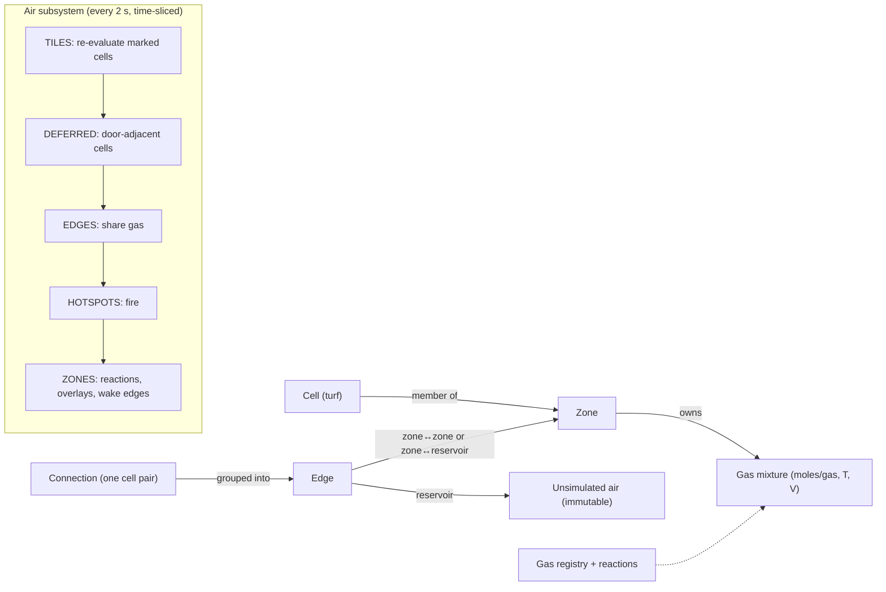

# vgstation13 ZAS core: design notes

> **Source:** vgstation13 `Bleeding-Edge` @ `23f25f386f` (2026-10-02). Paths are
> relative to the vgstation13 repo root. **Clean-room note:** this document
> describes behavior in prose and math only. No vgstation13 code is reproduced
> here or anywhere in zas-cubed (see the README's clean-room policy). Numeric
> constants are cited as facts.

## Implications for zas-cubed

- **The core is small and portable.** About 4k lines of DM under
  `code/modules/ZAS/` plus a 430-line controller in
  `code/controllers/subsystem/air.dm`. The concepts are cells, zones,
  connections, edges, gas mixtures, a gas registry, reactions, hotspots and
  airflow. All of them map onto a voxel world.
- **SS13 can mark which turfs are simulated; Minecraft can't.** In SS13 the map
  author decides which turfs are simulated (station floors) and which are not
  (space, planet surface). Minecraft has no such marking, so zas-cubed must
  derive it. The proposal: a cell is ambient unless it has been proven to be
  inside a bounded enclosure. A zone is only needed where the air differs from
  the ambient. This is the central adaptation (see §10).
- **Zone rebuilds don't scale as-is.** Any blockage inside a zone triggers a
  full O(zone size) rebuild. That's fine for SS13 rooms of 10²–10³ tiles but
  not for Minecraft stations of 10⁴–10⁵ blocks. Local split detection is
  needed before falling back to a rebuild.
- **Venting rate ignores volume.** Venting to vacuum loses a fixed fraction of
  the zone's air per tick, set only by the number of breach tiles (capped at
  6). A 50k-block station empties through one hole about as fast as a closet.
  "Faithful ZAS" keeps this, but it should be a documented and tunable choice.
- **vg has no heat conduction.** Zones never exchange heat with walls, with each
  other except by mixing gas, or with hot or cold surfaces. A Stefan–Boltzmann
  helper and two "insulation" settings exist but are dead code. Heat conduction
  (a first-release requirement) is therefore new design work.
- **vg's fire is built around fictional fuels.** Gas combustion is hard-wired to
  plasma and "volatile fuel". With real gases only, combustion has to become
  data-driven chemistry (H₂, CH₄, CO, ethene, and so on). The ZAS fire
  structure (hotspots, parcel burning, spread odds, O₂ cut-offs) can still be
  kept.
- **Doors show why zone-blocking matters.** Open doors let air flow but stop
  zones merging, so closing a door never forces a split. Minecraft doors,
  trapdoors, fence gates, airlocks and firelocks should get the same semantics.
- **Airflow is a scaling hazard.** Every active edge iterates every movable in
  both zones each tick. zas-cubed needs spatially indexed entity lookups and
  velocity impulses rather than tile stepping.

## 1. Architecture at a glance

| Concept | Role | Primary source |
|---|---|---|
| Cell (turf) | Unit of space; simulated or unsimulated | `code/modules/ZAS/Turf.dm` |
| Zone | Set of simulated cells sharing one perfectly mixed gas mixture | `Zone.dm` |
| Connection | One adjacency between a zoned cell and a neighbour cell | `Connection.dm` |
| Edge | All connections between the same pair of zones, or a zone and one reservoir composition | `ConnectionGroup.dm` |
| Gas mixture | Moles per gas, temperature, volume; ideal-gas thermodynamics | `_gas_mixture.dm` |
| Gas registry (XGM) | Per-gas constants and flags | `XGM.dm`, `XGM_gases.dm` |
| Reactions | Pluggable gas reactions scaled to available reactants | `XGM_reactions.dm`, `_gas_mixture.dm:532-576` |
| Hotspot | Fire on a cell; burns a parcel of zone air each tick | `Fire.dm:512-645` |
| Airflow | Knockdown, flinging, and impact damage from pressure differentials | `Airflow.dm`, `ConnectionGroup.dm:74-99` |
| Air subsystem | Scheduler, update queues, zone/edge lifecycle | `code/controllers/subsystem/air.dm` |

## 2. Data model

### 2.1 Gas mixture (`_gas_mixture.dm`)

- **State:** a sparse map of gas id → moles, plus temperature (K) and volume (L).
  Total moles and pressure are cached and recomputed after every mutation. Gases
  that reach zero are pruned (`_gas_mixture.dm:9-29, 235-251`).
- **Ideal gas law:** P = nRT/V with R = 8.314 kPa·L/(mol·K)
  (`__DEFINES/math_physics.dm:12`). One atmosphere is 101.325 kPa (`:13`).
- **Heat capacity:** C = Σ cᵢ·nᵢ, where cᵢ is the gas's specific heat in
  J/(mol·K), floored at 0.0003 J/K so an empty mixture never divides by zero
  (`_gas_mixture.dm:1, 167-173`).
- **Merging** keeps total thermal energy: T = (T₁C₁ + T₂C₂)/(C₁ + C₂), then the
  moles are added (`:97-111`). Adding a single gas at its own temperature uses
  the same rule, with a 0.5 K "don't bother" threshold (`:62-70`;
  `__DEFINES/atmos.dm:38`).
- **Removal:**
  - by moles: clamp to what's available, then remove that fraction (`:263-267`)
  - by ratio: each gas is reduced proportionally, and the removed parcel keeps
    the source temperature (`:271-291`)
  - by volume: equivalent to a ratio of removed volume over total volume
    (`:295-300`)
- **Per-unit-volume copy:** copy the composition and temperature, then rescale
  the moles to this mixture's own volume (`:324-332`). Zones use this to hand a
  cell its share of zone air.
- **Thermal energy:** adding or removing energy changes temperature by ΔE/C,
  never below a floor that defaults to the CMB temperature of 2.73 K
  (`:177-187`; `math_physics.dm:30`).
- **Equivalence test ("compare"):** two mixtures count as equal unless some
  quantity differs by more than an absolute threshold *and* a relative one
  (`:334-357`; `atmos.dm:30-41`). This test drives zone merging and edge
  sleeping.

  | Quantity | Absolute threshold | Relative threshold |
  |---|---|---|
  | Temperature | 4 K | 1.2 % |
  | Pressure | 0.1 kPa | 5 % |
  | Each gas's molar density | 5 % of standard-air molar density (≈0.0021 mol/L) | 5 % |

- **Unsimulated (reservoir) mixtures** are immutable. Every mutator is a no-op,
  and removal returns a copy without depleting the source (`:452-526`). This is
  how "space" and planet surfaces act as infinite reservoirs.
- **Standard air:** 21 % O₂ / 79 % N₂ at 101.325 kPa and 293.15 K. That's about
  103.93 mol per 2,500 L cell (`atmos.dm:1-16`). In Minecraft units, a 1,000 L
  block holds about 41.6 mol at standard conditions.

### 2.2 Gas registry (`XGM.dm`, `XGM_gases.dm`)

Each gas has an id, display name, short (formula) name, specific heat (J/(mol·K)),
molar mass (kg/mol), an optional tile overlay, a visibility threshold (mol/L),
flags (`NOTEWORTHY` for UI, `LOGGED` for admin logs), and a per-gas "safe for
humans" predicate (`XGM_gases.dm:1-21`). The registry is built once by
reflection over gas types (`XGM.dm:26-33`) and can be edited live by admins
(`XGM.dm:65-111`).

Real gases in vg's set, with vg's values next to real constant-volume molar heat
capacities near 300 K:

| Gas | vg specific heat | Real C_v (approx.) | vg molar mass | Source |
|---|---|---|---|---|
| O₂ | 20 | 21.1 | 0.032 | `XGM_gases.dm:23-33` |
| N₂ | 20 | 20.8 | 0.028 | `:35-45` |
| CO₂ | 30 | 28.9 | 0.044 | `:47-57` |
| N₂O | 40 | ≈30.4 | 0.044 | `:94-110` |
| Rn | 20 | 12.5 (monatomic) | 0.222 | `:189-200` |

vg's other gases (plasma, volatile fuel, oxygen agent B, cryotheum) are fictional
and **out of scope** for zas-cubed's built-in set. Real-gas constants should come
from reference data, not from vg.

### 2.3 Cells (`Turf.dm`, `Atom.dm`)

- **Simulated cells** carry a zone reference, a bitmask of open directions, a map
  of their connections, and a private gas mixture that's only used while the
  cell has no valid zone (`Turf.dm:1-9, 266-277, 292-295`).
- **Unsimulated cells** (space, planet surface) hold fixed per-gas values and a
  temperature. Reading their air yields a fresh immutable mixture
  (`Turf.dm:215-231`).
- **Blocking between two adjacent cells** has four outcomes, combined
  symmetrically from both sides (`air.dm:243-251`; `Atom.dm:23-60`):
  - *none*
  - *AIR_BLOCKED*: no gas passes
  - *ZONE_BLOCKED*: gas may pass, but the two sides must stay separate zones.
    Used by open doors and similar.
  - *BLOCKED*: both of the above

  Walls (`blocks_air`) are fully blocking. Objects on a cell (windows, doors)
  add their own blocking.
- **Vertical adjacency** in vg's multi-z only exists through "open space" cells
  (`Atom.dm:44-53`). Minecraft is natively 3D, so all six faces apply.

### 2.4 Zones (`Zone.dm`)

- **Zone air:** a zone is a set of simulated cells with one gas mixture whose
  volume is the sum of its cells' volumes (`Zone.dm:44-50, 74-90`).
- **Adding a cell** merges that cell's private air into the zone.
- **Removing a cell** first gives the cell a per-volume copy of zone air, then
  scales the zone's moles by (1 − V_cell/V_zone) (`:92-112`).
- **Merging** moves every cell of the smaller zone into the larger one and
  invalidates the smaller zone. Its edges are erased, and their cells are queued
  so the connections get rebuilt against the surviving zone (`:114-134`;
  `air.dm:261-274`).
- **Rebuilding** invalidates the zone and queues all its cells. Each cell keeps a
  per-volume copy of the old air, and the cells then regroup through normal cell
  updates. Connected remnants re-merge because their air is identical, while
  disconnected remnants become separate zones (`:146-157`; `Turf.dm:59-62`).
- **Zone tick** only runs for "dirty" zones: reactions, overlay thresholds,
  re-checking sleeping edges (`:174-185`). A zone becomes dirty whenever any
  code *reads* its air (`Turf.dm:266-270`), which is very pessimistic.
- **Hard-coded event hooks:** ice puddles, the list of burnable atoms, and
  registering for autoignition checks once the zone is at 500 K or above
  (`Zone.dm:236-285`; `__DEFINES/setup.dm:1187`).

### 2.5 Connections and edges (`Connection.dm`, `ConnectionGroup.dm`)

- **A connection** is one zoned cell A plus one neighbour B: a zoned cell of
  another zone, or an unsimulated cell. It carries two flags: *direct* (no door
  in between) and *space* (B is unsimulated) (`Connection.dm:1-75`).
- **An edge** aggregates every connection between the same pair of zones, or
  between a zone and one reservoir composition. It tracks:
  - `coefficient`: the number of connections
  - `direct`: how many of them are direct
  - `connecting_turfs`: used to aim airflow
  - a sleeping flag

  (`ConnectionGroup.dm:41-63, 101-127, 165-190`.)
- **Reservoir edges** are keyed by an exact match of O₂, N₂, plasma, CO₂ and
  temperature (`air.dm:398-411`). Other gases are ignored by that key, which is
  a latent bug for exotic ambients.
- **Re-validation:** after geometry changes, `Connection.update()` erases blocked
  connections, flips direct and indirect, and re-targets edges when either side
  changes zone (`Connection.dm:104-169`).

## 3. Control flow

The air subsystem runs every **2 seconds** (`air.dm:66`). Each run is
time-sliced across server ticks with a CPU budget check, and resumes where it
stopped (`air.dm:154-183`). The phases, in order (`air.dm:1-12, 187-228`):

1. **TILES:** queued cells re-evaluate their neighbours (§3.1). Cells whose own
   blocking is exactly ZONE_BLOCKED, such as door cells, are deferred.
2. **DEFERRED:** door cells update after the zones on both sides exist.
3. **EDGES:** every non-sleeping edge exchanges gas (§3.2).
4. **HOTSPOTS:** every fire processes (§4).
5. **ZONES:** dirty zones tick.

Other entry points:

- **Initialization** runs a cell update on every simulated cell. On cycle 0, all
  direct connections merge unconditionally (`air.dm:131-151, 296`).
- **Geometry changes** have a single entry point, `mark_for_update(cell)`. Any
  code that changes blocking calls it (`air.dm:324-334`; `Atom.dm:62-70`).
- **Autoignition** checks run in a separate "burnable" subsystem for zones at
  500 K or above (`code/controllers/subsystem/burnable.dm`).

### 3.1 Cell update algorithm (`Turf.dm:59-206`)

1. If the cell's zone was invalidated, copy the air locally and forget the zone.
2. If the cell itself now blocks air (a wall was built): remove just this cell
   when it's a door cell, which is cheap; otherwise rebuild the whole zone. Stop.
3. For each of the six directions:
   1. Skip neighbours whose shared face is AIR_BLOCKED.
   2. If a direction that was previously open is now blocked, and the
      neighbour is in *this* zone, the zone may have split: rebuild it and stop.
   3. Record the open directions.
4. Handle zoned neighbours:
   - **This cell has no zone yet:** join the neighbour's zone, unless the shared
     face is zone-blocked. If it is, postpone the neighbour.
   - **This cell already has a zone and the neighbour is in a different one:**
     `connect` the two.
5. Postpone unsimulated neighbours until this cell has a zone.
6. If the cell still has no zone, create a new zone containing it.
7. `connect` to every postponed neighbour.

`connect(A, B)` (`air.dm:277-321`) works as follows:

- **Blocked:** do nothing.
- **Both simulated, direct, and equivalent mixtures** (or this is the first
  cycle): merge the two zones.
- **Otherwise:** create one connection, register it on the matching edge, and
  mark it direct if no door separates the cells.

### 3.2 Edge exchange math

**Zone ↔ zone** (`ConnectionGroup.dm:128-152`; `_gas_mixture.dm:404-420`):

- **Sharing ratio:** r is looked up by connection count k:
  | k | 1 | 2 | 3 | 4 | 5 | ≥6 |
  |---|---|---|---|---|---|---|
  | r | 0.30 | 0.40 | 0.48 | 0.54 | 0.60 | 0.66 |
- **Exchange:** A gives up r·V_B/(V_A+V_B) of its gas and B gives up
  r·V_A/(V_A+V_B). Each then merges the other's parcel, which moves both
  mixtures toward the volume-weighted average.
- **Airflow:** if |P_A − P_B| is at least the lightest airflow threshold, run it
  for both zones, with opposite signs (§5).
- **Equivalent and directly connected:** erase the edge and merge the zones.
- **Equivalent but only through doors:** the edge sleeps, and *every* zone
  reachable through sleeping edges is instantly equalized to one combined
  mixture (`Zone.dm:159-172`; `code/game/machinery/ATMOSPHERICS/datum_pipe_network.dm:135-148`).

**Zone ↔ reservoir** (`ConnectionGroup.dm:192-208`; `_gas_mixture.dm:423-430`):

- **Temporary sharer:** build a sharer with volume V_s = V_res + V_zone +
  3·2,500 L and fill it with the reservoir composition, scaled to that volume.
  Then share with ratio r as above. The reservoir itself never changes.
- **When equivalent:** the zone air snaps exactly to the reservoir composition
  and the edge sleeps.
- **Consequence:** draining to vacuum loses a fraction
  f = r·V_s/(V_zone+V_s) of the zone's air per tick, where
  V_s = V_zone + 4·2,500 L. f ranges from about 0.83·r for a one-cell zone down
  to 0.5·r for large zones: about 15–25 % per 2 s tick through one breach and
  about 33–55 % through six or more. A large room loses half its air in roughly
  8 s through one hole, *whatever its volume*.

**Waking:** sleeping edges wake whenever a dirty zone ticks and its air no
longer compares equal (`Zone.dm:183-185`; `ConnectionGroup.dm:154-156, 210-215`).

## 4. Fire (`Fire.dm`)

- **Hotspots** are per-cell fire objects processed every air tick
  (`Fire.dm:512-645`). Each one:
  1. Checks whether it can keep burning. It goes out if the O₂ molar fraction
     is below 0.14 (plus or minus a small random jitter), or if there is less
     than about 1 mol of O₂ per cell (`:578-583`; `setup.dm:1154`).
  2. Exposes mobs, items and the cell itself to fire (`:597-609`).
  3. Spreads to open cardinal neighbours whose contents can burn. The
     probability rises with burn duration, √(T/293 K), fire level, and the
     presence of liquid fuel. Extinguisher foam and recent extinguishing block
     the spread (`:611-635`).
  4. Removes a parcel of zone air (0.75 × cell volume with the example
     config), burns it, and merges it back. This caps how fast any single
     hotspot consumes a zone (`:636-645`).
- **Gas combustion ("zburn")** only covers plasma and volatile fuel, above
  100 °C unless forced (`:672-751`; `atmos.dm:71-74`).
  - **Fire level** = multiplier × mix factor × dilution factor. The mix factor
    peaks at the ideal fuel-to-O₂ ratio, and the dilution factor falls as
    inert N₂ and CO₂ increase (`:806-823`).
  - **Consumption:** up to 2 mol of O₂ per mol of fuel. CO₂ produced is 2 × the
    fuel burned.
  - **Heat release** is 2 MJ per mol of fuel (from config). The new
    temperature is (starting energy + released energy)/C.
- **Solid fuels** use "thermal materials": wood, plastic, fabric, wax and
  biological. Each has an autoignition temperature, heating value, molecular
  weight, fuel-to-oxidizer ratio and flame temperature (`:38-74`).
  - Burn rate ∝ (x_O₂/0.14)·(T/293 K).
  - Burned mass becomes heat, consumed O₂, and an equal number of moles of
    CO₂, at efficiency (1 − T/T_flame).
  - Objects turn to ash when their mass runs out (`:169-236`).
- **Autoignition:** zones at 500 K or above check their flammable atoms. An atom
  ignites with 50 % probability when T is at or above its autoignition
  temperature, the O₂ fraction is at least 0.14, and there is at least 1 mol of
  O₂ per cell (`:348-367`).
- **Implication:** keep the *structure* (hotspots, parcel burning, spread odds,
  O₂ cut-offs, solid-fuel material model). Replace the fuel chemistry with
  data-driven real reactions: stoichiometry, enthalpy of combustion, ignition
  temperature, flammability limits. Minecraft's own fire block, and block and
  item flammability, are natural hotspot and solid-fuel analogues.

## 5. Airflow (`Airflow.dm`; `ConnectionGroup.dm:74-99`)

- **Trigger:** an active edge whose post-share pressure differential ΔP (kPa) is
  at least the *lightest* threshold. Thresholds are compared directly in kPa;
  the settings call them "% of 1 atm".
- **For every movable in both zones:**
  - **Mobs:** knocked down when ΔP exceeds the stun threshold, at most once per
    cooldown. Magboots and being grabbed prevent it (`Airflow.dm:42-82, 87-103`).
  - **Objects:** flung toward the breach (or away from it, for the
    higher-pressure side) when ΔP clears the object's weight-class threshold:
    | Object | Threshold |
    |---|---|
    | Tiny items | always |
    | Small items | ≥ 20 kPa |
    | Medium items | ≥ 35 kPa |
    | Large items | ≥ 50 kPa |
    | Mobs | ≥ 65 kPa |
    | Dense objects | ≥ 85 kPa |

    (`Airflow.dm:84-130`). The target is a random connecting cell within view.
  - **Flight:** speed ∝ ΔP/10, scaled by a distance falloff (max about 9 tiles),
    decaying by 1.5 per step (`:137-210`).
  - **Impacts** deal speed × damage factor (2) brute damage, spread over head,
    chest and groin and reduced by melee armour. They also stun or paralyse in
    proportion to speed (`:212-269`).
- **Cosmetic dust motes** are drawn on up to 20 cells per tick
  (`Zone.dm:287-318`; `setup.dm:2038`).
- **Server cost:** the code default *disables* pushing and its own description
  calls it a server killer (`NewSettings.dm:157-161`). The example config
  enables it (`config-example/ZAS.txt`).
- **Implication:** in zas-cubed, apply velocity impulses toward or away from the
  nearest edge face rather than stepping entities tile by tile. Find entities
  with spatial queries bounded to the zone, cap the work per tick, and expose
  armour and "magboot"-style resistance through the API.

## 6. Heat

- **How zone temperature changes:** only through gas mixing, reactions and fire,
  and devices such as thermomachines and heat-exchange pipes.
- **Dead code:** a Stefan–Boltzmann-style heat-sharing helper is defined but
  never called (`ConnectionGroup.dm:217-227`). The "connection insulation" and
  "connection temperature delta" settings are declared but never read
  (`NewSettings.dm:163-173`).
- **Unused turf properties:** turfs declare heat capacity and thermal
  conductivity (`code/game/turfs/simulated/walls.dm:12`; `floor.dm:32-33`). The
  only consumer is pipeline↔turf heat exchange for heat-exchange pipes
  (`code/game/machinery/ATMOSPHERICS/datum_pipeline.dm:172-230`).
- **Space coldness:** space cells sit at 2.73 K, so a zone venting to space only
  cools by exchanging gas with it. A config flag can disable even that
  (`NewSettings.dm`, `space_isnt_cold`).
- **Implication:** zas-cubed's first-release heat conduction has no vg precedent
  beyond the heat-exchange pipe formula. It needs its own design and
  requirements:
  - zone ↔ boundary blocks
  - zone ↔ ambient through walls
  - hot and cold blocks (lava, magma, ice)
  - machines
  - radiative loss to space

## 7. Tunables (`config-example/ZAS.txt`, `NewSettings.dm`)

| Setting | Example config | Meaning |
|---|---|---|
| `fire_consumption_rate` | 0.75 | Cell-volumes of zone air each hotspot burns per tick |
| `fire_firelevel_multiplier` | 25 | Scales fire level, mostly affecting extinguishing |
| `fire_fuel_energy_release` | 2,000,000 | J per mol of gaseous fuel burned |
| `fire_heat_generation` / `mass_consumption` / `oxygen_consumption` / `spread_rate` | code defaults 1.45 / 0.25 / 0.025 / 3 | Solid-fuel and spread tuning |
| `airflow_{lightest,light,medium,heavy,dense}_pressure` | 20 / 35 / 50 / 65 / 85 | ΔP thresholds (kPa) to move tiny → dense objects; "heavy" applies to mobs |
| `airflow_stun_pressure` / `_cooldown` / `airflow_stun` | 60 / 6 s / 1 | Mob knockdown |
| `airflow_damage` / `speed_decay` / `delay` / `mob_slowdown` | 2 / 1.5 / 3 s / 0.1 s | Impact and flight tuning |
| `airflow_push` | 1 (code default 0) | Global airflow-push toggle |
| `ice_formation`, `space_isnt_cold`, plasma contamination flags | various | vg-specific or fictional-gas features |

## 8. Debug tooling

- **Admin verbs** dump a zone's composition, pressure, volume, temperature and
  edge counts, and test the connection between two cells
  (`Diagnostic.dm:1-73`; `Zone.dm:209-234`).
- **Compile-time debug modes** overlay cell states (`Debug.dm`; `ZAS.dm:1`) or
  colour each zone randomly (`Zone.dm:39-42`).
- **The subsystem status line** reports the average cost of each phase and the
  counts of zones, edges and queued items (`air.dm:104-128`).
- **Implication:** zas-cubed should ship equivalents from day one: commands, a
  zone-colouring debug renderer, and per-phase profiling.

## 9. Quirks: don't replicate blindly

1. **Full zone rebuild** on any interior blockage. This is O(n) in zone size
   (`Turf.dm:130-136`).
2. **Zones are marked dirty on every air read**, which wastes zone ticks
   (`Turf.dm:266-270`).
3. **The reservoir edge key ignores most gases** (`air.dm:398-411`).
4. **Reservoir air is snapshotted when an edge is created**
   (`ConnectionGroup.dm:169-175`). A dynamic ambient, such as day/night
   temperature on a planet, would go stale.
5. **Venting rate ignores volume** (§3.2). It's an intentional gameplay shape,
   but it should be explicit and configurable.
6. **Instant equalization across door-separated zone networks** (§3.2). It's
   cheap, but it can cause visible pressure jumps.
7. **Over-subscribed reactions** are all scaled by one global worst ratio, even
   reactions that don't share reactants. A TODO in the code admits this
   (`_gas_mixture.dm:551-569`).
8. **"1 mol per tile" fire rules** are unit hacks tied to the 2,500 L cell
   (`Fire.dm:203, 364, 484`).
9. **Airflow iterates every movable in each zone** on every active edge
   (`Airflow.dm:271-276`).

## 10. Mapping ZAS concepts to Minecraft (draft, for requirements discussion)

| ZAS | Proposed zas-cubed analogue |
|---|---|
| Turf (2.5 m³) | **Cell** = block position. 1 m³ = 1,000 L, or less for partial blocks |
| Simulated vs. unsimulated turf | **Zoned** cell vs. **unzoned** cell. Unzoned cells take the ambient by definition |
| Space/planet turf gas values | **Per-dimension ambient atmosphere**, data-driven, plus an API provider hook |
| `blocks_air` / AIR_BLOCKED | Per-BlockState **face seal mask**, derived from the collision shape plus tag/datapack overrides and an API for dynamic blocks |
| ZONE_BLOCKED (doors) | **Zone-boundary blocks**: doors, trapdoors, fence gates, airlocks, firelocks |
| Open-space multi-z | Native 3D, six faces |
| Air subsystem, 2 s period, time-sliced | Server-side atmos scheduler. Configurable period and per-tick CPU budget; phases mirror §3 |
| `mark_for_update` | One block-change hook covering every `setBlock` path; ignores changes far from any zone |
| Hotspot object | Fire block or gas-fire cell state |
| Airflow tile stepping | Velocity impulses on entities, found with spatial queries |
| XGM gas datums | **Data-driven gas registry** with real constants |
| Gas reaction datums | **Data-driven reactions**, plus a code hook for complex ones |

**The central adaptation, "a zone only where air differs from ambient":**

- **Queries:** a cell with no zone reports the dimension ambient. That's correct
  both for open air and for a never-touched sealed room, whose air *is* ambient.
- **Creating zones:** a zone is created only when something changes a region's
  gas: a vent or leak, venting machines, or a breach of an existing zone. The
  trigger runs a bounded flood fill to prove the region is enclosed.
  - **Enclosed:** create a zone seeded with ambient air, then apply the change.
  - **Not enclosed:** the change goes to the ambient reservoir.
- **Garbage collection:** a zone that has re-equalized with ambient and has no
  persistent attachments can be dissolved.
- **Breaches** connect a zone to the unzoned cells beyond it. A bounded fill
  classifies those cells:
  - an enclosed pocket joins the zone
  - otherwise the opening becomes a reservoir edge to the ambient

  Fast paths: sky exposure or heightmaps, and cached classifications.
- **Cost:** block changes far from any zone cost nothing. Total work scales with
  zoned volume, not world size.
